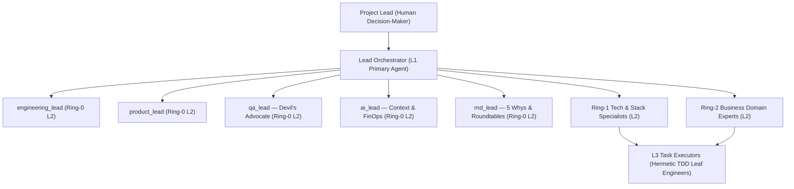

# 🏛️ Agentic System OS (`v1.0.0`)

> **Package:** `@stequar/agentic-system-os` | **CLI Binary:** `agentic-os` *(alias: `agentic-company`)*

**Enterprise-Grade Multi-Agent Software Engineering Orchestrator** with **Tri-Ring Domain Ontology**, **Cognitive Forcing Functions (`CFF-1..5`)**, **Neuro-Symbolic Formal AST Verification**, **Hardware-Adaptive Local SLM Swarm**, and native compatibility with **Anthropic Claude Code** and **OpenAI Codex**.

---

## ✨ Key Capabilities

1. **Professional Engineering Taxonomy (`Project Lead` & `Lead Orchestrator L1`):**
   - Replaces gimmicky role-play with an engineering-native command structure: you act as the **Project Lead** (Human Decision-Maker) and your primary coding agent acts as the **Lead Orchestrator (L1)** coordinating **Ring-0 Core Leads**, **Ring-1 Stack Specialists**, **Ring-2 Business Domain Experts**, and **L3 Leaf Task Executors**.
   - Configurable in `.company-os/settings.json` (`communication.personaPreset: "ENGINEERING_PROFESSIONAL" | "STARTUP_EXECUTIVE"`).
2. **Native Dual-Harness Support (**Claude Code** & **OpenAI Codex**):**
   - Automatically generates and synchronizes:
     - **`CLAUDE.md`** + **`.claude/commands/*.md`** + **`.mcp.json`** for **Anthropic Claude Code**.
     - **`AGENTS.md`** + **`.agents/skills/*/SKILL.md`** for **OpenAI Codex**, **Cursor**, and **Antigravity**.
3. **5-Phase Holistic Brownfield Bootstrap (`P0..P4`):**
   - Non-destructive AST section grafting (`<!-- AGENTIC-OS:MANAGED:START/END -->`) that preserves 100% of existing repository documentation (`Zero Dark-Memory`), mines bounded contexts from your codebase, and synthesizes custom Ring-2 Domain Experts.
4. **5 Deterministic Cognitive Forcing Functions (`CFF-1..5`):**
   - **`CFF-1..4` (Stop-the-Line RCA Gate):** Blocks premature code edits on bugs/anomalies until a 5-Whys Root Cause Analysis (`fiveWhys.length >= 3`) and Multi-Ring Devil's Advocate review are approved by the **Project Lead**.
   - **`CFF-5` (Configurable Spike Checkpoint Gate):** Toggle `governance.spikeCheckpoint` between `"HITL_SPIKE_REVIEW"` (pauses after technical Spikes for human review) and `"AUTONOMOUS_FAST_TRACK"` (proceeds directly to implementation).
5. **Deterministic Gatekeeper & Neuro-Symbolic AST Prover:**
   - Enforces the **Test Preservation Invariant** (blocks any patch that deletes or comments out tests/assertions), proves Hoare logic `{P} C {Q}` AST invariants (`division_by_zero_guard`, `non_null_dereference`, `array_index_bounds`), and triggers an atomic SHA-256 rollback + Incident War Room if Self-Healing fails 3/3 retries.
6. **Karpathy "Context as RAM" & Hardware-Adaptive Local SLM Swarm:**
   - Treats the LLM context window as finite volatile RAM and `docs/wiki/INDEX.md` as persistent disk.
   - Automatically profiles host RAM/VRAM (`LOW_RESOURCE_BYPASS`, `COMPACT_EDGE`, `BALANCED_PRO`, `WORKSTATION_ULTRA`) and discovers installed local models (`Qwen3-Coder`, `Gemma 3`, `Phi-4-Mini`) via Ollama/llama.cpp.

---

## 🏗️ Architecture & Tri-Ring Hierarchy



---

## 🚀 Installing & Testing on Another Machine (Private GitHub Repository Guide)

To push this library to a **private GitHub repository** and test it on a second machine with **Claude Code** or **OpenAI Codex**, follow these steps:

### Step 1: Push to Your Private GitHub Repository (Current Machine)
```bash
git remote add origin https://github.com/stequar/agentic_system_os.git
git push -u origin main
```

### Step 2: Install on Your Second Machine
On the target machine (macOS / Linux / Windows with **Node.js >= 20** and **Git**):

**Option A — Clone & Global Link (Recommended for active testing & tweaking):**
```bash
git clone https://github.com/stequar/agentic_system_os.git agentic-system-os
cd agentic-system-os
npm install
npm run build
npm link
```

**Option B — Direct Global Install from Private Git URL:**
```bash
npm install -g git+https://github.com/stequar/agentic_system_os.git
# or via SSH:
npm install -g git+ssh://git@github.com:stequar/agentic_system_os.git
```

Verify the CLI binary is available globally (`agentic-os` or alias `agentic-company`):
```bash
agentic-os --version
agentic-os doctor
```

---

## 🤖 Using with **Claude Code** & **OpenAI Codex** on Any Project

Once `agentic-os` is installed on your machine, navigate to any new or existing project (Python, TypeScript, Swift, Go, Rust, etc.) and run the **5-Phase Holistic Bootstrap**:

```bash
cd /path/to/your-target-project

# 1. Run 5-Phase Holistic Bootstrap (generates AGENTS.md, CLAUDE.md, .claude/commands/*, .mcp.json, .company-os/*, docs/wiki/*)
agentic-os bootstrap .

# 2. (Optional) Re-sync Claude Code & Codex harnesses at any time
agentic-os workflow setup-harnesses .
```

### 1. Running with **Anthropic Claude Code**
When you run `claude` inside `/path/to/your-target-project`:
- **Auto-Loaded Governance (`CLAUDE.md`):** Claude Code automatically loads `CLAUDE.md` at startup and adopts the **Lead Orchestrator (L1)** persona.
- **Auto-Discovered MCP Server (`.mcp.json`):** Claude Code automatically detects `.mcp.json` and connects to `agentic-company mcp` over stdio, gaining access to:
  - `inspect_stack`, `run_gatekeeper`, `run_doctor`
  - `prove_ast_invariants` (Neuro-Symbolic Formal Prover)
  - `dispatch_quad_tier_inference` (Hardware-Adaptive Local SLM Swarm)
  - `run_chaos_experiment` (Ephemeral Chaos Arena)
  - `execute_voice_command`
- **Built-in Slash Commands (`.claude/commands/`):** Inside Claude Code, type:
  - `/run-company` — Start Mode 1 Daily Standup & Tri-Ring synchronization
  - `/investigate-anomaly <scope>` — Start Mode 2 Stop-the-Line Read-Only 5-Whys RCA
  - `/rnd-roundtable` — Start Mode 3 Multi-Agent Consensus Roundtable with Devil's Advocate
  - `/gatekeeper-audit` — Start Mode 4 Build Execution & Deterministic Gatekeeper verification

### 2. Running with **OpenAI Codex CLI**
When you run `codex` inside `/path/to/your-target-project`:
- **Auto-Loaded Hierarchy (`AGENTS.md`):** Codex natively reads `AGENTS.md` and `.agents/skills/*/SKILL.md`.
- **Dual-Brain CLI Bridge:** Codex uses `agentic-company workflow status --json`, `agentic-company workflow route --scope <files> --json`, and `agentic-company workflow verify-gate --json` to enforce all Cognitive Forcing Functions (`CFF-1..5`).

---

## ⚙️ Central Settings Configuration (`.company-os/settings.json`)

All runtime switches live in `.company-os/settings.json` and are strictly validated with Zod.
See the full manual in [`docs/wiki/engineering/settings-reference.md`](docs/wiki/engineering/settings-reference.md).

### Inspect or Update Settings via CLI
```bash
# View current settings + complete catalog of allowed values
agentic-company workflow settings --json

# Toggle Spike Checkpoint Gate (CFF-5) between interactive review and autonomous fast-track
agentic-company workflow set-setting --key governance.spikeCheckpoint --value AUTONOMOUS_FAST_TRACK
agentic-company workflow set-setting --key governance.spikeCheckpoint --value HITL_SPIKE_REVIEW

# Switch persona naming preset (ENGINEERING_PROFESSIONAL vs STARTUP_EXECUTIVE)
agentic-company workflow set-setting --key communication.personaPreset --value ENGINEERING_PROFESSIONAL

# Switch primary language ('en' or 'it')
agentic-company workflow set-setting --key communication.language --value en

# Run the automated 4-scenario multi-workspace Settings Evaluation Suite
agentic-company workflow eval-settings
```

### Complete Settings Reference Table

| Setting Key (`--key`) | Type | Default | Allowed Values | Description |
| :--- | :---: | :---: | :--- | :--- |
| `governance.spikeCheckpoint` | `enum` | `"HITL_SPIKE_REVIEW"` | `"HITL_SPIKE_REVIEW"` \| `"AUTONOMOUS_FAST_TRACK"` | **`CFF-5`**: Pause after Spike for Project Lead approval vs proceed directly to build. |
| `governance.anomalyGate` | `enum` | `"STRICT_CFF_4_GATES"` | `"STRICT_CFF_4_GATES"` \| `"ADVISORY"` | **`CFF-1..4`**: Mandatory Stop-the-Line 5-Whys RCA on bugs vs advisory warning. |
| `governance.releaseApproval` | `enum` | `"CEO_MANDATORY"` | `"CEO_MANDATORY"` \| `"GATEKEEPER_AUTO"` | Require explicit human approval before release vs auto-approve on 100% green Gatekeeper. |
| `governance.roundtableDevilsAdvocate` | `boolean` | `true` | `true` \| `false` | Mandate `qa_lead` and Ring-2 Experts as Devil's Advocate in R&D Roundtables. |
| `localSlm.mode` | `enum` | `"AUTO_HARDWARE_ADAPTIVE"` | `"AUTO_HARDWARE_ADAPTIVE"` \| `"FORCE_ENABLED"` \| `"DISABLED_CLOUD_ONLY"` | Controls Tier-0 Local SLM Swarm routing and low-RAM hardware bypass. |
| `localSlm.preferredModelOverride` | `string\|null` | `null` | `null`, `"qwen3-coder:30b-a3b-q4_K_M"`, `"qwen3:8b-q4_K_M"`, `"gemma3:12b-it-qat"`, `"phi4-mini:3.8b-q4_K_M"` | Explicit Ollama model override; when `null`, auto-selects best installed/recommended model. |
| `localSlm.ollamaEndpoint` | `string` | `"http://127.0.0.1:11434"` | Any valid HTTP URL | Local loopback endpoint for Ollama or OpenAI-compatible SLM server. |
| `localSlm.slaTimeoutMs` | `number` | `800` | `100` .. `10000` | Max latency in ms before circuit-breaking local SLM to deterministic fallback. |
| `gatekeeper.enableFormalAstProver` | `boolean` | `true` | `true` \| `false` | Enables Neuro-Symbolic Hoare Logic `{P} C {Q}` AST verification in Gatekeeper. |
| `gatekeeper.formalProverTimeoutMs` | `number` | `500` | `50` .. `5000` | Max solver timeout in ms for the Formal AST Prover. |
| `gatekeeper.selfHealingMaxRetries` | `number` | `3` | `1` .. `5` | Max autonomous Self-Healing iterations before escalating to Incident War Room. |
| `gatekeeper.enableWarRoomCircuitBreaker` | `boolean` | `true` | `true` \| `false` | Triggers atomic SHA-256 rollback when Self-Healing exhausts retries. |
| `gatekeeper.useTiaTargetedTests` | `boolean` | `true` | `true` \| `false` | Uses Test Impact Analysis (TIA) AST dependency graph for sub-500ms inner-loop tests. |
| `communication.personaPreset` | `enum` | `"ENGINEERING_PROFESSIONAL"` | `"ENGINEERING_PROFESSIONAL"` \| `"STARTUP_EXECUTIVE"` | Naming preset: `Project Lead` & `Lead Orchestrator (L1)` vs `CEO` & `CTO`. |
| `communication.language` | `enum` | `"en"` | `"en"` \| `"it"` | Primary language for orchestrator communication and generated instructions. |
| `communication.cavemanMode` | `boolean` | `true` | `true` \| `false` | Ultra-Terse Caveman Compression (`[CAVEMAN-RPC]`) on internal agent-to-agent handoffs. |
| `communication.greetingRule3Options` | `boolean` | `true` | `true` \| `false` | Present the 3 operational options at session startup. |
| `finops.maxSessionBudgetUsd` | `number` | `5.0` | `> 0` (e.g. `1.0`, `5.0`, `25.0`) | Max session token budget in USD monitored by `BudgetWatchdog`. |
| `finops.safePauseOnBudgetExceeded` | `boolean` | `true` | `true` \| `false` | Triggers cooperative `SAFE_PAUSED` when 100% of session budget is reached. |
| `finops.enableTwoTierPromptCache` | `boolean` | `true` | `true` \| `false` | Enables Two-Tier Prompt Prefix Caching (Static System Prefix + Wiki Digest). |

---

## 🛠️ CLI Command Reference

| Command | Description |
| :--- | :--- |
| `agentic-company init [path]` | Interactive wizard to initialize a new repository (`--yes` for headless mode). |
| `agentic-company inspect <path>` | Detect languages, frameworks, package managers, and hermetic test runners (`--json`). |
| `agentic-company bootstrap [path]` | Execute the 5-Phase Holistic Workspace Bootstrap (`P0..P4`) + Claude Code & Codex harnesses. |
| `agentic-company attach <path>` | Inject `AGENTS.md`, `.agents/skills/`, and `docs/wiki/` with Smart-Merge (`--dry-run`). |
| `agentic-company workflow status [path]` | Inspect active Orchestrator Mode, Tri-Ring specialists, Formal Prover, Local SLM tier, and Settings. |
| `agentic-company workflow route --scope <files>` | Resolve Ring-1 Tech Specialists and Ring-2 Domain Experts + invariants for a file scope. |
| `agentic-company workflow verify-gate` | Verify Cognitive Forcing Functions (`CFF-1..5`) before transitioning to `MODE_4_BUILD_GATEKEEPER`. |
| `agentic-company workflow settings` | Display active `.company-os/settings.json` and the complete `SETTINGS_REFERENCE_CATALOG`. |
| `agentic-company workflow set-setting --key <k> --value <v>` | Atomically update and validate a setting in `.company-os/settings.json`. |
| `agentic-company workflow eval-settings` | Run the 4-scenario multi-workspace Settings Behavioral Evaluation Suite (`S1..S5`). |
| `agentic-company workflow setup-harnesses [path]` | Generate/update `CLAUDE.md`, `.claude/commands/*.md`, and `.mcp.json` for Claude Code & Codex. |
| `agentic-company doctor [path]` | Run parallel diagnostics on local toolchains (`git`, `python3`, `.venv`, `swiftc`, `docker`). |
| `agentic-company studio` | Launch the zero-dependency Local Web Studio Dashboard & Spatial Canvas on `http://127.0.0.1:4321`. |
| `agentic-company mcp` | Start the Model Context Protocol (MCP) Server over stdio. |

---

## 🧪 Verification & Quality Suites

```bash
# Run strict TypeScript typechecking
npm run typecheck

# Run all 62 Vitest suites (unit, integration, formal prover, chaos arena, workflow & settings evals)
npm test

# Compile production build to dist/
npm run build
```

## 📄 License

Released under the [MIT License](LICENSE).
