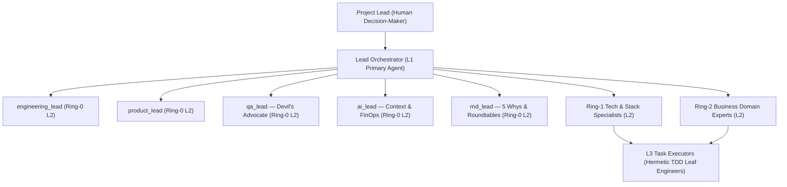

# 🏛️ Agentic System OS (`v1.0.0`)

> **Package:** `@stequar/agentic-system-os` | **CLI Binary:** `agentic-os` *(alias: `agentic-company`)*

A **multi-agent software-engineering orchestrator** with a **Tri-Ring domain ontology**, typed **Zod contracts** end-to-end, **Cognitive Forcing Functions (`CFF-1..5`)**, a **deterministic Gatekeeper** (regex diff-guard + heuristic static scanner + self-healing loop), **Karpathy "Context-as-RAM"** state, and native support for **Anthropic Claude Code** and **OpenAI Codex**.

> **Capability honesty:** this project names things for what they *are*. The Gatekeeper's code analysis is a **heuristic, regex-based static scanner** — not a formal/SMT prover. The local-model layer **profiles your hardware and can route to a local Ollama model**, but falls back to a **deterministic in-process stub** when no model is invoked. Simulated/heuristic subsystems are labelled as such in their output (`scanEngine: "PATTERN_HEURISTIC"`, `simulated: true`). See [Evaluation & Honesty](#-evaluation--honesty).

---

## ✨ Key Capabilities

1. **Professional Engineering Taxonomy (`Project Lead` & `Lead Orchestrator L1`):**
   - An engineering-native command structure: you act as the **Project Lead** (Human Decision-Maker); your primary coding agent acts as the **Lead Orchestrator (L1)** coordinating **Ring-0 Core Leads**, **Ring-1 Stack Specialists**, **Ring-2 Business Domain Experts**, and **L3 Leaf Task Executors**.
   - Configurable in `.company-os/settings.json` (`communication.personaPreset: "ENGINEERING_PROFESSIONAL" | "STARTUP_EXECUTIVE"`).
2. **Native Dual-Harness Support (Claude Code & OpenAI Codex):**
   - Generates and synchronizes **`CLAUDE.md`** + **`.claude/commands/*.md`** + **`.mcp.json`** (Anthropic Claude Code), and **`AGENTS.md`** + **`.agents/skills/*/SKILL.md`** (OpenAI Codex, Cursor, Antigravity).
3. **Non-Destructive Brownfield Bootstrap (`P0..P4`):**
   - Managed sentinel-block grafting (`<!-- AGENTIC-OS:MANAGED:START/END -->`) that **preserves your existing content** — user source files are never touched, and managed docs are **backed up to `.bak` before any update**. Mines bounded contexts from your codebase and synthesizes Ring-2 Domain Experts.
4. **5 Deterministic Cognitive Forcing Functions (`CFF-1..5`):**
   - **`CFF-1..4` (Stop-the-Line RCA Gate):** blocks premature code edits on bugs/anomalies until a 5-Whys Root Cause Analysis (`fiveWhys.length >= 3`) and a mandatory Devil's-Advocate review are approved by the **Project Lead**.
   - **`CFF-5` (Configurable Spike Checkpoint Gate):** toggle `governance.spikeCheckpoint` between `"HITL_SPIKE_REVIEW"` and `"AUTONOMOUS_FAST_TRACK"`.
5. **Deterministic Gatekeeper & Heuristic Static Scanner:**
   - **Regex Diff Guard** enforces the **Test Preservation Invariant** (blocks any patch that deletes/comments out tests or assertions) and **Scope Enforcement** (no out-of-scope file writes).
   - **Heuristic static scanner** flags risk patterns via regex over source text (`division_by_zero_guard`, `non_null_dereference`, `array_index_bounds`) and emits a best-effort executable counterexample. *Heuristic, not a formal proof.*
   - **Self-healing loop** with a bounded retry count and an atomic snapshot rollback on exhaustion.
6. **Karpathy "Context-as-RAM" & Hardware-Adaptive Model Routing:**
   - Treats the LLM context window as finite volatile RAM and `docs/wiki/INDEX.md` as persistent disk.
   - Profiles host RAM (`LOW_RESOURCE_BYPASS`, `COMPACT_EDGE`, `BALANCED_PRO`, `WORKSTATION_ULTRA`) and discovers installed local models (`Qwen3`, `Gemma 3`, `Phi-4`) via Ollama's loopback API. When no local model is invoked, Tier-1 falls back to a deterministic in-process stub (`executionMode` / `simulated` flags make this explicit).

---

## 🏗️ Architecture & Tri-Ring Hierarchy



---

## 🚀 Install & Run (Zero-Clone `npx`)

You do **not** need to clone this repo on target machines. Run it inside any project via **`npx`** or a global install.

### Option 1 — Zero-Clone `npx` (Recommended)
```bash
cd /path/to/your-target-project

# Run the 5-Phase Holistic Bootstrap directly from GitHub (no clone required)
npx --yes github:stequar/agentic_system_os bootstrap .
```
What happens automatically:
1. Generates **`CLAUDE.md`**, **`.claude/commands/*.md`**, **`.mcp.json`** (Anthropic Claude Code).
2. Generates **`AGENTS.md`**, **`.agents/skills/*/SKILL.md`** (OpenAI Codex, Antigravity, Cursor).
3. Creates a **fast local CLI shim (`.company-os/bin/agentic-os.mjs`)** pointing at the cached runtime so subsequent commands run locally with no network roundtrip:
   ```bash
   node .company-os/bin/agentic-os.mjs workflow status
   node .company-os/bin/agentic-os.mjs workflow settings
   ```

> **Tip:** attach/bootstrap are non-destructive, but commit or stash your working tree first so the generated managed blocks land as a clean, reviewable diff.

### Option 2 — Global Install from GitHub
```bash
npm install -g github:stequar/agentic_system_os
agentic-os --version
agentic-os doctor
```

---

## 🤖 Using with Claude Code, OpenAI Codex & Antigravity

After bootstrapping (`npx --yes github:stequar/agentic_system_os bootstrap .`):

```bash
cd /path/to/your-target-project
# Re-sync Claude Code & Codex harnesses at any time
node .company-os/bin/agentic-os.mjs workflow setup-harnesses .
```

### 1. Anthropic Claude Code
- **Auto-loaded governance (`CLAUDE.md`):** Claude Code loads `CLAUDE.md` at startup and adopts the **Lead Orchestrator (L1)** persona.
- **Auto-discovered MCP server (`.mcp.json`):** connects to `agentic-company mcp` over stdio, exposing:
  - `inspect_stack`, `run_gatekeeper`, `run_doctor`
  - `scan_code_heuristics` (regex-based heuristic code scan — *not* a formal prover)
  - `dispatch_quad_tier_inference` (hardware-adaptive routing; local-model or deterministic fallback)
  - `run_chaos_experiment` (deterministic in-process resilience simulation in an ephemeral arena)
  - `execute_voice_command`
- **Slash commands (`.claude/commands/`):** `/run-company`, `/investigate-anomaly <scope>`, `/rnd-roundtable`, `/gatekeeper-audit`.

### 2. OpenAI Codex CLI
- **Auto-loaded hierarchy (`AGENTS.md`):** Codex reads `AGENTS.md` and `.agents/skills/*/SKILL.md`.
- **Dual-Brain CLI bridge:** `agentic-company workflow status --json`, `… route --scope <files> --json`, `… verify-gate --json` enforce the Cognitive Forcing Functions.

---

## ⚙️ Settings (`.company-os/settings.json`)

All runtime switches live in `.company-os/settings.json` and are validated with Zod. Full manual: [`docs/wiki/engineering/settings-reference.md`](docs/wiki/engineering/settings-reference.md).

```bash
agentic-company workflow settings --json
agentic-company workflow set-setting --key governance.spikeCheckpoint --value AUTONOMOUS_FAST_TRACK
agentic-company workflow set-setting --key communication.language --value en
```

| Setting Key (`--key`) | Type | Default | Description |
| :--- | :---: | :---: | :--- |
| `governance.spikeCheckpoint` | `enum` | `"HITL_SPIKE_REVIEW"` | **`CFF-5`**: pause after Spike for Project Lead approval vs proceed to build (`AUTONOMOUS_FAST_TRACK`). |
| `governance.anomalyGate` | `enum` | `"STRICT_CFF_4_GATES"` | **`CFF-1..4`**: mandatory Stop-the-Line 5-Whys RCA on bugs vs `ADVISORY`. |
| `governance.releaseApproval` | `enum` | `"CEO_MANDATORY"` | Require human approval before release vs `GATEKEEPER_AUTO`. |
| `governance.roundtableDevilsAdvocate` | `boolean` | `true` | Mandate `qa_lead` as Devil's Advocate in roundtables (structurally enforced for architecture reviews). |
| `localSlm.mode` | `enum` | `"AUTO_HARDWARE_ADAPTIVE"` | Local-model routing: `AUTO_HARDWARE_ADAPTIVE` \| `FORCE_ENABLED` \| `DISABLED_CLOUD_ONLY`. |
| `localSlm.preferredModelOverride` | `string\|null` | `null` | Explicit Ollama model override; `null` auto-selects the best installed/recommended model. |
| `localSlm.ollamaEndpoint` | `string` | `"http://127.0.0.1:11434"` | Strict-loopback endpoint for Ollama / OpenAI-compatible server. |
| `localSlm.slaTimeoutMs` | `number` | `800` | Max latency (ms) before circuit-breaking local inference to deterministic fallback. |
| `gatekeeper.enableHeuristicScanner` | `boolean` | `true` | Enables the regex-based heuristic static scanner in the Gatekeeper (*not* a formal SMT prover). |
| `gatekeeper.heuristicScannerTimeoutMs` | `number` | `500` | Max execution time (ms) for the heuristic static scanner. |
| `gatekeeper.selfHealingMaxRetries` | `number` | `3` | Max autonomous self-healing iterations before escalating to the Incident War Room. |
| `gatekeeper.enableWarRoomCircuitBreaker` | `boolean` | `true` | Atomic SHA-256 rollback when self-healing exhausts retries. |
| `gatekeeper.useTiaTargetedTests` | `boolean` | `true` | Use Test Impact Analysis to run only impacted tests in the inner loop. |
| `communication.personaPreset` | `enum` | `"ENGINEERING_PROFESSIONAL"` | `Project Lead` & `Lead Orchestrator (L1)` vs `CEO` & `CTO`. |
| `communication.language` | `enum` | `"en"` | Primary language (`en` \| `it`). |
| `communication.cavemanMode` | `boolean` | `true` | Ultra-terse compression on internal agent-to-agent handoffs. |
| `communication.greetingRule3Options` | `boolean` | `true` | Present the 3 operational options at session startup. |
| `finops.maxSessionBudgetUsd` | `number` | `5.0` | Session token budget (USD) monitored by `BudgetWatchdog`. |
| `finops.safePauseOnBudgetExceeded` | `boolean` | `true` | Cooperative `SAFE_PAUSED` when the budget is reached. |
| `finops.enableTwoTierPromptCache` | `boolean` | `true` | Two-tier prompt-prefix caching (static system prefix + wiki digest). |

> **FinOps honesty:** the cost/budget math is real, but it only reflects usage that callers actually record; it is not wired to live provider billing.

---

## 🛠️ CLI Command Reference

| Command | Description |
| :--- | :--- |
| `agentic-company init [path]` | Interactive wizard to initialize a repository (`--yes` for headless). |
| `agentic-company inspect <path>` | Detect languages, frameworks, package managers, test runners (`--json`). |
| `agentic-company bootstrap [path]` | Run the 5-Phase Holistic Bootstrap (`P0..P4`) + Claude Code & Codex harnesses. |
| `agentic-company attach <path>` | Inject `AGENTS.md`, `.agents/skills/`, `docs/wiki/` via non-destructive Smart-Merge (`--dry-run`). |
| `agentic-company workflow status [path]` | Inspect active Orchestrator Mode, Tri-Ring specialists, heuristic scanner, local-model tier, settings. |
| `agentic-company workflow route --scope <files>` | Resolve Ring-1/Ring-2 specialists + invariants for a file scope. |
| `agentic-company workflow verify-gate` | Verify Cognitive Forcing Functions before `MODE_4_BUILD_GATEKEEPER`. |
| `agentic-company workflow settings` | Display settings + the `SETTINGS_REFERENCE_CATALOG`. |
| `agentic-company workflow set-setting --key <k> --value <v>` | Atomically update & validate a setting. |
| `agentic-company workflow setup-harnesses [path]` | Generate/update `CLAUDE.md`, `.claude/commands/*.md`, `.mcp.json`. |
| `agentic-company doctor [path]` | Parallel diagnostics on local toolchains (`git`, `python3`, `.venv`, `swiftc`, `docker`). |
| `agentic-company studio` | Launch the zero-dependency Local Web Studio Dashboard on `http://127.0.0.1:4321`. |
| `agentic-company mcp` | Start the Model Context Protocol (MCP) server over stdio. |

---

## 🔬 Evaluation & Honesty

The OS ships a **validation suite** whose results are real, reproducible observations (filesystem/git/hash) — not hardcoded scores. Each eval also acts as a regression wall and is exported from the public API.

| Eval | What it proves | Verdict |
| :--- | :--- | :---: |
| **Safety / Destructiveness** | adversarial inputs on throwaway repos cannot cause RCE, data loss, or out-of-scope writes | `SAFE_TO_RUN` |
| **Gatekeeper-Efficacy (mutation)** | injected defects are caught; clean inputs are not flagged | `EFFECTIVE` (TP 100% / FP 0%) |
| **Determinism / Idempotency** | identical input → byte-identical output; re-running attach is a no-op | `DETERMINISTIC` |
| **Golden-Snapshot** | deterministic generated artifacts match committed goldens | `GOLDEN_STABLE` |
| **Brownfield Corpus** | stack detection recall against human-labelled synthetic repos | `DETECTION_ACCURATE` |

```bash
npm run typecheck          # strict TypeScript, 0 errors
npm test                   # 74 suites / 480 tests (unit, integration, evals)
npm run build              # compile to dist/
```

The Safety eval is the **adoption gate**: run it before pointing the OS at a repo you care about.

---

## 📄 License

Released under the [MIT License](LICENSE).
