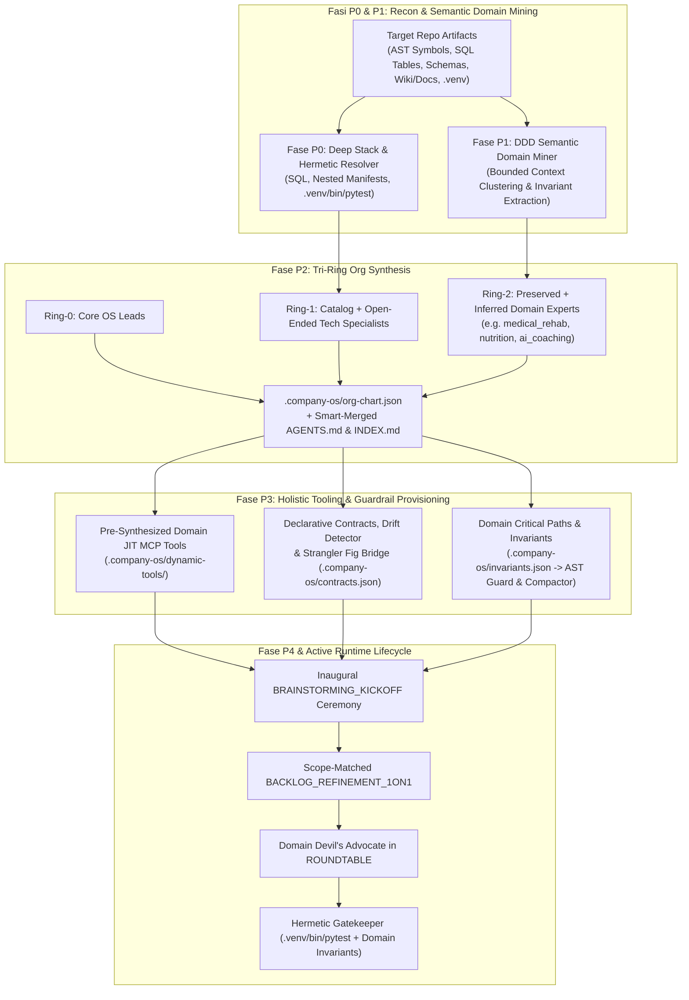

# 🔬 Architectural Spike: Sprint 17.5 Tech Validation
**Sprint:** SPRINT-17.5 — Brownfield Symbiosis, Autonomous Domain Expert Synthesis & Holistic Library Bootstrap  
**Author:** R&D Lead & Domain Leads (`rnd_lead`, `engineering_lead`, `ai_lead`, `qa_lead`, `product_lead`)  
**Status:** VALIDATED & APPROVED  
**Verdict:** `APPROVED`  
**Schema Compliance:** [`TechValidationReportSchema`](file:///Users/stequar/Documents/agentic_company_os/src/contracts/research.ts)  
**Foundation:** Sprint 17 Dogfooding Retrospective & RFC-007 (Ciclo 7 & 7.2 Deep-Dive)  
**Date:** 2026-11-04  

---

## 📋 Executive Summary

Questo dossier formalizza la **validazione tecnologica preventiva (Fase SPIKE — `TCK-17.5.0`)** per lo **Sprint 17.5: Brownfield Symbiosis, Autonomous Domain Expert Synthesis & Holistic Library Bootstrap**, nato dall'analisi empirica del Dogfooding sullo Sprint 17 (`/Users/stequar/fitness_project`) e dalle direttive strategiche del CEO:
1. *"non basta trovare i punti e definire i ticket. dobbiamo approfittare di questa prima analisi per portare i principi scoperti nella nostra libreria, capire quali sono le best practices per loro, analizzare le tecniche, fare ricerca."*
2. *"vorrei toccare maggiormente il punto degli esperti di dominio. prendiamo il caso di quelli derivati dallo stack e quelli preesistenti. ci sono alcuni casi in cui quelli derivati non sono sufficienti perchè magari ci sono tecnologie diverse, inoltre quelli di domain possono essere non presenti nelle repo in cui viene utilizzata la libreria... come possiamo migliorare la library aggiungendo la possibilità di analizzare la repo e automaticamente creare degli esperti di dominio che interverranno poi successivamente nello sviluppo, nelle cerimonie ecc? quali sono le fasi di preparazione in cui si creano? e come può essere allargato il concetto di setup globale della library (quindi non solo a livello di esperti di dominio, ma in generale su tutti i tool necessari)?"*

Attraverso la ricerca stato dell'arte su **DDD Bounded Context & Ubiquitous Language Mining**, **Dynamic Role Emergence (AutoAgents / Agent-Swarm)**, **Projen/Chezmoi Managed Blocks**, **Aider RepoMap** e **Martin Fowler's Strangler Fig Pattern**, lo spike ratifica **5 innovazioni strutturali** per la libreria:

1. **Non-Destructive Document Grafting (`Hybrid AST Section Grafting + Managed Sentinel Blocks`):** Quando l'OS viene eseguito su un repository esistente, preserva il 100% delle sezioni di dominio, delle Epiche (`Epic 0..5`), dei Ticket (`TCK-0.1..4.2`) e dei link in `docs/wiki/**` (zero *Dark Memory*), innestando la governance di sistema in blocchi delimitatori `<!-- AGENTIC-OS:MANAGED:START id="..." sha256="..." --> ... <!-- AGENTIC-OS:MANAGED:END -->` con idempotenza SHA-256 (`SKIPPED_UNCHANGED` al secondo passaggio).
2. **Tri-Ring Role Ontology, Open-Ended Tech Synthesizer (Ring-1) & Semantic Domain Miner (Ring-2):**
   - **Ring-0 (Core Governance Leads):** `cto`, `engineering_lead`, `product_lead`, `qa_lead`, `ai_lead`, `rnd_lead`.
   - **Ring-1 (Stack & Open-Ended Tech Specialists):** Oltre ai 6 template base, l'**Open-Ended Tech Specialist Synthesizer** ispeziona manifest (`requirements.txt`, `pyproject.toml`, `package.json`, `docker-compose.yml`), schemi `.sql` (`db/init/01-init.sql`) e tecnologie non-standard (es. PostgreSQL/Supabase, GraphQL, PyTorch, ETL scripts) per sintetizzare dinamicamente Lead tecnici specializzati.
   - **Ring-2 (Business Domain Specialists — Preserved + Autonomous DDD Mining):** Anche quando nella repo **non esiste alcun `AGENTS.md` preesistente**, il **Semantic Domain & Bounded Context Miner** analizza i simboli del codice (`MedicalCircuitBreaker`, `WorkoutGenerator`), le tabelle SQL (`exercises`, `muscles`, `users`), i modelli API e la documentazione (`docs/wiki/science/*`, `README.md`) per estrarre i **Bounded Contexts di dominio** e sintetizzare automaticamente gli Esperti di Dominio (es. `medical_rehab_specialist`, `nutrition_metabolic_specialist`, `ai_coaching_specialist`) completi di `domainScope` (file di competenza) e `domainInvariants` (regole di business inviolabili).
3. **Active Runtime Participation nelle Cerimonie e nello Sviluppo (`.company-os/org-chart.json`):**
   - Gli esperti sintetizzati vengono registrati in `.company-os/org-chart.json` e cablati nel `CeremonyDispatcher` e nella matrice RACI dinamica:
     * Vengono convocati automaticamente in `BRAINSTORMING_KICKOFF`.
     * Quando un ticket tocca file nel loro `domainScope`, partecipano obbligatoriamente al `BACKLOG_REFINEMENT_1ON1` dettando i criteri di accettazione di dominio.
     * In `ARCHITECTURE_REVIEW_ROUNDTABLE` agiscono come **Domain Devil's Advocate** con potere di blocco se una modifica viola le loro `domainInvariants`.
4. **Il Ciclo di Preparazione in 5 Fasi (`P0..P4`) & Setup Globale Olistico della Libreria:**
   - **Fase P0 (`DEEP_RECONNAISSANCE`):** Deep Stack Inspector (SQL, manifest annidati, entry point profondi) + `runEnvironmentDoctor` + risoluzione ermetica `.venv/bin/pytest > uv run pytest > poetry run pytest > pytest`.
   - **Fase P1 (`SEMANTIC_DOMAIN_MINING`):** Estrazione dell'Ubiquitous Language e clustering dei Bounded Contexts dal codice, dal DB e dalle docs.
   - **Fase P2 (`TRI-RING_ORG_SYNTHESIS`):** Sintesi di Ring-0, Ring-1 e Ring-2, salvataggio in `.company-os/org-chart.json` e Smart-Merge in `AGENTS.md` e `docs/wiki/INDEX.md`.
   - **Fase P3 (`HOLISTIC_TOOLING_AND_GUARDRAIL_PROVISIONING`):**
     * Pre-sintesi di **Domain JIT MCP Tools** (Sprint 19) su misura per i dati e gli schemi della repo.
     * Auto-estrazione dei contratti in `.company-os/contracts.json`, **Semantic Drift Report** (`id: int` vs `id: UUID`) e **Strangler Fig Bridge** sui file legacy (`app/schemas.py`, `Exercise.swift`).
     * Configurazione di `.company-os/invariants.json` (`criticalPaths` e `domainInvariants` per `AST Diff Guard` e `ContextCompactor`).
     * Configurazione di `.company-os/config.json` (comandi di test ermetici, grafo TIA e FinOps Cache Seal).
   - **Fase P4 (`INAUGURAL_ALIGNMENT_CEREMONY`):** Esecuzione della cerimonia inaugurale `BRAINSTORMING_KICKOFF` con tutti gli esperti creati e generazione del `WorkspaceBootstrapReport`.

Il verdetto ingegneristico collegiale è **`APPROVED`**.

---

## 🏛️ Architettura del Sistema: 5-Phase Holistic Bootstrap & Active Domain Experts



---

## 📑 Dati Strutturati Zod (TechValidationReportSchema)

```json
{
  "sprintId": "SPRINT-17.5",
  "sprintTheme": "Brownfield Symbiosis, Autonomous Domain Expert Synthesis & Holistic Library Bootstrap",
  "executiveSummary": "Validazione tecnologica preventiva per lo Sprint 17.5 di Agentic Company OS (Ciclo 7 & 7.2). Lo spike ratifica cinque innovazioni strutturali: (1) Hybrid AST Section Grafting & Managed Sentinel Blocks per l'iniezione non distruttiva della documentazione senza Dark Memory, (2) Tri-Ring Role Ontology con Open-Ended Tech Specialist Synthesizer (Ring-1) e Semantic Domain & Bounded Context Miner (Ring-2) capace di inferire e creare automaticamente gli Esperti di Dominio dal codice, dal DB SQL e dalle docs anche quando AGENTS.md non esiste, (3) Active Runtime Ceremony & RACI Routing che rende gli esperti creati partecipanti attivi in Kickoff, Refinement 1:1, Roundtable (come Domain Devil's Advocate) e Gatekeeper, (4) Contract Introspection (.company-os/contracts.json), Semantic Drift Detector e Strangler Fig Legacy Bridge, e (5) il Preparation Lifecycle in 5 Fasi (P0..P4) per il Setup Globale Olistico di tutti i tool (JIT MCP domain tools, invariants.json per AST Guard/Compactor e test runner ermetici .venv/bin/pytest).",
  "proposedDecisions": [
    "Adottare Hybrid AST Section Grafting combinato con Managed Sentinel Blocks (<!-- AGENTIC-OS:MANAGED:START/END -->) in attachWorkspace per preservare il 100% delle sezioni di dominio preesistenti in AGENTS.md, INDEX.md, roadmap.md e backlog.md garantendo idempotenza SHA-256.",
    "Implementare il Semantic Domain & Bounded Context Miner (src/inspector/domain-miner.ts) e l'Open-Ended Tech Specialist Synthesizer per generare automaticamente l'organigramma Tri-Ring (.company-os/org-chart.json) comprensivo di Ring-1 Tech Specialists custom e Ring-2 Business Domain Experts inferiti dal codice/SQL/wiki anche in assenza di AGENTS.md preesistente.",
    "Cablare gli esperti Ring-2 sintetizzati dentro CeremonyDispatcher e la matrice RACI dinamica affinché intervengano attivamente in BRAINSTORMING_KICKOFF, BACKLOG_REFINEMENT_1ON1 (per i ticket che toccano il loro domainScope) e ARCHITECTURE_REVIEW_ROUNDTABLE (come Domain Devil's Advocate a difesa delle domainInvariants).",
    "Formalizzare il Preparation & Bootstrap Lifecycle in 5 Fasi (P0 Deep Reconnaissance, P1 Semantic Domain Mining, P2 Tri-Ring Org Synthesis, P3 Holistic Tooling & Guardrail Provisioning, P4 Inaugural Alignment Ceremony) per configurare globalmente tool MCP dinamici di dominio, contratti, invarianti AST Guard e test runner ermetici (.venv/bin/pytest).",
    "Supportare il caricamento dichiarativo dei contratti da .company-os/contracts.json nel repository target, affiancato da Semantic Drift Detection (Pydantic vs SQL vs Swift Codable) e dal pattern Strangler Fig Bridge per i file schema legacy."
  ],
  "benchmarksAndTools": [
    {
      "name": "DDD Bounded Context & Ubiquitous Language AST/SQL Miner",
      "category": "domain-discovery",
      "url": "https://martinfowler.com/bliki/BoundedContext.html",
      "pros": [
        "Scopre e sintetizza autonomamente gli Esperti di Dominio (Ring-2) anche su repository che non hanno mai avuto un file AGENTS.md",
        "Ancora ogni esperto sintetizzato a file fisici reali (domainScope) e ad invarianti verificabili (domainInvariants)",
        "Evita allucinazioni grazie all'estrazione deterministica da classi AST, tabelle SQL e documentazione locale"
      ],
      "cons": [
        "Richiede un tetto massimo di cluster (max 5 Bounded Contexts) per prevenire la frammentazione eccessiva dei ruoli"
      ],
      "recommendation": "adopt",
      "notes": "Cuore della Fase P1 (SEMANTIC_DOMAIN_MINING) richiesta dal CEO per l'auto-generazione degli esperti di dominio."
    },
    {
      "name": "Projen / Chezmoi Managed Sentinel Blocks + Markdown AST Grafting",
      "category": "non-destructive-codegen",
      "url": "https://projen.io/",
      "pros": [
        "Preserva integralmente tutte le sezioni scritte dal team umano o preesistenti nel repository Brownfield",
        "Consente aggiornamenti idempotenti O(1) del solo blocco gestito dall'OS tramite hash SHA-256",
        "Zero dipendenze esterne pesanti e compatibilità totale con atomicWriteFile (.bak)"
      ],
      "cons": [
        "Richiede un parser accorto dei delimitatori HTML comment per evitare annidamenti impropri"
      ],
      "recommendation": "adopt",
      "notes": "Soluzione definitiva per eliminare la Brownfield Amnesia (Gap 1) mantenendo il 100% di idempotenza."
    },
    {
      "name": "Strangler Fig Contract Adapter & Semantic Schema Drift Detector",
      "category": "contract-synchronization",
      "url": "https://martinfowler.com/bliki/StranglerFigApplication.html",
      "pros": [
        "Individua esplicitamente i conflitti di tipo (es. id: int in Python/SQL vs id: UUID in Swift) prima della migrazione",
        "Previene errori di compilazione da simboli duplicati (struct Exercise) tramite re-export o bridge controllato",
        "Disaccoppia i contratti dal codice TypeScript dell'OS grazie a .company-os/contracts.json"
      ],
      "cons": [
        "Richiede backup automatico .bak quando si applica il bridge sui file schema legacy"
      ],
      "recommendation": "adopt",
      "notes": "Risolve congiuntamente i Gap 3 e Gap 5 dello Sprint 17."
    },
    {
      "name": "PEP 668 / uv / VirtualEnv Hermetic Runner Resolution",
      "category": "toolchain-hermeticity",
      "url": "https://packaging.python.org/en/latest/specifications/externally-managed-environments/",
      "pros": [
        "Elimina gli errori 'pytest: command not found' su ambienti macOS/Linux con Python gestito esternamente",
        "Garantisce che gli agenti L3 eseguano i test contro le esatte dipendenze installate in .venv"
      ],
      "cons": [
        "Richiede la verifica di esistenza di .venv/bin/pytest dentro il perimetro del repository target"
      ],
      "recommendation": "adopt",
      "notes": "Risolve il Gap 4 garantendo l'affidabilità del Deterministic Gatekeeper."
    }
  ],
  "bestPractices": [
    "Non sovrascrivere mai file Markdown preesistenti in un repository Brownfield senza preservare le sezioni di dominio fuori dal blocco <!-- AGENTIC-OS:MANAGED -->.",
    "Estrarre sempre i Bounded Contexts di business da AST, SQL e documentazione nella Fase P1 per sintetizzare gli Esperti di Dominio Ring-2 anche quando AGENTS.md non esiste.",
    "Rendere ogni esperto sintetizzato un cittadino attivo del runtime (.company-os/org-chart.json) convocato automaticamente da CeremonyDispatcher quando un ticket tocca il suo domainScope.",
    "Eseguire nella Fase P3 il provisioning olistico di tutti gli strumenti necessari al repo: JIT MCP domain tools, contracts.json, invariants.json e test runner ermetici (.venv/bin/pytest).",
    "Generare un Semantic Drift Report quando si sincronizzano contratti su un repository che possiede già schemi SQL, Pydantic o Swift Codable."
  ],
  "risksAndMitigations": [
    {
      "risk": "Proliferazione eccessiva di micro-esperti di dominio (Role Bloat) durante il mining automatico su repository complessi.",
      "impact": "high",
      "mitigation": "Applicare un algoritmo di clustering deterministico con soglia minima di rilevanza e tetto massimo di 5 Bounded Context Specialists Ring-2, ciascuno ancorato a file reali."
    },
    {
      "risk": "Possibile duplicazione del blocco gestito se attachWorkspace viene invocato più volte su un file Brownfield.",
      "impact": "high",
      "mitigation": "Usare marker univoci <!-- AGENTIC-OS:MANAGED:START id=\"...\" --> per sostituire in-place solo il blocco esistente e verificare l'uguaglianza SHA-256 per restituire SKIPPED_UNCHANGED."
    },
    {
      "risk": "Collisione di compilazione Swift ('Invalid redeclaration of Exercise') tra il file legacy app/Models/Exercise.swift e SyncedModels.swift.",
      "impact": "high",
      "mitigation": "Fornire il bridge Strangler Fig che allinea o trasforma il file legacy con backup preventivo .bak."
    },
    {
      "risk": "Esecuzione di un binario .venv/bin/pytest fuori dal perimetro del workspace tramite symlink malevolo.",
      "impact": "medium",
      "mitigation": "Risolvere e validare il path del binario locale esclusivamente all'interno di resolvedTargetPath."
    }
  ],
  "verdict": "APPROVED",
  "finalRecommendations": [
    "Approvare formalmente RFC-007 (inclusa l'espansione Ciclo 7.2) e il presente dossier Spike (TCK-17.5.0), procedendo con lo sviluppo dello Sprint 17.5.",
    "Implementare il motore Brownfield Smart-Merge con Managed Sentinel Blocks in src/attach/injector.ts (TCK-17.5.1).",
    "Aggiornare src/inspector/detector.ts e src/generator/roles.ts con rilevamento SQL, manifest annidati, risoluzione .venv/bin/pytest e Open-Ended Tech Specialist Synthesizer (TCK-17.5.2).",
    "Implementare il Semantic Domain & Bounded Context Miner in src/inspector/domain-miner.ts e il routing attivo degli esperti nelle cerimonie agili in src/core/ceremony-dispatcher.ts (TCK-17.5.3).",
    "Estendere src/sync/contract-sync.ts con supporto per .company-os/contracts.json, Semantic Drift Detector e Strangler Fig Legacy Bridge (TCK-17.5.4).",
    "Orchestrare la pipeline di Bootstrap Olistico in 5 Fasi (P0..P4) con pre-sintesi dei tool MCP di dominio e invarianti AST Guard, certificata da test Vitest al 100% verdi (TCK-17.5.5)."
  ],
  "sources": [
    "https://martinfowler.com/bliki/BoundedContext.html",
    "https://projen.io/",
    "https://www.chezmoi.io/",
    "https://aider.chat/docs/repomap.html",
    "https://martinfowler.com/bliki/StranglerFigApplication.html",
    "https://packaging.python.org/en/latest/specifications/externally-managed-environments/",
    "docs/wiki/rnd/audits/sprint-17-dogfooding-retrospective.md",
    "docs/wiki/rnd/rfcs/RFC-007-BROWNFIELD-SYMBIOSIS-AND-SMART-ADOPTION.md"
  ],
  "validatedAt": "2026-11-04T13:52:00.000Z"
}
```
