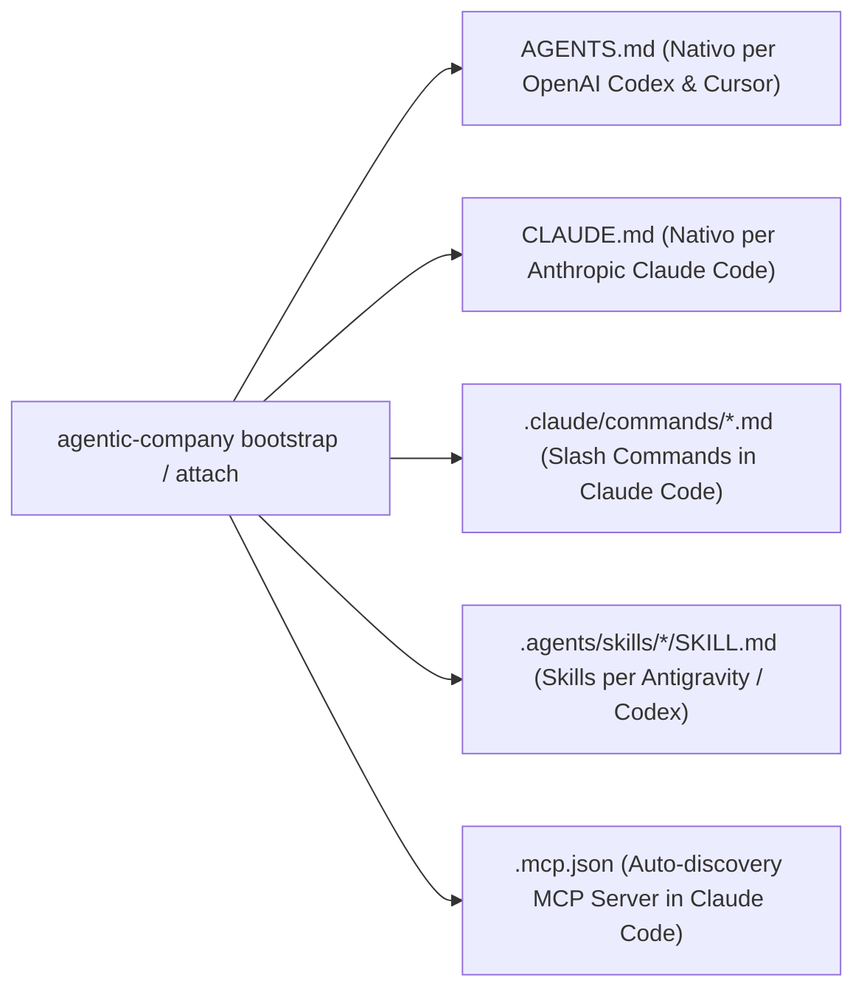

# 🔬 Tech Validation Spike: Sprint 18 — Open Source Public Release (v1.0.0), Professional Persona Taxonomy, English-First Localization & Claude Code / Codex Adapter

```json
{
  "sprintId": "SPRINT-18",
  "sprintTheme": "Open Source Public Release (v1.0.0), Professional Persona Taxonomy, English-First Localization & Claude Code / Codex Adapter",
  "executiveSummary": "Validazione tecnologica per lo Sprint 18 (v1.0.0) di Agentic Company OS. Ratifica la transizione a una tassonomia ingegneristica professionale (Project Lead / Lead Orchestrator L1 con preset configurabile in .company-os/settings.json), l'inglese ('en') come lingua primaria di default, l'adattatore dual-harness per Anthropic Claude Code (CLAUDE.md, .claude/commands/*.md, .mcp.json) e OpenAI Codex (AGENTS.md), la portabilità per repository privati GitHub su macchine esterne e la documentazione completa per il repository GitHub.",
  "proposedDecisions": [
    "Introdurre communication.personaPreset ('ENGINEERING_PROFESSIONAL' default -> Project Lead & Lead Orchestrator L1; 'STARTUP_EXECUTIVE' -> CEO & CTO) e impostare communication.language default su 'en' in .company-os/settings.json.",
    "Aggiornare i generatori di AGENTS.md, CLAUDE.md, le 4 skill operative e i prompt di sistema per supportare l'inglese come lingua primaria mantenendo il 100% di retrocompatibilità con le suite di eval.",
    "Creare l'adattatore cross-agent per Claude Code e OpenAI Codex che genera automaticamente CLAUDE.md, .claude/commands/{run-company,investigate-anomaly,rnd-roundtable,gatekeeper-audit}.md e .mcp.json oltre a AGENTS.md e .agents/skills/.",
    "Rendere il pacchetto immediatamente eseguibile su una seconda macchina tramite repo privata GitHub aggiungendo lo shebang #!/usr/bin/env node a src/index.ts, gli script prepare/prepack in package.json (v1.0.0) e la guida passo-passo in README.md."
  ],
  "benchmarksAndTools": [
    {
      "name": "Anthropic Claude Code Project Adapter (CLAUDE.md + .claude/commands + .mcp.json)",
      "category": "agent-harness",
      "url": "https://docs.anthropic.com/en/docs/agents-and-tools/claude-code/overview",
      "pros": [
        "Caricamento automatico di CLAUDE.md all'avvio di Claude Code senza configurazione manuale",
        "Auto-discovery nativa dei 9 tool MCP del server Agentic Company OS tramite .mcp.json",
        "Comandi slash nativi (/run-company, /investigate-anomaly, /rnd-roundtable, /gatekeeper-audit) tramite .claude/commands/*.md"
      ],
      "cons": [
        "Richiede sincronizzazione automatica tra AGENTS.md e CLAUDE.md durante attach/bootstrap"
      ],
      "recommendation": "adopt",
      "notes": "Indispensabile per i test sul campo con Claude Code su macchine esterne."
    },
    {
      "name": "OpenAI Codex CLI & AGENTS.md Standard",
      "category": "agent-harness",
      "url": "https://agents.md/",
      "pros": [
        "Lettura nativa gerarchica di AGENTS.md nella root del repository",
        "Istruzioni imperative in inglese massimizzano la precisione di esecuzione dei modelli reasoning"
      ],
      "cons": [
        "Nessuno"
      ],
      "recommendation": "adopt",
      "notes": "Pienamente compatibile con l'architettura Tri-Ring."
    }
  ],
  "bestPractices": [
    "Usare una terminologia tecnica e professionale ('Project Lead' per l'umano, 'Lead Orchestrator L1' per l'agente primario) come default, lasciando 'CEO / CTO' come preset opzionale.",
    "Adottare l'inglese ('en') come lingua primaria per tutte le istruzioni di sistema, skill e documentazione GitHub.",
    "Fornire sia CLAUDE.md + .claude/commands/ + .mcp.json (per Claude Code) sia AGENTS.md + .agents/skills/ (per Codex / Antigravity / Cursor)."
  ],
  "risksAndMitigations": [
    {
      "risk": "I test di regressione esistenti (es. workflow-eval W1) cercano marker specifici dentro AGENTS.md.",
      "impact": "medium",
      "mitigation": "Includere header bilingui o alias strutturali in AGENTS.md e aggiornare gradualmente il validatore W1 affinché accetti sia la tassonomia ENGINEERING_PROFESSIONAL (Project Lead / Lead Orchestrator) sia STARTUP_EXECUTIVE (CEO / CTO)."
    },
    {
      "risk": "Su una seconda macchina il binario CLI agentic-company fallisce se manca lo shebang Node o la build dist/.",
      "impact": "high",
      "mitigation": "Aggiungere #!/usr/bin/env node in src/index.ts e configurare 'prepare': 'npm run build' in package.json."
    }
  ],
  "verdict": "APPROVED",
  "finalRecommendations": [
    "Allinearsi con il Project Lead (CEO) sul naming esatto ('Project Lead' + 'Lead Orchestrator') prima di procedere all'implementazione (CFF-5 Checkpoint).",
    "Implementare il generatore dual-harness per Claude Code e Codex.",
    "Scrivere il nuovo README.md professionale in inglese con guida completa al test su seconda macchina con Claude Code e Codex."
  ],
  "sources": [
    "https://docs.anthropic.com/en/docs/agents-and-tools/claude-code/memory",
    "https://agents.md/",
    "src/generator/roles.ts",
    "src/attach/injector.ts"
  ],
  "validatedAt": "2026-11-09T16:18:00.000Z"
}
```

---

## 1. Analisi del Naming: Da `CEO / CTO` a un Modello Professionale Ingegneristico

La tua osservazione sul naming è centrata al 100%: in un contesto open-source o enterprise, farsi chiamare `"CEO 👑"` da un tool CLI mentre l'agente si firma `"CTO"` può risultare giocoso ma **poco professionale** per uno Staff Engineer, un Tech Lead o un team di sviluppo.

### Proposta di Tassonomia Professionale (`ENGINEERING_PROFESSIONAL` — Default)

| Ruolo Attuale (Legacy) | Nuovo Naming Professionale (Default `en`) | Perché funziona meglio su GitHub / Enterprise |
| :--- | :--- | :--- |
| **`CEO 👑 (Utente Umano)`** | **`Project Lead` / `Human Architect`** | Riconosce l'autorità decisionale e architetturale dell'utente umano senza teatrino aziendale. |
| **`CTO (Agente Primario — L1)`** | **`Lead Orchestrator (L1)` / `Chief Architect Agent`** | Descrive esattamente la funzione tecnica del modello L1: orchestrare l'architettura, i contratti e i sub-agenti L2/L3. |
| **`[CTO MODE: 1 — STANDUP]`** | **`[ORCHESTRATOR MODE: 1 — STANDUP]`** | Neutro, tecnico, immediatamente comprensibile nei log di Claude Code e Codex. |
| **`docs/CEO_Dashboard.md`** | **`docs/Executive_Dashboard.md`** *(con alias retrocompatibile)* | Nome standard per un cruscotto di stato architetturale e di progetto. |

> **Flessibilità in `.company-os/settings.json`:** Possiamo aggiungere `communication.personaPreset`:
> - `"ENGINEERING_PROFESSIONAL"` (**Default**): usa `Project Lead` e `Lead Orchestrator (L1)`.
> - `"STARTUP_EXECUTIVE"` (Opzionale): mantiene `CEO` e `CTO` per chi apprezza la metafora startup.

---

## 2. Audit delle Istruzioni in Italiano & Passaggio a Inglese (`en`) come Lingua Primaria

Abbiamo eseguito un audit completo della codebase per mappare dove risiedono testi e prompt in italiano:

1. **`.company-os/settings.json` (`src/contracts/settings.ts`):**
   - Attualmente `communication.language` ha default `"it"`.
   - **Azione:** Cambiare il default di `communication.language` a **`"en"`** (mantenendo `"it"` selezionabile se un utente italiano vuole che l'orchestratore gli risponda in italiano, mentre i prompt di sistema restano in inglese tecnico ad alta precisione).
2. **Generatore `AGENTS.md` / `CLAUDE.md` (`src/generator/roles.ts`):**
   - Attualmente le sezioni `## 0. Hierarchy & Operating Protocol`, `MODE 1..4`, `CFF-1..5`, `Tri-Ring Architecture` e `Karpathy Context as RAM` sono generate in italiano.
   - **Azione:** Renderizzare `AGENTS.md` e `CLAUDE.md` in **Inglese Tecnico** come standard primario (con supporto bilingue per gli invariant di retrocompatibilità dei test esistenti).
3. **System Prompt dei Ruoli L2/L3 (`src/generator/templates/core-kernel.ts`, `roles-prompts.ts`, `cached-kernel.ts`):**
   - Attualmente i prompt di `mobile_manager`, `backend_manager`, `frontend_manager`, `go_manager`, `rust_manager`, `lead_engineer` sono in italiano.
   - **Azione:** Fornire i template primari in inglese per massimizzare l'aderenza ai vincoli di Claude Code e Codex.
4. **Le 4 Skill Operative (`src/attach/injector.ts` — `.agents/skills/*/SKILL.md`):**
   - `/run-company`, `/investigate-anomaly`, `/rnd-roundtable`, `/gatekeeper-audit`.
   - **Azione:** Aggiornare le istruzioni operative in inglese chiaro e professionale.

---

## 3. Compatibilità Nativa con **Claude Code** e **OpenAI Codex** (Test su Seconda Macchina)

Per far sì che il tuo test su un'altra macchina con **Claude Code** e **Codex** funzioni al primo colpo, dobbiamo tenere conto di come i due strumenti leggono il workspace:



- **OpenAI Codex CLI:** Legge automaticamente `AGENTS.md` nella root del progetto.
- **Anthropic Claude Code:**
  1. Legge automaticamente **`CLAUDE.md`** nella root del progetto (non legge `AGENTS.md` di default se non referenziato!).
  2. Scopre automaticamente i server MCP dal file **`.mcp.json`** nella root del progetto (così Claude Code vede subito i tool `inspect_stack`, `run_gatekeeper`, `prove_ast_invariants`, `dispatch_quad_tier_inference`, `run_chaos_experiment`).
  3. Scopre i comandi slash personalizzati da **`.claude/commands/`** (`run-company.md`, `investigate-anomaly.md`, `rnd-roundtable.md`, `gatekeeper-audit.md`), permettendoti di digitare `/project:run-company` o `/run-company` direttamente dentro Claude Code!
- **Portabilità CLI (`bin` & Shebang):**
  - Aggiungeremo `#!/usr/bin/env node` in cima a `src/index.ts` e lo script `"prepare": "npm run build"` in `package.json`, così sull'altra macchina ti basterà clonare la repo privata (o installarla via `npm install -g .`) per avere il comando `agentic-company` funzionante ovunque.
