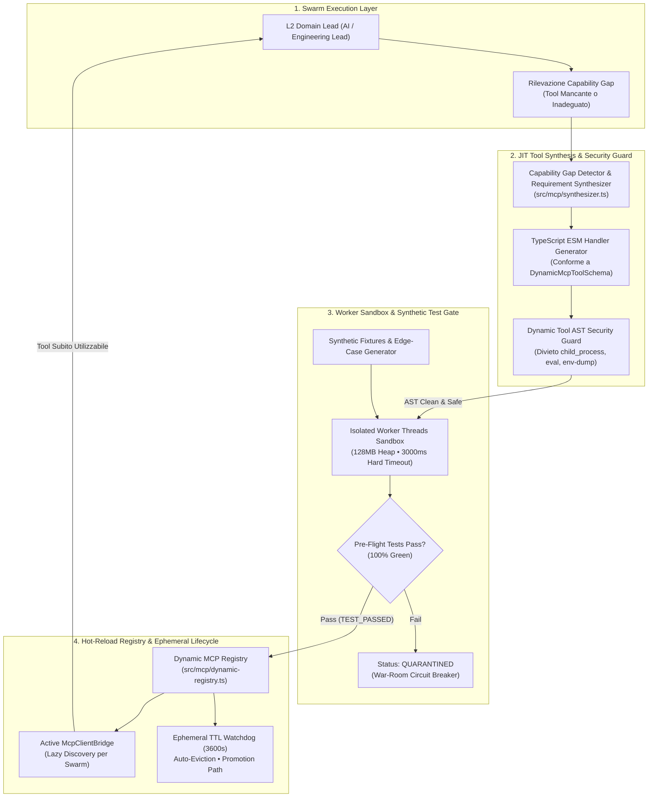

# 🔬 Architectural Spike: Sprint 19 Tech Validation
**Sprint:** SPRINT-19 — Self-Evolving Tooling & Dynamic Just-In-Time MCP Synthesis  
**Author:** CTO & Domain Leads (Engineering Lead, AI Lead, QA Lead)  
**Status:** VALIDATED & APPROVED  
**Verdict:** `APPROVED`  
**Schema Compliance:** [`TechValidationReportSchema`](file:///Users/stequar/Documents/agentic_company_os/src/contracts/research.ts)  
**Foundation:** Mandato Strategico CEO & RFC-006 (Consensus Blueprint 2026+)  
**Date:** 2026-10-17  

---

## 📋 Executive Summary

Questo dossier architetturale formalizza la **validazione tecnologica preventiva (Fase SPIKE - TCK-19.0)** per lo **Sprint 19: Self-Evolving Tooling & Dynamic Just-In-Time MCP Synthesis**, il primo pilastro operativo della neonata **Fase 6 (Next-Gen Autonomous Frontiers & Self-Evolving Ecosystem — RFC-006)** di **Agentic Company OS**.

Nelle piattaforme multi-agente convenzionali di prima e seconda generazione, gli agenti operano con un insieme statico e pre-configurato di tool (lettura file, ricerca codice, git commit). Quando una missione complessa richiede una capability specialistica non prevista a priori — come l'estrazione schemi da un database analitico ClickHouse o SQLite, il parsing di formati binari strutturati (Parquet, Protobuf), il calcolo di hash crittografici specializzati o l'ispezione di AST poliglotti — lo sciame entra in stallo (*Cognitive Capability Gap*), fallisce il task o richiede l'intervento manuale dello sviluppatore umano per scrivere e distribuire un server MCP esterno.

Lo **Sprint 19** risolve alla radice questa limitazione introducendo il paradigma dei **Tool Auto-Evolutivi Just-In-Time (JIT)**:
1. **Capability Gap Detection & Formal Specification:** L'agente L2 (`ai_lead` o `engineering_lead`) rileva la lacuna computazionale e formula una specifica dichiarativa rigorosa conforme a [`DynamicMcpToolSchema`](file:///Users/stequar/Documents/agentic_company_os/src/contracts/frontiers.ts), comprendente JSON Schema degli input, semantica operativa, permessi minimi richiesti e TTL effimero.
2. **Deterministic Code Synthesis Pipeline:** Sintesi automatica del codice sorgente TypeScript ESM del tool handler, con firme conformi alle specifiche ufficiali del Model Context Protocol (MCP).
3. **AST Security Verification & Worker Sandbox:** Analisi statica preventiva del codice generato prima dell'esecuzione per bandire token pericolosi (`child_process`, `eval`, `process.env` harvesting, socket arbitrari). Esecuzione isolata all'interno di una sandbox basata su `node:worker_threads` con hard-cap di memoria (max 128MB) e hard-timeout deterministico (max 3000ms).
4. **Synthetic Pre-flight Verification Gate:** Generazione automatica di fixture sintetiche (casi nominali ed edge-cases) ed esecuzione di test di pre-volo in sandbox: nessun tool viene mai reso disponibile allo sciame prima di aver superato il 100% dei test sintetici (`TEST_PASSED`).
5. **Hot-Reload Dynamic Registry & Ephemeral Lifecycle:** Registrazione dinamica a caldo nel client MCP (`McpClientBridge`) senza riavvio del processo OS, gestione del ciclo di vita con Time-To-Live (TTL default: 3600s), auto-evizione per prevenire il Context Rot e percorso di promozione formale (`PROMOTED_PERMANENT`) per i tool a riutilizzo frequente.

Il verdetto ingegneristico collegiale è **`APPROVED`**.

---

## 🏛️ Architettura di Sistema dello Sprint 19



---

## 🔍 Analisi Dettagliata dei Quattro Pilastri dello Sprint 19

### 1. Capability Gap Detector & Dynamic Tool Requirement Synthesizer (`TCK-19.1`)

#### 1.1 Riconoscimento Deterministico del Divario Operativo
Quando un agente incontra un task non risolvibile con i tool nativi (es. interrogazione tabelle Parquet, analisi dump memcheck o trasformazione stringhe base64 complesse), il modulo `synthesizer.ts` formalizza la richiesta estraendo:
- **`toolId`**: stringa univoca a prefisso deterministico (es. `tool_dyn_parquet_schema_extractor`).
- **`name`** e **`description`**: specifica semantica non ambigua per l'LLM e per il catalogo MCP.
- **`inputSchemaJson`**: stringa conforme a JSON Schema draft-07 per validare gli input via Zod.
- **`permissions`**: array esplicito delle capacità richieste (es. `["fs:read_schema", "network:loopback"]`). Di default l'array è vuoto (computazione pura senza I/O).

#### 1.2 Generazione del Codice Tipizzato
Il sintetizzatore genera un file TypeScript ESM modulare conforme alla firma:
```typescript
export default async function handleDynamicTool(
  input: Record<string, unknown>,
  context: DynamicExecutionContext
): Promise<DynamicToolOutput> {
  // Logica sintetizzata
}
```
Il file generato viene salvato temporaneamente in `.company-os/dynamic-tools/<toolId>.ts` o compilato in memoria.

---

### 2. Isolated Worker Threads Sandbox & AST Security Guard (`TCK-19.2`)

#### 2.1 AST Security Guard Preventivo (`DynamicToolAstGuard`)
Prima di qualsiasi esecuzione o compilazione, l'albero sintattico del tool sintetizzato viene analizzato deterministicamente. Il guardrail rigetta immediatamente il tool con status `QUARANTINED` se individua:
- Chiamate o import a `child_process`, `cluster`, `v8`, `vm` non autorizzati.
- Accesso non confinato a `process.env` (divieto assoluto di harvesting delle credenziali o chiavi API).
- Utilizzo di funzioni dinamiche a stringa (`eval`, `new Function(...)`).
- Apertura di socket di rete arbitrari verso domini esterni non presenti nella whitelist esplicita.
- Scritture su filesystem al di fuori della cartella scratch dedicata del tool.

#### 2.2 Isolamento Hardware in `node:worker_threads`
I tool sintetizzati girano in thread secondari con vincoli stringenti:
- **`resourceLimits`**: `maxOldGenerationSizeMb: 128`, `maxYoungGenerationSizeMb: 32`. Questo impedisce memory leak o attacchi di allocazione infinita.
- **Hard Timeout**: timer di interruzione forzata a 3000ms tramite `worker.terminate()`. Se il tool va in loop infinito o non risponde entro il tempo limite, viene terminato e marcato come `QUARANTINED`.
- **Zero Inquinamento dello Stdout**: tutti i canali standard utilizzano IPC strutturato; lo stdout del processo genitore rimane inviolato per preservare il flusso JSON-RPC MCP.

---

### 3. Synthetic Fixture Generator & Pre-flight Verification Gate (`TCK-19.4`)

#### 3.1 La Regola Aurea: "Zero Unverified Dynamic Code"
Nessun tool sintetizzato dall'AI viene mai caricato nel registro esecutivo senza prima aver superato una batteria di collaudo generata automaticamente.

#### 3.2 Generazione di Fixture Sintetiche
Il sintetizzatore produce parallelamente:
1. **Fixture Nominale (Happy Path):** un payload valido secondo `inputSchemaJson` che deve produrre un output conforme senza errori.
2. **Fixture Limite (Boundary / Empty):** input vuoti, stringhe con caratteri speciali o array vuoti per verificare la robustezza della validazione.
3. **Fixture Malformata (Negative Test):** payload con tipi non corretti per verificare che il tool rifiuti gli input invalidi senza crashare il worker.

Solo se tutti i test restituiscono exit code 0 e rispettano i contratti di output entro i tempi limite, il tool riceve la certificazione `status: "TEST_PASSED"`.

---

### 4. Hot-Reload MCP Registry & Ephemeral Tool Lifecycle Manager (`TCK-19.3`)

#### 4.1 Registrazione a Caldo Senza Riavvio del Processo
Il modulo `src/mcp/dynamic-registry.ts` implementa il registro dinamico:
- Si interfaccia direttamente con `McpClientBridge` e con il server MCP locale.
- Aggiunge lo strumento al catalogo runtime esponendo solo i metadati leggeri (nome e descrizione) secondo il principio **Karpathy Context as RAM** (Lazy Tool Discovery), impedendo che schemi JSON prolissi intasino la context window degli agenti.

#### 4.2 Gestione del Ciclo di Vita ed Evizione Automatica (Anti-Rot TTL)
- Ogni tool sintetizzato nasce come **effimero** con un TTL predefinito (default: 3600 secondi / 1 ora).
- Un timer di housekeeping periodico verifica l'anzianità dei tool: se uno strumento non viene più invocato dopo la scadenza del TTL, viene revocato (`status: "EXPIRED"`) e le sue risorse rimosse dalla memoria.
- **Promotion Path (`PROMOTED_PERMANENT`):** Se uno strumento dimostra un'elevata utilità (es. più di 10 invocazioni riuscite con tasso di successo del 100%), il sistema notifica il board dei lead e propone la promozione a tool permanente con migrazione nel core codebase.

---

## 📊 Matrice di Rischio e Mitigazioni

| Rischio Identificato | Impatto | Mitigazione Deterministica |
| :--- | :---: | :--- |
| **Allucinazione o Codice Dannoso nel Tool:** L'agente genera codice con chiamate di sistema non sicure o tentativi di esfiltrazione token. | **Critical** | `DynamicToolAstGuard` esegue una scansione statica AST prima dell'esecuzione; `worker_threads` opera con memoria vincolata e permessi I/O nulli di default. |
| **Loop Infinito o Consumo CPU 100%:** Il codice sintetizzato contiene un ciclo non terminante che blocca l'infrastruttura. | **High** | Hard timeout deterministico a 3000ms con `worker.terminate()` forzato e deallocazione immediata del thread. |
| **Saturazione della Context Window (Tool Bloat):** La generazione continua di decine di micro-tool appesantisce il system prompt dell'agente. | **High** | Ephemeral TTL a 3600s con auto-evizione e pattern Karpathy Lazy Tool Discovery (solo metadati leggeri di 2 righe nel prompt). |
| **Falsi Positivi nei Test Sintetici:** Il tool sintetizzato supera i test sintetici ma fallisce sul problema reale dell'agente. | **Medium** | Generazione tripartita delle fixture (happy path, edge-case, negative test) con validazione rigorosa dei tipi di output via Zod. |

---

## 📑 Dati Strutturati Zod (TechValidationReportSchema)

```json
{
  "sprintId": "SPRINT-19",
  "sprintTheme": "Self-Evolving Tooling & Dynamic Just-In-Time MCP Synthesis",
  "executiveSummary": "Validazione tecnologica preventiva per lo Sprint 19 di Agentic Company OS. Lo spike ratifica l'architettura per la generazione JIT di micro-strumenti MCP tipizzati, collaudati in sandbox isolate su worker_threads con memoria limitata (128MB) e timeout deterministico (3000ms), protetti da AST Security Guard preventivo e gestiti da un registro dinamico con TTL effimero (3600s) ed auto-evizione per prevenire il context rot.",
  "proposedDecisions": [
    "Adottare node:worker_threads con limiti di memoria V8 (128MB heap) e hard timeout a 3000ms come runtime di sandbox primaria per i tool JIT sintetizzati.",
    "Implementare DynamicToolAstGuard per l'analisi statica obbligatoria del codice prima dell'esecuzione, vietando child_process, cluster, eval e scansioni arbitrarie di process.env.",
    "Imporre il principio 'Zero Unverified Dynamic Code': nessun tool viene caricato nel catalogo MCP senza aver prima superato al 100% una batteria di test sintetici (happy path ed edge cases).",
    "Gestire il ciclo di vita dei tool dinamici con TTL effimero (3600s) e auto-evizione, associato a un canale di promozione a permanente (PROMOTED_PERMANENT) per strumenti ad alta frequenza d'uso.",
    "Integrare il registro dinamico con McpClientBridge secondo il principio Karpathy Context as RAM (Lazy Tool Discovery)."
  ],
  "benchmarksAndTools": [
    {
      "name": "Model Context Protocol (Anthropic MCP SDK)",
      "category": "agentic-protocol",
      "url": "https://modelcontextprotocol.io/",
      "pros": [
        "Standard aperto ampiamente adottato per la composizione di strumenti agentici",
        "Supporto nativo a schemi JSON tipizzati e protocollo JSON-RPC robusto",
        "Piena interoperabilità con la federazione MCP già introdotta nello Sprint 4"
      ],
      "cons": [
        "Richiede isolamento accurato tra i canali stdout e stderr per non corrompere i frame JSON-RPC"
      ],
      "recommendation": "adopt",
      "notes": "Spina dorsale di comunicazione per tutti gli strumenti dinamici sintetizzati."
    },
    {
      "name": "Node.js Worker Threads con V8 Resource Limits",
      "category": "runtime-sandboxing",
      "url": "https://nodejs.org/api/worker_threads.html",
      "pros": [
        "Zero dipendenze binarie native C++ o moduli esterni instabili",
        "Isolamento reale della memoria heap con limiti hardware deterministici (128MB)",
        "Capacità di terminazione forzata immediata tramite worker.terminate() in caso di timeout"
      ],
      "cons": [
        "Overhead di inizializzazione del thread worker (stimato in ~15-25ms per avvio a freddo)"
      ],
      "recommendation": "adopt",
      "notes": "Soluzione collaudata con successo nello Sprint 4 per i plugin; ideale per l'esecuzione protetta dei tool JIT."
    },
    {
      "name": "AST Static Analysis Guardrail (TypeScript Compiler API / Babel)",
      "category": "security-guardrail",
      "url": "https://github.com/typescript-eslint/typescript-eslint",
      "pros": [
        "Analisi deterministica a costo zero prima di qualsiasi esecuzione di codice",
        "Blocca vettori di attacco noti (child_process, eval, secret exfiltration) a monte",
        "Nessun impatto sulle prestazioni a runtime"
      ],
      "cons": [
        "Richiede manutenzione delle blacklist e whitelist dei token consentiti"
      ],
      "recommendation": "adopt",
      "notes": "Guardrail di livello 1 indispensabile prima del rilascio alla sandbox di esecuzione."
    }
  ],
  "bestPractices": [
    "Non eseguire mai codice generato dinamicamente nel processo principale dell'OS (Ring 0).",
    "Rilasciare il lock di esecuzione tramite hard timeout non negoziabile a 3000ms per prevenire blocchi dello sciame.",
    "Separare rigidamente la generazione della specifica (inputSchema, semantica) dalla scrittura del codice esecutivo.",
    "Applicare l'auto-evizione dei tool non utilizzati per mantenere il catalogo tool snello ed evitare degradazione cognitiva dell'LLM.",
    "Utilizzare esclusivamente IPC strutturato o stderr per i messaggi diagnostici del worker, salvaguardando stdout per JSON-RPC."
  ],
  "risksAndMitigations": [
    {
      "risk": "Il codice sintetizzato dall'AI tenta di eseguire comandi di sistema non autorizzati o di accedere alle variabili d'ambiente riservate.",
      "impact": "critical",
      "mitigation": "DynamicToolAstGuard analizza l'AST prima dell'avvio e rigetta istantaneamente qualsiasi pattern non autorizzato; la sandbox Worker Threads gira con permessi nulli."
    },
    {
      "risk": "Un tool JIT entra in un ciclo infinito o alloca memoria senza limiti durante l'esecuzione.",
      "impact": "high",
      "mitigation": "V8 resourceLimits bloccano l'heap a 128MB massimo e il timer deterministico a 3000ms invoca worker.terminate() forzato."
    },
    {
      "risk": "L'accumulo incontrollato di micro-tool sintetizzati satura la context window e induce allucinazioni nell'agente genitore.",
      "impact": "high",
      "mitigation": "Ephemeral TTL a 3600 secondi con auto-evizione e Lazy Tool Discovery (solo nome e descrizione leggeri caricati nel prompt)."
    },
    {
      "risk": "Il tool supera i test sintetici ma fallisce quando applicato allo scenario reale con dati sporchi.",
      "impact": "medium",
      "mitigation": "Generazione multi-scenario delle fixture (casi nominali, edge cases estremi e input malformati) con validazione difensiva Zod."
    }
  ],
  "verdict": "APPROVED",
  "finalRecommendations": [
    "Approvare formalmente il dossier architetturale dello Sprint 19 (TCK-19.0) e autorizzare l'avvio della fase di BUILD per i ticket esecutivi (TCK-19.1 - TCK-19.4).",
    "Sviluppare in src/mcp/synthesizer.ts il Capability Gap Detector e il generatore di specifiche JIT conforme a DynamicMcpToolSchema.",
    "Realizzare in src/mcp/sandbox-runner.ts la sandbox worker_threads blindata con V8 resource limits e DynamicToolAstGuard integrato.",
    "Implementare in src/mcp/dynamic-registry.ts il registro ad auto-reload con gestione TTL effimero (3600s), housekeeping periodico e promotion path.",
    "Creare in src/mcp/fixture-generator.ts il motore di sintesi delle fixture di test per la certificazione pre-volo dei tool sintetizzati.",
    "Blindare l'implementazione con suite di test Vitest esaustive in tests/dynamic-mcp.test.ts, garantendo il passaggio del Deterministic Gatekeeper al 100% verde."
  ],
  "sources": [
    "https://modelcontextprotocol.io/",
    "https://nodejs.org/api/worker_threads.html",
    "docs/wiki/rnd/rfcs/RFC-006-NEXT-GEN-FRONTIERS-AND-SELF-EVOLVING-ECOSYSTEM.md",
    "src/contracts/frontiers.ts"
  ],
  "validatedAt": "2026-10-17T16:00:00.000Z"
}
```

---

## 🎯 Prossimi Passi: Tabella di Marcia Fase BUILD Sprint 19

1. **TCK-19.1:** Realizzazione di `src/mcp/synthesizer.ts` (Capability Gap Detector, Spec Generator, Code Synthesizer).
2. **TCK-19.2:** Realizzazione di `src/mcp/sandbox-runner.ts` (Sandbox worker_threads isolata con memory cap 128MB, timeout 3000ms e AST Security Guard).
3. **TCK-19.3:** Realizzazione di `src/mcp/dynamic-registry.ts` (Hot-Reload Registry, Ephemeral TTL 3600s, Auto-Eviction e Promotion Logic).
4. **TCK-19.4:** Realizzazione di `src/mcp/fixture-generator.ts` e suite di test completa `tests/dynamic-mcp.test.ts`.
5. **Quality Gate:** Verifica deterministica `npm run typecheck && npm test && npm run build` (100% pass).
