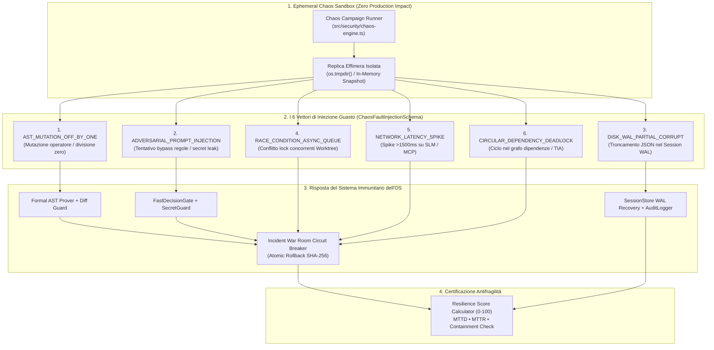

# 🔬 Architectural Spike: Sprint 22 Tech Validation
**Sprint:** SPRINT-22 — Antifragile Chaos Swarm & Synthetic Fault Injection Engine  
**Author:** CTO & Domain Leads (`qa_lead` [Devil's Advocate], `engineering_lead`, `rnd_lead`, `ast_gatekeeper_specialist` [Ring-2])  
**Status:** VALIDATED & APPROVED (Ready for CEO Review)  
**Verdict:** `APPROVED`  
**Schema Compliance:** [`TechValidationReportSchema`](file:///Users/stequar/Documents/agentic_company_os/src/contracts/research.ts) & [`ChaosFaultInjectionSchema`](file:///Users/stequar/Documents/agentic_company_os/src/contracts/frontiers.ts#L66-L84)  
**Foundation:** Mandato Strategico CEO & [`RFC-006`](file:///Users/stequar/Documents/agentic_company_os/docs/wiki/rnd/rfcs/RFC-006-NEXT-GEN-FRONTIERS-AND-SELF-EVOLVING-ECOSYSTEM.md)  
**Date:** 2026-11-09  

---

## 📋 Executive Summary

Questo dossier architetturale formalizza lo **Spike Tecnico (`TCK-22.0`)** per lo **Sprint 22: Antifragile Chaos Swarm & Synthetic Fault Injection Engine**, quarto pilastro della **Fase 6 (RFC-006)**.

### Il Problema: "Chi Controlla i Controllori?" (*Quis custodiet ipsos custodes?*)
Nei primi 21 sprint abbiamo costruito un apparato di sicurezza e auto-riparazione multi-strato:
- **Kahneman System-1 Gate** ([`src/core/fast-decision-gate.ts`](file:///Users/stequar/Documents/agentic_company_os/src/core/fast-decision-gate.ts)) e **Secret Guard** ([`src/security/secret-guard.ts`](file:///Users/stequar/Documents/agentic_company_os/src/security/secret-guard.ts)),
- **AST Diff Guard** ([`src/gatekeeper/ast-guard.ts`](file:///Users/stequar/Documents/agentic_company_os/src/gatekeeper/ast-guard.ts)) e **Neuro-Symbolic Formal Prover** ([`src/gatekeeper/formal-prover.ts`](file:///Users/stequar/Documents/agentic_company_os/src/gatekeeper/formal-prover.ts)),
- **Session Store WAL con Two-Phase Commit** ([`src/core/session-store.ts`](file:///Users/stequar/Documents/agentic_company_os/src/core/session-store.ts)),
- **Incident War Room Circuit Breaker** ([`src/gatekeeper/war-room.ts`](file:///Users/stequar/Documents/agentic_company_os/src/gatekeeper/war-room.ts)).

Tuttavia, un sistema di sicurezza che non viene mai sottoposto a guasti reali rischia la **deriva silenziosa (*Silent Guardrail Decay*)**: come faceva Netflix con *Chaos Monkey*, un'organizzazione autonoma deve iniettare deliberatamente guasti controllati (in una sandbox effimera isolata) per misurare scientificamente:
1. **`detectionTimeMs` (MTTD — Mean Time To Detect):** quanto impiegano i guardrail ad accorgersi dell'anomalia?
2. **`recoveryTimeMs` (MTTR — Mean Time To Recover):** quanto impiega la War Room o il WAL a eseguire il rollback atomico SHA-256?
3. **`containmentSuccess`:** il guasto è rimasto confinato al 100% senza mai contaminare il branch `main` o i file di produzione?
4. **`resilienceScore (0–100)`:** punteggio matematico di antifragilità dell'OS.

---

## 🏛️ Architettura del Motore di Chaos Engineering (`src/security/chaos-engine.ts`)



---

## 🔍 I 6 Scenari di Guasto Sintetico (`ChaosFaultInjectionSchema`)

Ogni esperimento genera un certificato validato da [`ChaosFaultInjectionSchema`](file:///Users/stequar/Documents/agentic_company_os/src/contracts/frontiers.ts#L66-L84):

| # | `faultType` | Sottosistema Bersaglio (`targetSubsystem`) | Guasto Sintetico Iniettato (in Sandbox Effimera) | Difesa dell'OS Attesa |
| :--- | :--- | :--- | :--- | :--- |
| **1** | `AST_MUTATION_OFF_BY_ONE` | `gatekeeper` | Inietta una mutazione sintattica/aritmetica (es. rimozione guardia `/ 0` o rimozione `expect()`). | Intercettato in `< 25ms` da [`proveAstInvariants`](file:///Users/stequar/Documents/agentic_company_os/src/gatekeeper/formal-prover.ts) e [`validatePatch`](file:///Users/stequar/Documents/agentic_company_os/src/gatekeeper/ast-guard.ts) con rollback atomico. |
| **2** | `ADVERSARIAL_PROMPT_INJECTION` | `security-perimeter` | Simula un prompt ostile che tenta di sovrascrivere `.env` o esfiltrare una chiave `sk-proj-...`. | Bloccato in `< 5ms` da [`FastDecisionGate`](file:///Users/stequar/Documents/agentic_company_os/src/core/fast-decision-gate.ts) + [`SecretGuard`](file:///Users/stequar/Documents/agentic_company_os/src/security/secret-guard.ts). |
| **3** | `DISK_WAL_PARTIAL_CORRUPT` | `session-store` | Corrompe parzialmente un file `.tmp` / JSON di checkpoint nel WAL effimero. | Rilevato e isolato da [`SessionStore`](file:///Users/stequar/Documents/agentic_company_os/src/core/session-store.ts) / [`AuditLogger`](file:///Users/stequar/Documents/agentic_company_os/src/core/audit-logger.ts) senza corrompere lo stato principale. |
| **4** | `RACE_CONDITION_ASYNC_QUEUE` | `worktree-manager` | Simula due agenti L3 che tentano di acquisire contemporaneamente il lock sullo stesso file target. | Conflitto rilevato deterministicamente con isolamento ed escalation alla War Room. |
| **5** | `NETWORK_LATENCY_SPIKE` | `quad-tier-dispatcher` | Inietta uno spike di latenza (`> 1200ms`) sull'endpoint SLM locale. | Il [`dispatchQuadTierInference`](file:///Users/stequar/Documents/agentic_company_os/src/distillation/quad-tier-dispatcher.ts) scatta in `SLA_TIMEOUT` ed esegue l'auto-escalation su Cloud Tier-2. |
| **6** | `CIRCULAR_DEPENDENCY_DEADLOCK` | `tia-graph` | Introduce un ciclo `A -> B -> A` nel grafo di dipendenze analizzato dal Test Impact Analyzer. | Il visita-grafo di [`runTia`](file:///Users/stequar/Documents/agentic_company_os/src/gatekeeper/tia.ts) rileva il ciclo (visited set) senza mai andare in loop infinito. |

---

## 📐 Formula Deterministica del `resilienceScore (0–100)`

Il punteggio di antifragilità di ogni esperimento (e della campagna complessiva) è calcolato oggettivamente:
- **Containment Mandatory Gate:** Se `containmentSuccess === false` (il guasto è uscito dalla sandbox), il punteggio cade immediatamente a **`0`**.
- Se `containmentSuccess === true`:
  - Base score: **`70 punti`** per il contenimento ermetico.
  - Bonus velocità di rilevamento (`detectionTimeMs <= 50ms`): **`+15 punti`** (scala linearmente fino a `0` oltre `500ms`).
  - Bonus velocità di ripristino (`recoveryTimeMs <= 100ms`): **`+15 punti`** (scala linearmente fino a `0` oltre `1000ms`).

---

## 📑 Dati Strutturati Zod (TechValidationReportSchema)

```json
{
  "sprintId": "SPRINT-22",
  "sprintTheme": "Antifragile Chaos Swarm & Synthetic Fault Injection Engine",
  "executiveSummary": "Validazione tecnologica preventiva per lo Sprint 22 di Agentic Company OS. Ratifica il Chaos Fault Injection Engine (src/security/chaos-engine.ts) conforme a ChaosFaultInjectionSchema, progettato per eseguire i 6 vettori di guasto sintetico in un'arena effimera isolata (zero impatto su main), verificare la reattività di FormalProver, FastDecisionGate, SecretGuard, SessionStore, QuadTierDispatcher e WarRoomEngine, e certificare il Resilience Score (0-100).",
  "proposedDecisions": [
    "Implementare src/security/chaos-engine.ts conforme a ChaosFaultInjectionSchema supportando tutti i 6 vettori di guasto (AST_MUTATION_OFF_BY_ONE, ADVERSARIAL_PROMPT_INJECTION, DISK_WAL_PARTIAL_CORRUPT, RACE_CONDITION_ASYNC_QUEUE, NETWORK_LATENCY_SPIKE, CIRCULAR_DEPENDENCY_DEADLOCK).",
    "Garantire l'invariante 'Zero Production Impact': ogni esperimento di caos viene eseguito esclusivamente su directory temporanee effimere (os.tmpdir()) o snapshot in-memory, senza mai toccare i file del repository.",
    "Calcolare deterministicamente il resilienceScore (0-100) in funzione di containmentSuccess, detectionTimeMs (SLA < 50ms) e recoveryTimeMs (SLA < 100ms).",
    "Cablare il Chaos Engine con WarRoomEngine (src/gatekeeper/war-room.ts) per stress-testare l'apertura e risoluzione automatica degli incidenti.",
    "Cablare end-to-end (Zero Island Modules) il Chaos Engine in src/mcp/server.ts (tool run_chaos_experiment) e src/cli/commands/workflow.ts (telemetria chaosResilience in workflow status)."
  ],
  "benchmarksAndTools": [
    {
      "name": "Netflix Chaos Monkey / Principles of Chaos Engineering (Ephemeral Arena Adaptation)",
      "category": "chaos-engineering",
      "url": "https://principlesofchaos.org/",
      "pros": [
        "Verifica empiricamente che i guardrail (FormalProver, AST Diff Guard, SecretGuard, War Room) siano realmente attivi e reattivi",
        "Misura MTTD (detectionTimeMs) e MTTR (recoveryTimeMs) con precisione sub-millisecondo",
        "Esecuzione 100% ermetica in arena temporanea senza alcun rischio per il codice sorgente"
      ],
      "cons": [
        "Richiede pulizia rigorosa delle directory temporanee al termine di ogni campagna"
      ],
      "recommendation": "adopt",
      "notes": "Fondamentale per prevenire il Silent Guardrail Decay e certificare l'antifragilità dell'OS."
    },
    {
      "name": "Mutation Testing & Adversarial Prompt Fuzzing",
      "category": "security-resilience",
      "url": "https://stryker-mutator.io/",
      "pros": [
        "Valida che il Gatekeeper e il Formal Prover intercettino mutazioni semantiche sottili (off-by-one, divisioni non protette)",
        "Verifica l'immunità del sistema a tentativi di prompt injection ed esfiltrazione segreti"
      ],
      "cons": [
        "Va confinato ai percorsi critici per mantenere tempi di esecuzione rapidi (<200ms per campagna)"
      ],
      "recommendation": "adopt",
      "notes": "Integrato nativamente nei vettori AST_MUTATION_OFF_BY_ONE e ADVERSARIAL_PROMPT_INJECTION."
    }
  ],
  "bestPractices": [
    "Non eseguire mai iniezioni di guasto sul working tree principale del repository: utilizzare esclusivamente sandbox effimere in os.tmpdir().",
    "Azzerare il resilienceScore (0/100) qualora containmentSuccess risulti false.",
    "Eseguire regolarmente la campagna completa dei 6 vettori di caos per verificare che nessun guardrail sia stato disattivato.",
    "Tracciare l'attivazione della War Room (warRoomActivated) per i guasti ad alta severità."
  ],
  "risksAndMitigations": [
    {
      "risk": "Un esperimento di caos modifica accidentalmente file reali del workspace.",
      "impact": "critical",
      "mitigation": "Isolamento fisico in directory temporanea effimera creata con fs.mkdtemp(os.tmpdir()) e rimossa nel blocco finally."
    },
    {
      "risk": "Un test di deadlock circolare (CIRCULAR_DEPENDENCY_DEADLOCK) blocca il processo principale.",
      "impact": "high",
      "mitigation": "Rilevamento deterministico dei cicli tramite visited-set a profondità limitata e hard-timeout a 200ms."
    }
  ],
  "verdict": "APPROVED",
  "finalRecommendations": [
    "Sottoporre il presente report di Spike dello Sprint 22 alla revisione del CEO.",
    "Dopo l'approvazione del CEO, implementare src/security/chaos-engine.ts con il runner di singolo esperimento e di campagna completa (6 vettori).",
    "Cablare il Chaos Engine in src/mcp/server.ts e src/cli/commands/workflow.ts e certificare la suite tests/chaos-swarm.test.ts."
  ],
  "sources": [
    "https://principlesofchaos.org/",
    "docs/wiki/rnd/rfcs/RFC-006-NEXT-GEN-FRONTIERS-AND-SELF-EVOLVING-ECOSYSTEM.md",
    "src/contracts/frontiers.ts",
    "src/gatekeeper/war-room.ts"
  ],
  "validatedAt": "2026-11-09T15:01:00.000Z"
}
```
