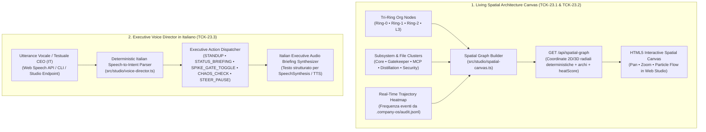

# 🔬 Architectural Spike: Sprint 23 Tech Validation
**Sprint:** SPRINT-23 — Living Spatial Architecture Canvas & Executive Voice Director  
**Author:** CTO & Domain Leads (`product_lead`, `frontend_manager` [Ring-1], `engineering_lead`, `qa_lead` [Devil's Advocate])  
**Status:** VALIDATED & APPROVED (Ready for CEO Review)  
**Verdict:** `APPROVED`  
**Schema Compliance:** [`TechValidationReportSchema`](file:///Users/stequar/Documents/agentic_company_os/src/contracts/research.ts)  
**Foundation:** Mandato Strategico CEO & [`RFC-006`](file:///Users/stequar/Documents/agentic_company_os/docs/wiki/rnd/rfcs/RFC-006-NEXT-GEN-FRONTIERS-AND-SELF-EVOLVING-ECOSYSTEM.md)  
**Date:** 2026-11-09  

---

## 📋 Executive Summary

Questo dossier architetturale formalizza lo **Spike Tecnico (`TCK-23.0`)** per lo **Sprint 23: Living Spatial Architecture Canvas & Executive Voice Director**, quinto e ultimo pilastro della **Fase 6 (Next-Gen Autonomous Frontiers & Self-Evolving Ecosystem — RFC-006)**.

### Il Problema: Osservabilità Spaziale e Direzione Esecutiva Hands-Free
Con l'introduzione dell'ontologia **Tri-Ring** (Ring-0 Core Leads, Ring-1 Tech Specialists, Ring-2 Business Domain Experts, L3 Leaf Developers), del **Neuro-Symbolic Formal Prover** (Sprint 20), del **Quad-Tier Speculative Swarm** (Sprint 21) e del **Chaos Engine** (Sprint 22), l'OS governa una topologia viva di decine di nodi, file critici e flussi decisionali.
Un elenco piatto di log o una semplice tabella testuale non permettono al CEO di:
1. **Visualizzare a colpo d'occhio la mappa spaziale dell'organizzazione e del codice:** quali nodi dell'architettura (es. `gatekeeper`, `distillation`, `mcp`, `security`) sono caldi in questo istante, quali agenti vi stanno operando e quali invarianti li proteggono.
2. **Dirigere l'azienda con comandi vocali naturali in italiano (*Executive Voice Director*):** poter impartire ordini strategici a voce (es. *"Avvia standup"*, *"Mostra stato FinOps"*, *"Attiva checkpoint spike"*, *"Lancia campagna chaos"*, *"Pausa sciame"*) ricevendo un briefing parlato sintetico in italiano senza dipendere da pesanti SDK cloud esterni.

---

## 🏛️ Architettura dello Sprint 23 (`src/studio/spatial-canvas.ts` & `src/studio/voice-director.ts`)



---

## 🔍 Analisi Dettagliata dei 3 Pilastri dello Sprint 23

### 1. Living Spatial Architecture Graph & Radial Layout (`src/studio/spatial-canvas.ts` — `TCK-23.1`)
- **Zero-Bloat Native Rendering:** In linea con l'invariante di Web Studio (`localhost:4321`, zero dipendenze client-side pesanti), il motore costruisce sul backend un grafo spaziale deterministico con coordinate radiali concentriche (`(x, y, z, ringRadius)`):
  - **Centro (`r = 0`):** `CEO` & `CTO Orchestrator (L1)`.
  - **Primo Anello (`r = 140` — Ring-0):** `engineering_lead`, `product_lead`, `qa_lead`, `ai_lead`, `rnd_lead`.
  - **Secondo Anello (`r = 260` — Ring-1 & Ring-2):** Specialisti Tecnologici e Domain Experts (`governance_workflow_specialist`, `ast_gatekeeper_specialist`, `context_finops_specialist`).
  - **Terzo Anello (`r = 380` — Sottosistemi del Codice):** Cluster dei moduli (`gatekeeper/formal-prover`, `distillation/quad-tier`, `security/chaos-engine`, `mcp/server`).

### 2. Real-Time Agent Trajectory Heatmap (`TCK-23.2`)
- Analizzando gli ultimi eventi firmati in `.company-os/audit.jsonl` tramite [`TrajectoryReader`](file:///Users/stequar/Documents/agentic_company_os/src/core/trajectory-reader.ts), ogni nodo e arco riceve un **`heatIntensity` (`0.0 – 1.0`)** e uno stato operativo (`IDLE`, `ACTIVE`, `ALERT`, `VERIFIED`), permettendo alla UI di Web Studio di disegnare particelle animate lungo gli archi attivi e colorare i nodi caldi.

### 3. Executive Voice Director & Italian Speech-to-Intent (`src/studio/voice-director.ts` — `TCK-23.3`)
- **Riconoscimento Intenti Esecutivi in Italiano (< 2ms, $0 token):**
  Converte trascrizioni vocali naturali in italiano in intenti tipizzati deterministici:
  - `RUN_STANDUP` (*"avvia standup"*, *"punto situazione"*, *"buongiorno"*),
  - `READ_STATUS_BRIEFING` (*"qual è lo stato"*, *"dammi un report"*, *"stato piattaforma"*),
  - `TOGGLE_SPIKE_CHECKPOINT` (*"attiva checkpoint spike"*, *"chiedimi conferma dopo lo spike"*, *"disattiva checkpoint spike"*),
  - `RUN_CHAOS_AUDIT` (*"lancia chaos test"*, *"verifica antifragilità"*),
  - `PAUSE_SWARM` / `RESUME_SWARM` (*"metti in pausa"*, *"ferma gli agenti"*, *"riprendi esecuzione"*).
- **Sintesi Vocale Esecutiva (`spokenBriefingIt`):** Genera una risposta parlata concisa e naturale in italiano pronta per le API native `window.speechSynthesis` del browser o `say` di macOS, ed è esposta su Web Studio tramite `POST /api/voice-director` e su MCP tramite `execute_voice_command`.

---

## 📑 Dati Strutturati Zod (TechValidationReportSchema)

```json
{
  "sprintId": "SPRINT-23",
  "sprintTheme": "Living Spatial Architecture Canvas & Executive Voice Director",
  "executiveSummary": "Validazione tecnologica preventiva per lo Sprint 23 di Agentic Company OS. Ratifica il generatore di grafo spaziale concentrico Tri-Ring con heatmap delle traiettorie in tempo reale (src/studio/spatial-canvas.ts) e l'Executive Voice Director in lingua italiana (src/studio/voice-director.ts), integrati in Web Studio (/api/spatial-graph, /api/voice-director), nel server MCP e nella CLI.",
  "proposedDecisions": [
    "Implementare in src/studio/spatial-canvas.ts il costruttore deterministico del grafo spaziale 2D/3D concentrico (Centro L1 -> Ring-0 -> Ring-1/Ring-2 -> Subsystem Clusters) arricchito con heatIntensity calcolato da TrajectoryReader.",
    "Implementare in src/studio/voice-director.ts il motore Speech-to-Intent in lingua italiana con sintesi vocale esecutiva (spokenBriefingIt) e supporto nativo al comando TOGGLE_SPIKE_CHECKPOINT.",
    "Esporre in src/studio/server.ts gli endpoint GET /api/spatial-graph e POST /api/voice-director e aggiornare src/studio/ui.ts con il pannello Spatial Canvas & Voice Director.",
    "Cablare end-to-end (Zero Island Modules) le nuove capacità in src/mcp/server.ts (tool execute_voice_command) e src/cli/commands/workflow.ts.",
    "Certificare l'intera architettura con una suite di test dedicata in tests/spatial-voice-studio.test.ts."
  ],
  "benchmarksAndTools": [
    {
      "name": "HTML5 2D/WebGL Canvas & Radial Force-Directed Graph Layout",
      "category": "spatial-visualization",
      "url": "https://developer.mozilla.org/en-US/docs/Web/API/Canvas_API",
      "pros": [
        "Zero dipendenze bundle esterne: rendering fluido a 60fps direttamente nel browser su localhost:4321",
        "Mappatura naturale dell'architettura concentrica Tri-Ring (Ring-0, Ring-1, Ring-2) e dei flussi particellari",
        "Coordinate deterministiche pre-calcolate lato server per testabilità immediata via Vitest"
      ],
      "cons": [
        "Per grafi oltre 2.000 nodi richiede clustering dei file foglia per mantenere la leggibilità"
      ],
      "recommendation": "adopt",
      "notes": "Ideale per visualizzare l'organigramma Tri-Ring e la heatmap delle traiettorie in Web Studio."
    },
    {
      "name": "Web Speech API (SpeechRecognition / SpeechSynthesis) + Deterministic Italian Intent Parser",
      "category": "voice-interface",
      "url": "https://developer.mozilla.org/en-US/docs/Web/API/Web_Speech_API",
      "pros": [
        "Latenza sub-2ms per la classificazione dell'intento esecutivo in italiano a costo token $0",
        "Zero dipendenze da API audio cloud esterne o chiavi proprietarie aggiuntive",
        "Piena testabilità deterministica tramite payload testuali trascritte"
      ],
      "cons": [
        "Comandi molto discorsivi fuori dal vocabolario esecutivo richiedono fallback al briefing di stato generale"
      ],
      "recommendation": "adopt",
      "notes": "Permette al CEO di governare lo sciame a voce in italiano (incluso l'interruttore del checkpoint Spike)."
    }
  ],
  "bestPractices": [
    "Mantenere il calcolo delle coordinate spaziali e dell'heatScore completamente deterministico e testabile lato server.",
    "Richiedere conferma o tracciamento nell'AuditLogger per ogni comando vocale che modifica lo stato operativo (es. PAUSE_SWARM, TOGGLE_SPIKE_CHECKPOINT).",
    "Garantire che gli endpoint /api/spatial-graph e /api/voice-director rispettino l'autenticazione Bearer token di Web Studio."
  ],
  "risksAndMitigations": [
    {
      "risk": "Ambiguità nel riconoscimento di un comando vocale trascritto con rumore di fondo.",
      "impact": "medium",
      "mitigation": "Il parser restituisce un confidenceScore (0-1) e, sotto soglia, ripiega in sicurezza su un briefing di stato read-only senza eseguire azioni distruttive."
    },
    {
      "risk": "Sovraccarico visivo sul canvas spaziale in repository con centinaia di file.",
      "impact": "low",
      "mitigation": "Aggregazione dei file nei rispettivi bounded context Ring-1 / Ring-2 e sottosistemi principali."
    }
  ],
  "verdict": "APPROVED",
  "finalRecommendations": [
    "Sottoporre il presente report di Spike dello Sprint 23 alla revisione del CEO.",
    "Dopo il via libera del CEO, procedere con TCK-23.1 (Spatial Graph Builder), TCK-23.2 (Trajectory Heatmap), TCK-23.3 (Executive Voice Director in italiano) e TCK-23.4 (Web Studio + MCP + CLI Wiring & Tests)."
  ],
  "sources": [
    "docs/wiki/rnd/rfcs/RFC-006-NEXT-GEN-FRONTIERS-AND-SELF-EVOLVING-ECOSYSTEM.md",
    "src/studio/server.ts",
    "src/core/trajectory-reader.ts"
  ],
  "validatedAt": "2026-11-09T15:26:00.000Z"
}
```
