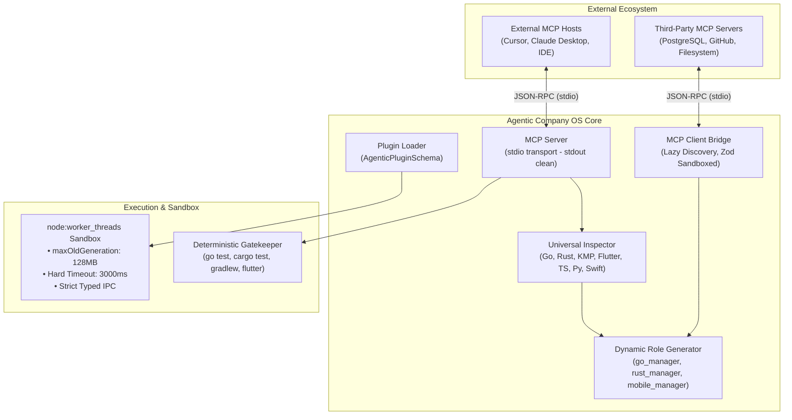

# 🔬 Architectural Spike: Sprint 4 Tech Validation
**Sprint:** SPRINT-4 — Universal Multi-Stack Scaffolding Engine & Modular Plugin Core (with Native MCP)  
**Author:** Engineering Lead (Domain Lead L2)  
**Status:** VALIDATED & APPROVED  
**Verdict:** `APPROVED`  
**Schema Compliance:** [`TechValidationReportSchema`](file:///Users/stequar/Documents/agentic_company_os/src/contracts/research.ts)  
**Ratified Foundation:** [`RFC-001`](file:///Users/stequar/Documents/agentic_company_os/docs/wiki/rnd/rfcs/RFC-001-OPEN-SOURCE-OS-FOUNDATION.md)  
**Date:** 2026-10-16  

---

## 📋 Executive Summary

Questo dossier architetturale formalizza la validazione tecnologica per lo **Sprint 4** ("Universal Multi-Stack Scaffolding Engine & Modular Plugin Core with Native MCP"), ratificato all'unanimità dal board tecnico in [`RFC-001`](file:///Users/stequar/Documents/agentic_company_os/docs/wiki/rnd/rfcs/RFC-001-OPEN-SOURCE-OS-FOUNDATION.md).

Lo scopo fondamentale dello Sprint 4 è trasformare Agentic Company OS da un orchestratore orientato a stack specifici (Swift, Python, TypeScript) in un **sistema operativo universale ed estendibile per lo sviluppo software autonomo**, articolato su tre pilastri cardine:

1. **Universal Multi-Stack Scaffolding Engine:**
   - Estensione delle capacità di rilevamento dell'Inspector e di generazione ruoli per supportare nativamente **Go**, **Rust**, **Kotlin Multiplatform (KMP)** e **Flutter/Dart**.
   - Assegnazione dinamica di Domain Lead L2 dedicati: `go_manager`, `rust_manager`, e un `mobile_manager` bivalente arricchito per cross-platform (KMP/Flutter), con regole idiomatiche rigorose (borrow checker, explicit error handling, immutabilità, coroutines, widget reactive lifecycle).
2. **Modular Plugin Architecture (Zod Plugin SDK & Worker Threads Sandbox):**
   - Definizione del contratto tipizzato `AgenticPluginSchema` (`src/contracts/plugins.ts`) per supportare plugin di tipo: `detector`, `role`, `gatekeeper` e `tool`.
   - Esecuzione isolata e sicura basata su `node:worker_threads` con vincoli hardware deterministici: `resourceLimits` (massimo 128MB heap old generation, 16MB young generation) e terminazione perentoria via `worker.terminate()` con timeout massimo a **3000ms**.
   - Protocollo IPC strutturato e tipizzato con Zod per prevenire crash del processo principale dovuti a memory leak, eccezioni non catturate o loop infiniti.
3. **Model Context Protocol (MCP) Integration:**
   - **MCP Server:** esposizione delle feature deterministiche dell'OS (`run_gatekeeper`, `inspect_stack`, `run_doctor`) verso host esterni (Cursor, Claude Desktop, Antigravity IDE) tramite trasporto `stdio` (`StdioServerTransport` di `@modelcontextprotocol/sdk`). **Regola di ferro:** isolamento assoluto di `stdout` (riservato esclusivamente ai frame JSON-RPC 2.0 delimitati da newline) e confinamento di tutto il logging diagnostico su `stderr` (`console.error`).
   - **MCP Client Bridge:** client isolato (`StdioClientTransport`) per connettere server MCP di terze parti (filesystem, GitHub, PostgreSQL, Brave search) agli agenti L2 dell'OS, con **Lazy Tool Discovery** per rispettare il principio Karpathy "Context as RAM" ed evitare la saturazione della finestra di contesto.

Il verdetto ingegneristico conclusivo è **`APPROVED`**.

---

## 🏛️ Valutazione Dettagliata dei Tre Pilastri Architetturali



---

### 1. Universal Multi-Stack Scaffolding Engine

L'attuale motore di ispezione supportava primariamente Python, Swift, TypeScript e Docker. Lo Sprint 4 integra quattro linguaggi e runtime di livello enterprise, ciascuno con la propria anatomia manifest, comandi di test e regole idiomatiche.

#### A. Go (`go.mod`, `go_manager`)
- **Manifest Detection:** Presenza di `go.mod` (direttive `module <path>`, `go <version>`, blocchi `require (...)`), `go.sum` per checksum crittografici, o file sorgente `.go`.
- **Package Manager:** `go` (Go Modules nativo).
- **Test Runner Deterministico:** `go test ./...` (con opzioni idiomatiche `-v` e `-race` per rilevamento data race in concorrenza).
- **Architettura Idiomatica & Best Practice:**
  - Layout standard Go (`cmd/` per gli entry point binari, `internal/` per codice privato non importabile esternamente, `pkg/` per librerie riutilizzabili).
  - Gestione esplicita degli errori senza eccezioni: `if err != nil { return fmt.Errorf("operazione fallita: %w", err) }`.
  - Concorrenza sicura tramite goroutine e canali, sincronizzazione deterministica con `sync.WaitGroup`, `context.Context` con propagazione di timeout e cancellazione.
  - Interfacce minime implementate implicitamente (*duck typing* a compile-time).
- **Domain Lead Assegnato:** `go_manager` (L2), abilitato a delegare Leaf Developers L3 (`go_developer`), con System Prompt specializzato su memory footprint ridotto, benchmark microsecondi e zero memory leak su goroutine non chiuse.

#### B. Rust (`Cargo.toml`, `rust_manager`)
- **Manifest Detection:** Presenza di `Cargo.toml` (sezioni `[package]`, `[dependencies]`, `[workspace]`), `Cargo.lock`, o sorgenti `.rs`.
- **Package Manager:** `cargo`.
- **Test & Lint Runner Deterministico:** `cargo test` per i test unitari e di integrazione; `cargo clippy -- -D warnings` come gatekeeper statico a zero warning consentiti.
- **Architettura Idiomatica & Best Practice:**
  - Modello di ownership, borrowing (`&T`, `&mut T`) e lifetime espliciti; divieto tassativo di blocchi `unsafe` senza giustificazione formale e review L2.
  - Astrazioni a costo zero (*zero-cost abstractions*) e pattern matching esaustivo su enum `Result<T, E>` e `Option<T>` (divieto di `.unwrap()` in codice di produzione; preferenza per operatore `?` o gestione difensiva).
  - Modularizzazione gerarchica tramite `mod.rs` o directory corrispondenti al modulo.
  - Gestione di workspace multi-crate per progetti complessi.
- **Domain Lead Assegnato:** `rust_manager` (L2), con delega a `rust_developer` L3, focalizzato su memory safety, thread safety e conformità alle direttive del compiler e del borrow checker.

#### C. Kotlin Multiplatform — KMP (`build.gradle.kts`, `mobile_manager`)
- **Manifest Detection:** Presenza di `build.gradle.kts` o `settings.gradle.kts` con plugin `kotlin("multiplatform")` o dipendenze `org.jetbrains.kotlin.multiplatform`, e sorgenti `.kt`/`.kts`.
- **Package Manager:** `gradle` (Gradle Wrapper `./gradlew`).
- **Test Runner Deterministico:** `./gradlew test` (oppure `./gradlew allTests` / `./gradlew check`).
- **Architettura Idiomatica & Best Practice:**
  - Separazione pulita dei source set: `commonMain` e `commonTest` per logica condivisa agnostica dalla piattaforma; `androidMain`, `iosMain`, `jvmMain` per binding nativi specifici.
  - Meccanismo `expect` / `actual` per dichiarare interfacce native condivise e implementazioni atomiche per piattaforma.
  - Concorrenza asincrona reattiva basata su `kotlinx.coroutines` e `StateFlow`/`SharedFlow`.
- **Domain Lead Assegnato:** `mobile_manager` (L2), esteso per orchestrare sia codebase iOS native che progetti cross-platform KMP.

#### D. Flutter & Dart (`pubspec.yaml`, `mobile_manager`)
- **Manifest Detection:** Presenza di `pubspec.yaml` contenente la chiave `flutter:` o sdk dart, `pubspec.lock`, e sorgenti `.dart`.
- **Package Manager:** `flutter` / `pub`.
- **Test Runner Deterministico:** `flutter test` (o `dart test` per librerie pure Dart).
- **Architettura Idiomatica & Best Practice:**
  - Gerarchia ad albero dei widget: distinzione rigorosa tra `StatelessWidget` (puri, immutabili) e `StatefulWidget`.
  - State management deterministico e testabile (es. Riverpod, BLoC o Provider) disaccoppiato dall'albero dei widget UI.
  - Sound Null Safety nativa (uso corretto di `?`, assenza di asserzioni di nullità `!` ingiustificate).
  - Platform Channels tipizzati o `pigeon` per la comunicazione IPC nativa con Swift/Kotlin.
- **Domain Lead Assegnato:** `mobile_manager` (L2), esteso per gestire Leaf Developers specializzati in UI reattiva Flutter e bridge nativi.

---

### 2. Modular Plugin Architecture (Zod SDK & Worker Threads Sandbox)

#### Il Problema: Estendibilità della Community vs Stabilità del Kernel
Un sistema operativo open-source multi-agente non può rimanere monolitico. Tuttavia, consentire l'esecuzione di plugin di terze parti (detector personalizzati, role templates della community, quality gates proprietari) introduce rischi critici:
- **Crash del processo primario:** Se un plugin lancia un'eccezione non gestita, dereferenzia `null` o consuma troppa memoria, l'intero runtime di Agentic Company OS collasserebbe.
- **Loop infiniti o blocchi I/O:** Un plugin male implementato con un `while (true)` o un deadlock di rete bloccherebbe la pipeline decisionale degli agenti L2.
- **Inquinamento del contesto:** Plugin non tipizzati generano payload irregolari che mandano in allucinazione i modelli LLM.

#### La Soluzione: Zod SDK Tipizzato + Sandboxing su `node:worker_threads`

```
┌────────────────────────────────────────────────────────────────────────┐
│                        MAIN THREAD (Kernel OS)                         │
│                                                                        │
│   PluginLoader                                                         │
│   1. Carica manifest plugin & valida con AgenticPluginSchema           │
│   2. Spawna Worker Thread con resourceLimits restrittivi               │
│   3. Avvia Timer di Guard a 3000ms                                     │
└───────────────────┬────────────────────────────────▲───────────────────┘
                    │                                │
    postMessage()   │  Typed Input Payload           │  Typed Result / Error
    (Structured IPC)│                                │  (Zod validated)
                    ▼                                │
┌────────────────────────────────────────────────────┴───────────────────┐
│                    ISOLATED WORKER THREAD SANDBOX                      │
│                                                                        │
│   • V8 Isolate Separato (Heap Dedicato)                                │
│   • resourceLimits:                                                    │
│       - maxOldGenerationSizeMb: 128                                    │
│       - maxYoungGenerationSizeMb: 16                                   │
│       - codeRangeSizeMb: 16                                            │
│   • Hard Termination via worker.terminate() se timeout > 3000ms        │
│   • Se memoria superata: ERR_WORKER_OUT_OF_MEMORY (catch automatico)   │
└────────────────────────────────────────────────────────────────────────┘
```

#### Specifiche del Contratto Zod `AgenticPluginSchema`
Il contratto `src/contracts/plugins.ts` modella quattro categorie ortogonali di plugin:
1. `"detector"`: estende `detectProjectStack` con manifest, linguaggi o framework custom (es. Elixir/Phoenix, Zig, Haskell, C++ CMake).
2. `"role"`: definisce nuovi ruoli di Domain Lead o Leaf con prompt operativi e contratti specializzati.
3. `"gatekeeper"`: introduce controlli di qualità deterministici aggiuntivi (es. SonarQube, Trivy security scanner, linter personalizzati).
4. `"tool"`: espone strumenti funzionali eseguibili invocabili dagli agenti.

```typescript
export const PluginTypeSchema = z.enum(["detector", "role", "gatekeeper", "tool"]);

export const AgenticPluginManifestSchema = z.object({
  id: z.string().regex(/^[a-z0-9-_]+$/),
  name: z.string(),
  version: z.string().regex(/^\d+\.\d+\.\d+/),
  type: PluginTypeSchema,
  description: z.string(),
  author: z.string(),
  entryPoint: z.string(), // percorso relativo a script js/ts
  configSchema: z.record(z.any()).optional(),
});
```

#### Dettagli di Implementazione del Sandboxing
1. **Configurazione Isolamento Risorse:**
   ```typescript
   const worker = new Worker(workerScriptPath, {
     workerData: { pluginPath, payload },
     resourceLimits: {
       maxOldGenerationSizeMb: 128,
       maxYoungGenerationSizeMb: 16,
       codeRangeSizeMb: 16,
     },
   });
   ```
2. **Hard Timeout a 3.000 ms con Terminazione Forzata:**
   Se il worker non restituisce il messaggio entro 3000ms, il main thread invoca perentoriamente `await worker.terminate()` e restituisce un errore deterministico tipizzato (`PLUGIN_TIMEOUT_EXCEEDED`).
3. **Gestione Out Of Memory (OOM):**
   Se il worker alloca più di 128MB di heap, il V8 isolate solleva l'errore `ERR_WORKER_OUT_OF_MEMORY`. Il main thread intercetta l'evento sull'event emitter `worker.on('error')`, evitando il collasso del kernel.
4. **TypeScript ESM Compatibility:**
   I file di plugin scritti in TypeScript vengono eseguiti tramite worker loader compatibile con ESM (`tsx` o dynamic import trasparente in ESM nativo con `type: "module"`).

---

### 3. Model Context Protocol (MCP) Integration

Il Model Context Protocol (MCP) è lo standard aperto emergente per la connessione sicura e interoperabile tra modelli di intelligenza artificiale, ambienti di sviluppo e tool esterni. Agentic Company OS adotta un'architettura **bivalente**:

```
 ┌──────────────────────┐                           ┌───────────────────────────┐
 │   External Hosts     │                           │  Third-Party MCP Servers  │
 │ (Cursor, Claude, IDE)│                           │ (PostgreSQL, GitHub, etc.)│
 └──────────┬───────────┘                           └─────────────▲─────────────┘
            │ stdio (JSON-RPC)                                    │ stdio (JSON-RPC)
            ▼                                                     │
 ┌──────────────────────┐                           ┌─────────────┴─────────────┐
 │ Agentic Company OS   │                           │ Agentic Company OS        │
 │ MCP SERVER           │                           │ MCP CLIENT BRIDGE         │
 ├──────────────────────┤                           ├───────────────────────────┤
 │ • Tool: inspect_stack│                           │ • Lazy Tool Discovery     │
 │ • Tool: run_doctor   │                           │ • Schema Caching in RAM   │
 │ • Tool: gatekeeper   │                           │ • Input Zod Sanitization  │
 ├──────────────────────┤                           ├───────────────────────────┤
 │ Stdout: JSON-RPC ONLY│                           │ Spawn subprocess          │
 │ Stderr: Diagnostics  │                           │ Bound per-session         │
 └──────────────────────┘                           └───────────────────────────┘
```

#### A. MCP Server: Esposizione delle Capability Deterministiche verso l'Esterno
- **Obiettivo:** Consentire a sviluppatori umani o agenti residenti in editor abilitati MCP (Cursor, Claude Desktop, Antigravity IDE, Windsurf) di invocare direttamente i tool di Agentic Company OS.
- **Tool Esposti nel Catalogo:**
  1. `inspect_stack`: scansiona un workspace e restituisce `ProjectStack` tipizzato.
  2. `run_doctor`: esegue la diagnostica della toolchain di sistema con output tipizzato `DoctorReport`.
  3. `run_gatekeeper`: esegue test e verifiche deterministiche sul target path e restituisce `GatekeeperResult`.
- **Regola di Ferro: Isolamento Totale di `stdout` su Trasporto `stdio`:**
  - Il protocollo `StdioServerTransport` impiega lo standard output (`process.stdout`) esclusivamente per trasmettere messaggi JSON-RPC 2.0 delimitati da newline (`\n`).
  - **Qualsiasi scrittura non controllata su `stdout` (ad esempio un `console.log` o un banner informativo) corrompe istantaneamente il parser JSON-RPC dell'host client, provocando la disconnessione immediata del server.**
  - **Architettura di Logging:** Tutte le emissioni di debug, log o diagnostica DEVONO transitare categoricamente su `process.stderr` (`console.error` o logger dedicato su stderr).

#### B. MCP Client: Bridge Confinato con Lazy Discovery verso Server di Terze Parti
- **Obiettivo:** Arricchire le capacità degli agenti L2 dell'OS collegandosi a server MCP esterni certificati (es. `@modelcontextprotocol/server-filesystem`, server PostgreSQL, GitHub issues/PR, server SQLite, Memory).
- **Subprocess Isolation via `StdioClientTransport`:**
  - Il client avvia il server esterno come subprocess isolato.
- **Lazy Tool Discovery & "Context as RAM":**
  - Un problema tipico degli agenti LLM è l'inquinamento della finestra di contesto causato dal dump prematuro di decine di schemi di tool mai utilizzati.
  - Il Client Bridge implementa la **scoperta pigra (*lazy discovery*)**: interroga `client.listTools()` all'avvio, ne memorizza i metadati leggeri nell'indice in RAM, e inietta la definizione completa del tool nel contesto dell'agente L2 solo quando l'intento dell'agente ne richiede l'attivazione.
- **Validazione Difensiva degli Argomenti:**
  - Prima di inoltrare la richiesta di chiamata tool a un server MCP esterno (`client.callTool(...)`), i parametri vengono filtrati e validati rispetto a schemi Zod per prevenire injection di comandi o path traversal.

---

## 📊 Benchmark e Valutazione Comparativa degli Strumenti

| Strumento / Tecnologia | Categoria | Pro | Contro | Verdetto | Note Tecniche |
|---|---|---|---|---|---|
| **`@modelcontextprotocol/sdk`** | Protocol / Integration | Standard ufficiale TypeScript per MCP, supporto integrato a `StdioServerTransport` e `StdioClientTransport`, tipizzazione nativa. | Richiede rigore assoluto nell'uso di `stdout` (zero log sporchi). | **ADOPT** | Fondamentale per l'interoperabilità dell'OS con l'ecosistema IA aperto. |
| **`node:worker_threads`** | Sandboxing / Concurrency | Zero dipendenze esterne, avvio ultra-rapido (<10ms), isolamento heap V8, limiti di memoria precisi con `resourceLimits`. | Condivide il runtime Node dell'host; non isola il filesystem a livello kernel senza permission model. | **ADOPT** | Perfetto compromesso per plugin veloci con timeout perentorio a 3000ms e 128MB heap. |
| **Go Toolchain (`go.mod`, `go test`)** | Language Scaffolding | Compilazione nativa veloce, rilevamento data race (`-race`), gestione dipendenze deterministica e immutabile. | Richiede binario `go` installato sull'host target. | **ADOPT** | Aggiunta di `go_manager` con regole idiomatiche a zero allocazioni incontrollate. |
| **Rust Toolchain (`Cargo.toml`, `clippy`)** | Language Scaffolding | Garanzie matematiche di memory safety, linter `clippy` severo e deterministico, zero-cost abstractions. | Tempi di compilazione iniziali superiori rispetto ad altri linguaggi. | **ADOPT** | Aggiunta di `rust_manager` con divieto di `unsafe` e clippy impostato su `-D warnings`. |
| **Gradle Kotlin DSL (`build.gradle.kts`)** | Mobile / Multiplatform | Standard moderno per KMP e Android, forte tipizzazione a compile-time, supporto multi-target unificato. | Sintassi complessa per la scansione regex dei manifest. | **ADOPT** | Integrato nel detector e gestito dal Domain Lead `mobile_manager`. |
| **Flutter CLI (`pubspec.yaml`, `flutter test`)** | Mobile Cross-Platform | Ecosistema maturo per UI cross-platform, reactive widget tree, test suite deterministica. | Richiede l'SDK Flutter configurato nel PATH. | **ADOPT** | Estensione di `mobile_manager` con pattern Riverpod/BLoC e null safety rigorosa. |
| **Docker Container Sandboxing per Plugin** | Sandboxing Alternativo | Isolamento completo del filesystem e della rete a livello kernel OS. | Overhead elevato: avvio in 1.5 - 3 secondi, consumo RAM ~200MB per container, dipendenza daemon. | **AVOID** | Inaccettabile per micro-plugin eseguiti in sincrono o ad alta frequenza; scartato a favore dei Worker Threads. |
| **`vm2` / `eval()` Sandboxing** | Sandboxing Alternativo | Avvio immediato in-process. | Gravi vulnerabilità storiche di sandbox escape (CVE multiple), assenza di vincoli hardware su heap. | **AVOID** | Severamente deprecato per ragioni di sicurezza della supply chain. |

---

## ⚖️ Decisioni Architetturali Proposte (Proposed Decisions)

1. **Adozione del Modello Multi-Stack Esteso:** Integrare nel modulo `detectProjectStack` il supporto completo per Go (`go.mod`, `go.sum`), Rust (`Cargo.toml`, `Cargo.lock`), Kotlin Multiplatform (`build.gradle.kts`) e Flutter (`pubspec.yaml`), estraendo i package manager corrispondenti (`go`, `cargo`, `gradle`, `flutter`) e i rispettivi comandi di test deterministici.
2. **Introduzione dei Domain Lead `go_manager` e `rust_manager`:** Ampliare `generateTeamConfiguration` per istanziare ruoli L2 dedicati per Go e Rust con System Prompt ad alta specializzazione, ed estendere `mobile_manager` affinché copra non solo Swift/iOS ma anche KMP e Flutter.
3. **Sandbox Basato su `node:worker_threads` con Limiti Deterministici:** Eseguire qualsiasi plugin o codice esterno in thread secondari con `resourceLimits` configurato a `maxOldGenerationSizeMb: 128` e `maxYoungGenerationSizeMb: 16`, con abort perentorio via `worker.terminate()` a 3000ms.
4. **Plugin SDK Formalizzato con Zod:** Creare `src/contracts/plugins.ts` con schemi per manifest, input/output di detector, role templates, gatekeeper e tool, garantendo la compatibilità con TypeScript ESM.
5. **Architettura MCP Bivalente con Separazione Rigorosa di Canale:**
   - **MCP Server:** esporre `run_gatekeeper`, `inspect_stack` e `run_doctor` via `StdioServerTransport`, convogliando tassativamente i log diagnostici su `stderr` per garantire l'integrità del canale JSON-RPC su `stdout`.
   - **MCP Client:** incapsulare la connessione verso server MCP di terze parti via `StdioClientTransport`, implementando la lazy discovery degli strumenti per preservare la RAM di contesto degli agenti.

---

## 🛡️ Rischi e Strategie di Mitigazione

| Rischio Identificato | Impatto | Strategia di Mitigazione Deterministica |
|---|---|---|
| **Inquinamento dello stream JSON-RPC su MCP Server per via di `console.log` involontari** | **Critical** | Rifiuto assoluto di `console.log` nei moduli del server MCP; redirect di ogni emissione informativa o diagnostica su `process.stderr` (`console.error`). |
| **Plugin malevolo o difettoso che esegue un loop infinito o alloca memoria indiscriminata** | **High** | Isolamento in `Worker Thread` con `resourceLimits.maxOldGenerationSizeMb = 128` e hard kill programmato con `worker.terminate()` a 3.000 ms. |
| **Saturazione del contesto cognitivo degli agenti causata dall'iniezione di troppi tool MCP esterni** | **High** | Implementazione del pattern *Lazy Tool Discovery*: caching leggero in RAM degli schemi e caricamento dinamico solo on-demand ("Context as RAM"). |
| **Assenza della toolchain locale (es. `go`, `cargo`, `flutter`) sulla macchina dell'utente** | **Medium** | Il detector rileva i file sorgente ma il Doctor e il Gatekeeper gestiscono l'assenza del binario marcando il check con `warn`/`error` senza crashare l'OS. |
| **Incompatibilità ESM / CJS nel caricamento dinamico dei plugin TypeScript** | **Medium** | Adozione di worker loader compatibili con ESM nativo e standardizzazione del manifest dei plugin su moduli ECMAScript. |

---

## 🎯 Direttive Operative per la Fase BUILD (Leaf Developers L3)

1. **Ticket TCK-4.1: Universal Multi-Stack Detector & Scaffolding Engine:**
   - Aggiornare `src/inspector/detector.ts` per rilevare accuratamente Go, Rust, KMP e Flutter.
   - Aggiornare `src/generator/roles.ts` e creare i prompt per `go_manager`, `rust_manager` e il prompt arricchito per `mobile_manager` (KMP/Flutter) in `src/generator/templates/roles-prompts.ts`.
   - Verificare che i comandi di test deterministici (`go test ./...`, `cargo test`, `./gradlew test`, `flutter test`) vengano registrati correttamente.
2. **Ticket TCK-4.2: Modular Plugin Architecture & Zod SDK:**
   - Creare i contratti Zod in `src/contracts/plugins.ts`.
   - Implementare `src/plugins/loader.ts` e `src/plugins/runner.ts` con `node:worker_threads`, gestione di `resourceLimits` (128MB) e hard timeout a 3000ms.
3. **Ticket TCK-4.3: Model Context Protocol (MCP) Server & Client Bridge:**
   - Creare i contratti Zod in `src/contracts/mcp.ts`.
   - Implementare `src/mcp/server.ts` con `@modelcontextprotocol/sdk` su trasporto `stdio` ed esclusione categorica di output non-JSON su `stdout`.
   - Implementare `src/mcp/client.ts` con lazy discovery dei tool esterni e validazione Zod degli argomenti.
4. **Ticket TCK-4.4: QA & Gatekeeper Validation:**
   - Creare suite di test esaustive in `tests/universal-stack.test.ts`, `tests/plugins.test.ts` e `tests/mcp.test.ts`.
   - Assicurarsi che `npm run typecheck` e `npm test` passino con il 100% di successo e zero errori.

---

## 📑 Dati Strutturati Zod (TechValidationReportSchema)

```json
{
  "sprintId": "SPRINT-4",
  "sprintTheme": "Universal Multi-Stack Scaffolding Engine & Modular Plugin Core (with Native MCP)",
  "executiveSummary": "Validazione architetturale dello Sprint 4 (ratificato da RFC-001) per l'evoluzione di Agentic Company OS in un sistema operativo universale ed estendibile: estensione dell'Inspector e dei ruoli per Go, Rust, KMP e Flutter; architettura a plugin sandboxed su Worker Threads con limiti di 128MB e timeout a 3000ms; integrazione bivalente MCP (Server su stdio con stdout pulito per IDE esterni, e Client Bridge confinato con lazy discovery per tool di terze parti).",
  "proposedDecisions": [
    "Estendere detectProjectStack e generateTeamConfiguration per supportare Go (go.mod, go_manager), Rust (Cargo.toml, rust_manager), Kotlin Multiplatform (build.gradle.kts, mobile_manager) e Flutter (pubspec.yaml, mobile_manager).",
    "Adottare node:worker_threads con resourceLimits (128MB max heap) e hard timeout termination a 3000ms via worker.terminate() come runtime di sandboxing sicuro per i plugin di terze parti.",
    "Definire il contratto formale AgenticPluginSchema in src/contracts/plugins.ts coprendo plugin di tipo detector, role, gatekeeper e tool.",
    "Implementare MCP Server su stdio con isolamento categorico di stdout per lo stream JSON-RPC 2.0 e reindirizzamento di tutti i log diagnostici su stderr (console.error).",
    "Implementare MCP Client con pattern Lazy Tool Discovery e validazione difensiva Zod per connettere server MCP esterni senza saturare la finestra di contesto degli agenti L2."
  ],
  "benchmarksAndTools": [
    {
      "name": "@modelcontextprotocol/sdk",
      "category": "mcp-protocol",
      "url": "https://github.com/modelcontextprotocol/typescript-sdk",
      "pros": [
        "SDK ufficiale TypeScript",
        "Supporto nativo a StdioServerTransport e StdioClientTransport",
        "Tipizzazione nativa con schemi JSON-RPC 2.0 conformi allo standard"
      ],
      "cons": [
        "Richiede rigore per evitare inquinamento di stdout con console.log"
      ],
      "recommendation": "adopt",
      "notes": "Fondamentale per esporre i tool OS a Cursor/Claude Desktop e per integrare server MCP esterni."
    },
    {
      "name": "node:worker_threads",
      "category": "sandboxing",
      "url": "https://nodejs.org/api/worker_threads.html",
      "pros": [
        "Nessuna dipendenza binaria esterna",
        "Avvio istantaneo (<10ms) rispetto a container",
        "Isolamento di memoria reale con resourceLimits (maxOldGenerationSizeMb)",
        "Terminazione hardware affidabile via worker.terminate()"
      ],
      "cons": [
        "Non isola il filesystem a livello di kernel OS"
      ],
      "recommendation": "adopt",
      "notes": "Soluzione ottimale per l'esecuzione di micro-plugin deterministici a basso footprint."
    },
    {
      "name": "Go Toolchain (go.mod / go test)",
      "category": "language-scaffolding",
      "url": "https://go.dev/doc/",
      "pros": [
        "Compilazione e test ultra-rapidi",
        "Rilevamento nativo delle data race con il flag -race",
        "Gestione esplicita degli errori e concorrenza robusta"
      ],
      "cons": [
        "Richiede installazione del compilatore go sull'ambiente locale"
      ],
      "recommendation": "adopt",
      "notes": "Permette all'OS di orchestrare microservizi e backend ad altissime prestazioni con go_manager."
    },
    {
      "name": "Rust Toolchain (Cargo.toml / cargo test / clippy)",
      "category": "language-scaffolding",
      "url": "https://doc.rust-lang.org/cargo/",
      "pros": [
        "Garanzie assolute di memoria senza garbage collector",
        "Linter clippy avanzatissimo per qualità del codice",
        "Zero-cost abstractions e thread safety garantita a compile-time"
      ],
      "cons": [
        "Curva di apprendimento e tempi di compilazione per cold build"
      ],
      "recommendation": "adopt",
      "notes": "Introduzione del ruolo rust_manager con divieto di unsafe e clippy come gatekeeper."
    },
    {
      "name": "Kotlin Multiplatform (build.gradle.kts)",
      "category": "mobile-crossplatform",
      "url": "https://kotlinlang.org/docs/multiplatform.html",
      "pros": [
        "Condivisione della business logic tra iOS, Android e Backend",
        "Forte tipizzazione e coroutines avanzate",
        "Integrazione nativa con ecosistemi Android e Swift"
      ],
      "cons": [
        "Complessità di configurazione del build Gradle"
      ],
      "recommendation": "adopt",
      "notes": "Ampliamento di mobile_manager per gestire progetti enterprise KMP."
    },
    {
      "name": "Flutter / Dart (pubspec.yaml / flutter test)",
      "category": "mobile-crossplatform",
      "url": "https://flutter.dev/docs",
      "pros": [
        "Framework cross-platform leader con UI reattiva dichiarativa",
        "Hot reload e suite di test unitari, widget e integrazione integrati",
        "Sound null-safety completa"
      ],
      "cons": [
        "Dimensione del bundle applicativo superiore al nativo puro"
      ],
      "recommendation": "adopt",
      "notes": "Ampliamento di mobile_manager per applicazioni mobile e desktop multipiattaforma."
    },
    {
      "name": "Docker Container Plugin Sandboxing",
      "category": "sandboxing",
      "pros": [
        "Isolamento completo a livello kernel di filesystem, rete e CPU"
      ],
      "cons": [
        "Latenza di bootstrap inaccettabile (1-3 secondi per invocazione)",
        "Elevato consumo di memoria (oltre 200MB a istanza)",
        "Richiede Docker daemon costantemente attivo"
      ],
      "recommendation": "avoid",
      "notes": "Rifiutato per il sandboxing dei plugin; i Worker Threads offrono latenza sub-10ms e isolamento heap sufficiente."
    },
    {
      "name": "In-Process eval() / vm2",
      "category": "sandboxing",
      "pros": [
        "Latenza zero"
      ],
      "cons": [
        "Gravi vulnerabilità note di sandbox escape",
        "Nessun vincolo sull'allocazione della memoria heap",
        "Rischio di crash dell'intero processo principale"
      ],
      "recommendation": "avoid",
      "notes": "Completamente rifiutato per ragioni di sicurezza e stabilità dell'architettura OS."
    }
  ],
  "bestPractices": [
    "Scansione euristica e non invasiva dei manifest poliglotti con gestione prioritaria dei test script nativi.",
    "Isolamento categorico su stdout: solo frame JSON-RPC 2.0 delimitati da newline; redirect obbligatorio di ogni log su stderr (console.error).",
    "Sandboxing su Worker Threads con limiti espliciti di memoria (128MB max heap) e timer di abort rigido a 3000ms con worker.terminate().",
    "Lazy Tool Discovery per server MCP esterni: indicizzazione in RAM dei soli metadati e iniezione dello schema completo nel prompt dell'agente solo su richiesta effettiva.",
    "Contratti Zod deterministici bidirezionali su tutti i confini di IPC e serializzazione plugin.",
    "Regola del Borrow Checker e assenza di codice unsafe per il Domain Lead Rust (rust_manager).",
    "Concorrenza controllata tramite goroutine con context timeout e gestione esplicita degli errori per go_manager."
  ],
  "risksAndMitigations": [
    {
      "risk": "Corruzione dello stream JSON-RPC su MCP Server dovuta a stampe non controllate su stdout da librerie terze o chiamate console.log.",
      "impact": "critical",
      "mitigation": "Incapsulamento di StdioServerTransport con isolamento rigoroso: vietato l'uso di console.log; uso esclusivo di process.stderr per logging e diagnostica."
    },
    {
      "risk": "Plugin difettoso o malevolo che entra in loop infinito o alloca memoria fino al crash dell'intero processo OS.",
      "impact": "high",
      "mitigation": "Isolamento in Worker Thread dedicato con resourceLimits.maxOldGenerationSizeMb a 128MB e terminazione forzata con worker.terminate() allo scadere del timeout di 3000ms."
    },
    {
      "risk": "Saturazione della finestra di contesto dell'LLM (Context as RAM) a causa del caricamento simultaneo di centinaia di tool MCP esterni.",
      "impact": "high",
      "mitigation": "Adozione del pattern Lazy Tool Discovery: mantenimento di un indice leggero in RAM ed emissione nel prompt dell'agente solo dei tool rilevanti per il task in corso."
    },
    {
      "risk": "Ambiente utente privo della toolchain nativa (es. go o cargo non presenti nel PATH) al momento dell'ispezione o del gatekeeping.",
      "impact": "medium",
      "mitigation": "Rilevamento euristico non bloccante; Environment Doctor e Gatekeeper intercettano l'assenza del binario e restituiscono messaggi di remediation guidati senza bloccare l'OS."
    },
    {
      "risk": "Discrepanze o errori di tipo tra payload inviati ai plugin e risposte deserializzate.",
      "impact": "medium",
      "mitigation": "Validazione Zod bidirezionale tramite AgenticPluginSchema sia prima della trasmissione IPC che alla ricezione del risultato dal worker."
    }
  ],
  "verdict": "APPROVED",
  "finalRecommendations": [
    "Approvare formalmente il dossier architetturale dello Sprint 4 (TCK-4.0) e sbloccare i ticket esecutivi di BUILD (TCK-4.1, TCK-4.2, TCK-4.3, TCK-4.4).",
    "Implementare il supporto multi-stack in src/inspector/detector.ts e src/generator/roles.ts aggiungendo i ruoli go_manager, rust_manager e mobile_manager (KMP/Flutter).",
    "Definire src/contracts/plugins.ts e implementare il sandboxed runner in src/plugins/runner.ts con Worker Threads, 128MB heap limit e 3000ms hard timeout.",
    "Implementare src/contracts/mcp.ts, l'MCP Server su stdio in src/mcp/server.ts con log esclusivo su stderr, e l'MCP Client Bridge in src/mcp/client.ts con Lazy Discovery.",
    "Estendere la suite di test deterministica con tests/universal-stack.test.ts, tests/plugins.test.ts e tests/mcp.test.ts garantendo il 100% di successo via npm test e npm run typecheck."
  ],
  "sources": [
    "https://github.com/modelcontextprotocol/typescript-sdk",
    "https://modelcontextprotocol.io/docs/concepts/architecture",
    "https://nodejs.org/api/worker_threads.html#worker-threads",
    "https://go.dev/doc/modules/layout",
    "https://doc.rust-lang.org/book/ch04-00-understanding-ownership.html",
    "https://kotlinlang.org/docs/multiplatform.html",
    "https://docs.flutter.dev/testing"
  ],
  "validatedAt": "2026-10-16T13:00:00.000Z"
}
```

---
