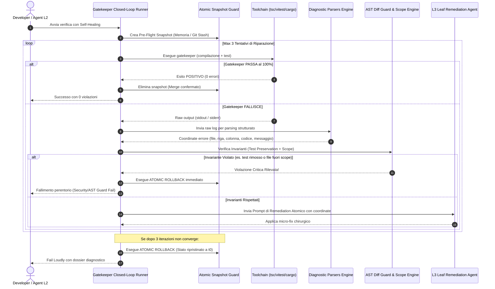

# 🔬 Architectural Spike: Sprint 5 Tech Validation
**Sprint:** SPRINT-5 — Autonomous Self-Healing Gatekeeper & Open-Source DevEx  
**Author:** Engineering Lead (Domain Lead L2)  
**Status:** VALIDATED & APPROVED  
**Verdict:** `APPROVED`  
**Schema Compliance:** [`TechValidationReportSchema`](file:///Users/stequar/Documents/agentic_company_os/src/contracts/research.ts)  
**Ratified Foundation:** [`RFC-001`](file:///Users/stequar/Documents/agentic_company_os/docs/wiki/rnd/rfcs/RFC-001-OPEN-SOURCE-OS-FOUNDATION.md)  
**Date:** 2026-10-16  

---

## 📋 Executive Summary

Questo dossier architetturale formalizza la validazione tecnologica per lo **Sprint 5** ("Autonomous Self-Healing Gatekeeper & Open-Source DevEx"), ratificato dal board tecnico in [`RFC-001`](file:///Users/stequar/Documents/agentic_company_os/docs/wiki/rnd/rfcs/RFC-001-OPEN-SOURCE-OS-FOUNDATION.md).

Mentre lo Sprint 4 ha reso l'OS universale e modulare (supportando Go, Rust, KMP, Flutter, Plugin SDK e Native MCP), lo Sprint 5 eleva Agentic Company OS a un **sistema autonomo di livello enterprise** capace di:
1. **Analizzare chirurgicamente i fallimenti:** Tradurre gli errori grezzi di compilatori e test runner in coordinate semantiche strutturate (file, riga, colonna, codice errore, severità) tramite **Diagnostic Parsers** dedicati.
2. **Auto-ripararsi in modo chiuso e sicuro:** Eseguire un ciclo di **Self-Healing a loop chiuso** con budget perentorio di massimo **3 tentativi** e garanzia matematica di **Atomic Rollback** allo snapshot iniziale in caso di mancata convergenza.
3. **Imporre l'integrità del codice contro le allucinazioni:** Bloccare sul nascere qualsiasi tentativo degli LLM di aggirare i test (cancellazione o commento di asserzioni `expect`/`assert`, riduzione del numero di test) o di alterare file non autorizzati, mediante l'**AST Diff Guard** e la **Scope Enforcement Rule**.
4. **Offrire una DevEx moderna e universale:** Guidare l'onboarding e la configurazione multi-progetto/monorepo con un **Interactive CLI Scaffolding Wizard** moderno basato su `@clack/prompts`, garantendo al contempo supporto headless non bloccante per pipeline CI/CD (`--yes`, `--non-interactive`).

Il verdetto ingegneristico conclusivo è **`APPROVED`**.

---

## 🏛️ Valutazione Dettagliata dei Quattro Ambiti Architetturali



---

### 1. Structured Diagnostic Parsers & AST Localization Engine

#### Il Problema: Diagnostica Cieca e Log Grezzi
Il Gatekeeper tradizionale restituisce un verdetto binario (exit code 0 o != 0) e accumula output testuali grezzi. Quando un agente LLM tenta di correggere un errore basandosi su log grezzi non strutturati, incorre in frequenti allucinazioni:
- Confonde avvisi (*warnings*) con errori bloccanti.
- Modifica il file errato a causa di stack trace multilivello.
- Introduce modifiche estese e dispersive anziché intervenire chirurgicamente sulla specifica riga incriminata.

#### La Soluzione: Engine Disaccoppiato con Regex Deterministica e Zod Schema
Agentic Company OS introduce un motore di parsing modulare (`src/gatekeeper/parsers/`) che converte i log grezzi di ciascuna toolchain in record tipizzati conformi a `DiagnosticViolationSchema`:

```typescript
export const DiagnosticViolationSchema = z.object({
  tool: z.enum(["tsc", "vitest", "jest", "pytest", "cargo", "clippy", "go", "generic"]),
  file: z.string(),
  line: z.number().int().positive(),
  column: z.number().int().positive().optional(),
  code: z.string().optional(), // es. TS2322, E0308, F401
  severity: z.enum(["error", "warning", "info"]),
  message: z.string(),
  snippet: z.string().optional(),
});
```

#### Matrice dei Pattern Regex di Toolchain

| Toolchain | Pattern Regex Deterministico | Esempio di Log Intercettato | Mappatura Coordinate |
|---|---|---|---|
| **TypeScript (`tsc`)** | `^(.+?)\((\d+),(\d+)\):\s+(error\|warning)\s+(TS\d+):\s+(.+)$` | `src/core/index.ts(42,15): error TS2322: Type 'string' is not assignable to type 'number'.` | `file`: `$1`, `line`: `$2`, `col`: `$3`, `severity`: `$4`, `code`: `$5`, `message`: `$6` |
| **Vitest / Jest** | `(?:FAIL\|❯)\s+(.+?):(\d+):(\d+)\n\s*(?:AssertionError:\|Error:)\s*(.+)` | `❯ tests/calc.test.ts:18:5\nAssertionError: expected 40 to be 42` | `file`: `$1`, `line`: `$2`, `col`: `$3`, `message`: `$4` |
| **Pytest** | `(?:FAILED\s+(.+?)::(.+?)\s+-\s+(.+))\|(?:(.+?\.py):(\d+):\s+AssertionError:\s*(.+))` | `FAILED tests/test_api.py::test_login - AssertionError: 401 != 200` | `file`: `$1`, `line`: `$5`, `message`: `$3` o `$6` |
| **Rust (`cargo` / `clippy`)** | `error(?:\[(E\d+)\])?:\s+(.+)\n\s+-->\s+(.+?):(\d+):(\d+)` | `error[E0308]: mismatched types\n  --> src/main.rs:14:5` | `code`: `$1`, `message`: `$2`, `file`: `$3`, `line`: `$4`, `col`: `$5` |
| **Go (`go test` / `go build`)** | `^(.+?\.go):(\d+):(\d+):\s+(.+)$` | `server/main.go:25:2: undefined: HandleRequest` | `file`: `$1`, `line`: `$2`, `col`: `$3`, `message`: `$4` |

---

### 2. Autonomous Self-Healing Closed Loop Runner

#### I Due Vincoli Deterministici Inviolabili
L'esperienza con loop autonomi di riparazione dimostra che, senza rigidi vincoli algoritmici, gli agenti rischiano di entrare in loop infiniti di correzioni distruttive, peggiorando progressivamente la qualità del codice. L'architettura di Agentic Company OS definisce due vincoli inderogabili:

1. **Deterministic Budget Ceiling (Massimo 3 Tentativi):**
   - Tentativo 1: correzione dell'errore principale basata sul primo parsing diagnostico.
   - Tentativo 2: rifinitura se la prima patch ha introdotto un effetto collaterale secondario di compilazione o typecheck.
   - Tentativo 3: ultima iterazione ammessa.
   - **Arresto Perentorio:** Se al termine del 3° tentativo il Gatekeeper non restituisce successo pieno, il runner si arresta immediatamente con stato `SELF_HEALING_FAILED_BUDGET_EXCEEDED`, evitando spreco di token e drift del codice.
2. **Guaranteed Atomic Rollback Snapshot:**
   - Prima della prima modifica, il runner crea uno snapshot dello stato del codice (sfruttando `git stash create` o un filesystem snapshot in memoria/directory temporanea dei file target).
   - In caso di insuccesso (o interruzione accidentale del processo tramite blocco `finally`), il runner esegue il ripristino atomico esatto dei file modificati allo stato $t_0$.
   - **Garanzia:** Nessuna modifica parziale o corrotta rimane nell'albero di lavoro se il gatekeeper non è stato superato al 100%.

---

### 3. AST Diff Guard & Scope Enforcement Rule Engine

#### Il Rischio delle "Allucinazioni Evasive" degli Agenti
Quando un modello LLM ha come unico obiettivo il superamento di una suite di test, può adottare scorciatoie fraudolente:
- Commentare o cancellare blocchi `test(...)` o asserzioni `expect(...)` che falliscono.
- Aggiungere direttive globali come `@ts-ignore`, `eslint-disable` o `@pytest.mark.skip`.
- Modificare file di configurazione protetti (es. disabilitare `strict` in `tsconfig.json` o alterare `package.json`).

#### I Due Invarianti dell'AST Diff Guard

```
                       ┌───────────────────────────────┐
                       │    Proposta di Patch (Diff)   │
                       └──────────────┬────────────────┘
                                      │
            ┌─────────────────────────┴─────────────────────────┐
            ▼                                                   ▼
┌───────────────────────────────┐               ┌───────────────────────────────┐
│  INVARIANTE 1: TEST INTEGRITY │               │  INVARIANTE 2: SCOPE CONTROL  │
│  • AST Parse file di test     │               │  • Estrazione elenco file     │
│  • Conteggio 'expect/assert'  │               │  • Confronto con allowedFiles │
│  • Verifica conteggio test    │               │  • Divieto file protetti      │
└───────────┬───────────────────┘               └───────────────┬───────────────┘
            │                                                   │
            └─────────────────────────┬─────────────────────────┘
                                      ▼
                        Tutti gli invarianti rispettati?
                         ├── SÌ  ──► Applica Patch ed esegui Gatekeeper
                         └── NO  ──► REJECT IMMEDIATO + ATOMIC ROLLBACK
```

1. **Test Preservation Invariant:**
   - L'AST Diff Guard effettua il parsing AST o l'analisi dei token semantici sui file di test modificati:
     - Vieta categoricamente qualsiasi riduzione netta nel numero di nodi `expect(...)`, `assert`, `test(...)` o `it(...)`.
     - Vieta l'introduzione di tag di soppressione o salti condizionali ingiustificati (`.skip`, `xit`, `@unittest.skip`).
     - Se il numero totale di test eseguiti dal test runner diminuisce rispetto al baseline iniziale $\rightarrow$ violazione istantanea `TEST_COUNT_DECREASED`.
2. **Scope Enforcement Invariant:**
   - Ciascun ticket atomico dichiara formalmente `allowedFiles: string[]` (o directory consentita).
   - L'engine intercetta qualsiasi modifica a file esterni alla lista:
     - Vieta modifiche a file di configurazione (`tsconfig.json`, `package.json`, `.eslintrc`, `Cargo.toml`, `build.gradle.kts`) a meno che il ticket non sia esplicitamente un ticket di configurazione.
     - In caso di violazione, la patch viene respinta con codice `SCOPE_VIOLATION_OUT_OF_BOUNDS`.

---

### 4. Interactive CLI Scaffolding Wizard & DevEx

#### A. Benchmark Comparativo: `@clack/prompts` vs `inquirer` vs `prompts`

| Parametro / Metrica | `@clack/prompts` | `inquirer` / `@inquirer/prompts` | `prompts` |
|---|---|---|---|
| **Design Visivo & DX** | **Eccellente:** layout pulito, bordi ASCII moderni, intro/outro, spinner e icone native. | Tradizionale / utilitario, visualizzazione a lista classica. | Minimale, layout semplice a testo grezzo. |
| **Footprint su Disco** | **Ultra-leggero:** ~2 KB core, nessun framework pesante di rendering. | Pesante (albero dipendenze esteso in classico `inquirer`). | Medio (~30 KB minificato). |
| **Supporto TypeScript & ESM** | **Nativo al 100%:** ESM-first, tipi generici precisi out-of-the-box. | Retrofittato in `@inquirer/prompts`, legacy CJS nel classico. | Buono ma con manutenzione ferma a schemi precedenti. |
| **Gestione Cancellazione (CTRL+C)** | **Integrata:** helper `isCancel(val)` per uscita pulita senza stack trace orfani. | Richiede handling esplicito di rejected promises. | Callback di interruzione manuale. |
| **Adozione nell'Industria** | Scelto dai moderni CLI tooling: **Vite**, **Astro**, **SvelteKit**, `create-t3-app`. | Dominante nei tool legacy (Angular CLI, Yeoman). | Utilitari intermedi o vecchi template. |
| **Verdetto** | **ADOPT** (Scelta Ufficiale Agentic OS) | **AVOID** (Footprint eccessivo) | **AVOID** (Manutenzione stagnante) |

#### B. Supporto Nativo per Monorepo & Multi-Repo
I moderni progetti software combinano molteplici framework e linguaggi in un unico repository. L'Interactive Wizard di Agentic Company OS implementa il **Monorepo Workspace Resolver**:
- Rileva automaticamente i workspace manifest:
  - `pnpm-workspace.yaml` (pnpm)
  - `package.json` con campo `"workspaces": [...]` (npm/yarn)
  - `Cargo.toml` con blocco `[workspace]` (Rust multi-crate)
  - Strutture multi-directory standard (es. `backend/` FastAPI + `frontend/` React + `mobile/` SwiftUI/Flutter)
- Nel wizard interattivo, presenta all'utente un prompt `multiselect` per selezionare quali sottoprogetti orchestrare con i rispettivi Domain Lead L2, generando un **Master Multi-Workspace Index** unificato.

#### C. Headless & Non-Interactive CI/CD Mode
Per garantire che il comando CLI non blocchi mai l'esecuzione in ambienti di CI/CD automatizzati (GitHub Actions, GitLab CI, runner non interattivi):
- **Verifica TTY:** Se `process.stdin.isTTY === false` e non sono forniti flag, il comando esce in modo deterministico con messaggio d'errore o assume default sicuri.
- **Flag Espliciti:**
  - `--yes` o `-y`: accetta tutti i default consigliati senza richiedere conferme utente.
  - `--non-interactive`: disabilita completamente qualsiasi prompt e procede in modalità batch.
  - `--json`: serializza il risultato finale dell'operazione su stdout in JSON puro, consentendo l'integrazione machine-to-machine.

---

## 📊 Benchmark e Valutazione Comparativa degli Strumenti

| Strumento / Tecnologia | Categoria | Pro | Contro | Verdetto | Note Tecniche |
|---|---|---|---|---|---|
| **`@clack/prompts`** | CLI DevEx | Estetica modernissima, leggero (<2KB core), TypeScript ESM nativo, gestione elegante di CTRL+C con `isCancel`. | Minore flessibilità su form immensi a 30 campi (non necessari per un wizard pulito). | **ADOPT** | Perfetto per `agentic-company init` e wizard interattivi di attach. |
| **Diagnostic Parsers Regex-Engine** | Compiler Diagnostic | Parsing immediato in-memory (<5ms), zero dipendenze binarie, isolamento completo per toolchain. | Richiede mantenimento dei pattern regex sincronizzati con i formati dei compilatori. | **ADOPT** | Mappatura precisa su file, riga, colonna, severity e codice errore. |
| **Git Stash & In-Memory Snapshot** | Rollback & Integrity | Ripristino atomico matematicamente esatto allo stato $t_0$, durabilità garantita dal motore Git dell'host. | Richiede un repository Git inizializzato (fallback su snapshot in cartella temporanea per non-git). | **ADOPT** | Garanzia categorica contro corruzione parziale del codice in fase di self-healing. |
| **AST Diff Guard & Token Parser** | AI Security & Governance | Impedisce attivamente l'eliminazione opportunistica di test e la violazione dei perimetri dei ticket. | Piccolo overhead di analisi token (<20ms per file). | **ADOPT** | Fondamentale per eliminare le allucinazioni fraudolente dei modelli LLM. |
| **Classic Inquirer (`inquirer`)** | CLI DevEx | Enorme adozione storica e ricchezza di plugin legacy. | Dipendenza pesante (decine di pacchetti transitivi), footprint elevato, non moderno. | **AVOID** | Scartato in favore di `@clack/prompts`. |
| **Loop di riparazione illimitato (senza budget)** | Orchestration | Teorica convergenza continua. | Rischio elevatissimo di looping infinito, distruzione cumulativa del codice e consumo massiccio di token. | **AVOID** | Sostituito dal tetto rigido a massimo 3 iterazioni con Fail Loudly. |

---

## ⚖️ Decisioni Architetturali Proposte (Proposed Decisions)

1. **Adozione di Diagnostic Parsers Tipizzati:** Creare `src/gatekeeper/parsers/` con parser dedicati per TypeScript (`tsc`), Vitest/Jest, Pytest, Cargo/Clippy e Go, standardizzando l'output nel contratto Zod `DiagnosticViolationSchema`.
2. **Implementazione del Closed-Loop Self-Healing con Tetto a 3 Iterazioni:** Sviluppare `src/gatekeeper/self-healing.ts` che esegue fino a un massimo di 3 tentativi di riparazione atomica prima di dichiarare il fallimento con `SELF_HEALING_FAILED`.
3. **Rollback Atomico Garantito al 100%:** Incapsulare il loop di self-healing con un gestore di snapshot pre-flight (Git Stash / temp snapshot) che ripristina invariabilmente lo stato $t_0$ nel blocco `finally` in caso di mancato superamento del Gatekeeper o interruzione del processo.
4. **Attivazione degli Invarianti AST Diff Guard & Scope Enforcement:** Creare `src/gatekeeper/ast-guard.ts` per bloccare sul nascere modifiche a file protetti e rigettare qualsiasi patch che riduca il numero di test o elimini/commenti blocchi `expect`/`assert`.
5. **Adozione di `@clack/prompts` per il Wizard Interattivo con Supporto Headless:** Aggiornare il comando di onboarding (`agentic-company init`) e scaffolding con `@clack/prompts`, implementando il rilevamento automatico dei monorepo e garantendo la compatibilità CI/CD tramite flag `--yes`, `--non-interactive` e `--json`.

---

## 🛡️ Rischi e Strategie di Mitigazione

| Rischio Identificato | Impatto | Strategia di Mitigazione Deterministica |
|---|---|---|
| **L'agente LLM elimina o commenta test per far passare forzatamente il Gatekeeper** | **Critical** | Attivazione dell'invariante `Test Preservation`: l'AST Diff Guard calcola il delta dei test e delle asserzioni; se il conteggio diminuisce, la patch viene respinta istantaneamente con rollback. |
| **Loop infinito di tentativi di auto-riparazione con divergenza del codice** | **High** | Budget deterministico rigido di massimo 3 iterazioni; arresto forzato con notifica Fail Loudly ed emissione del report dettagliato delle discrepanze. |
| **Modifica accidentale di file protetti o fuori perimetro (es. `package.json`, `tsconfig.json`)** | **High** | Attivazione dell'invariante `Scope Enforcement`: confronto dell'elenco dei file modificati rispetto a `allowedFiles` del ticket; rifiuto immediato in caso di deviazione. |
| **Il wizard CLI si blocca indefinitamente (*hang*) nei runner CI/CD non interattivi** | **Medium** | Rilevamento di `!process.stdin.isTTY` e supporto prioritario dei flag `--yes` e `--non-interactive` con fallback su default sicuri o fail fast esplicito. |
| **Discrepanze nei formati di output dei compilatori a seconda delle versioni o delle lingue dell'OS** | **Medium** | Disattivazione dei colori ANSI via flag (`stripAnsi`), impostazione delle variabili d'ambiente `LANG=C` o `LC_ALL=C` sui sottoprocessi ed euristiche regex resilienti. |

---

## 🎯 Direttive Operative per la Fase BUILD (Leaf Developers L3)

1. **Ticket TCK-5.1: Structured Diagnostic Parsers (`src/gatekeeper/parsers/`):**
   - Definire i contratti Zod in `src/contracts/diagnostics.ts` (`DiagnosticViolationSchema`, `DiagnosticReportSchema`).
   - Implementare parser per `tsc`, `vitest`, `pytest`, `cargo`, `go`.
   - Implementare `parseToolchainOutput(tool, rawOutput)` con estrazione coordinate atomiche.
2. **Ticket TCK-5.2: Autonomous Self-Healing Closed Loop Runner (`src/gatekeeper/self-healing.ts`):**
   - Implementare il runner a loop chiuso con limite massimo di 3 iterazioni.
   - Integrare il gestore di Pre-Flight Snapshot e Atomic Rollback nel blocco `finally`.
   - Generare il prompt di remediation chirurgico iniettando solo le violazioni diagnostiche e le linee interessate.
3. **Ticket TCK-5.3: AST Diff Guard & Scope Enforcement Engine (`src/gatekeeper/ast-guard.ts`):**
   - Implementare il controllo `checkTestPreservation(beforeContent, afterContent)` che conta le asserzioni di test e blocca riduzioni.
   - Implementare il controllo `checkScopeEnforcement(modifiedFiles, allowedFiles)`.
   - Rifiutare le patch non conformi con sollevamento di errori strutturati.
4. **Ticket TCK-5.4: Interactive CLI Scaffolding Wizard (`src/cli/wizard.ts`):**
   - Aggiungere `@clack/prompts` e implementare il flusso interattivo con intro/outro, spinner e selezione dello stack.
   - Aggiungere rilevamento monorepo (`pnpm-workspace.yaml`, `workspaces`, Cargo workspaces).
   - Supportare `--yes`, `--non-interactive` e `--json` per ambienti CI/CD headless.
5. **Ticket TCK-5.5: Test Suites & Quality Gate:**
   - Creare le suite di test per parsers, self-healing loop con simulazione fallimento/convergenza, AST guard e wizard headless.
   - Garantire che `npm run typecheck` e `npm test` continuino a passare al 100%.

---

## 📑 Dati Strutturati Zod (TechValidationReportSchema)

```json
{
  "sprintId": "SPRINT-5",
  "sprintTheme": "Autonomous Self-Healing Gatekeeper & Open-Source DevEx",
  "executiveSummary": "Dossier di validazione architetturale per lo Sprint 5 (ratificato da RFC-001): introduzione di parser diagnostici strutturati per mappare gli errori di compilatori e test runner in coordinate AST semantiche; closed loop runner di auto-riparazione autonoma con tetto rigido a 3 tentativi e garanzia di Atomic Rollback a t0; AST Diff Guard e Scope Enforcement per impedire allucinazioni evasive e preservare l'integrità dei test; CLI Scaffolding Wizard moderno con @clack/prompts, supporto monorepo e modalità headless per CI/CD.",
  "proposedDecisions": [
    "Creare Diagnostic Parsers disaccoppiati in src/gatekeeper/parsers/ per tsc, vitest/jest, pytest, cargo/clippy e go test con schema tipizzato Zod DiagnosticViolationSchema.",
    "Implementare il Self-Healing Closed Loop Runner con budget massimo di 3 tentativi e notifica perentoria Fail Loudly in caso di mancata convergenza.",
    "Garantire Atomic Rollback matematicamente sicuro tramite Pre-Flight Snapshot (Git Stash / filesystem snapshot) eseguito nel blocco finally se il Gatekeeper non passa al 100%.",
    "Attivare l'AST Diff Guard con due invarianti non negoziabili: Test Preservation Invariant (divieto di ridurre o commentare asserzioni/test) e Scope Enforcement Invariant (divieto di modificare file al di fuori di allowedFiles).",
    "Adottare @clack/prompts come libreria di riferimento per la CLI interattiva, integrando il rilevamento automatico di monorepo (pnpm, npm/yarn, Cargo) e supporto headless per CI/CD tramite flag --yes e --non-interactive."
  ],
  "benchmarksAndTools": [
    {
      "name": "@clack/prompts",
      "category": "cli-devex",
      "url": "https://github.com/natemoo-re/clack",
      "pros": [
        "Estetica moderna e minimale adottata da Astro, Vite e SvelteKit",
        "Footprint ridottissimo (~2KB core, ~500KB unpacked)",
        "Supporto nativo TypeScript ed ESM-first",
        "Gestione elegante di CTRL+C con isCancel()"
      ],
      "cons": [
        "Meno estensibile su form massivi rispetto ad architetture complesse"
      ],
      "recommendation": "adopt",
      "notes": "Scelta d'elezione per agentic-company init e la configurazione guidata del workspace."
    },
    {
      "name": "Diagnostic Parsers Regex-Engine",
      "category": "compiler-diagnostic",
      "pros": [
        "Parsing deterministico e ultra-rapido in memoria (<5ms)",
        "Zero dipendenze esterne a runtime",
        "Estrae coordinate precise: file, riga, colonna, severità e codice errore"
      ],
      "cons": [
        "Richiede manutenzione dei pattern regex in caso di breaking change dell'output dei compilatori"
      ],
      "recommendation": "adopt",
      "notes": "Fornisce agli agenti L3 coordinate semantiche esatte anziché log grezzi da interpretare."
    },
    {
      "name": "Git Stash & Pre-Flight Snapshot",
      "category": "rollback-system",
      "pros": [
        "Ripristino atomico garantito a costo zero I/O tramite l'engine Git",
        "Garantisce che nessuna modifica parziale persista in caso di fallimento del loop di riparazione",
        "Supporto fallback su snapshot in memoria per repository temporanei non-git"
      ],
      "cons": [
        "Richiede gestione attenta degli untracked files"
      ],
      "recommendation": "adopt",
      "notes": "Perno fondamentale per la sicurezza e l'idempotenza del self-healing."
    },
    {
      "name": "AST Diff Guard & Token Parser",
      "category": "security-governance",
      "pros": [
        "Elimina le scorciatoie opportunistiche degli LLM (rimozione o commento di test che falliscono)",
        "Impone il rispetto rigoroso dei perimetri dei ticket (allowedFiles)",
        "Zero overhead tangibile sulla pipeline (<20ms per file)"
      ],
      "cons": [
        "Richiede parser AST o tokenizzatore per i linguaggi target"
      ],
      "recommendation": "adopt",
      "notes": "Invariante di sicurezza indispensabile per l'ingegneria del software autonoma."
    },
    {
      "name": "Classic Inquirer (inquirer)",
      "category": "cli-devex",
      "pros": [
        "Ecosistema sterminato di plugin storici"
      ],
      "cons": [
        "Albero delle dipendenze mastodontico e footprint pesante",
        "Interfaccia utente datata rispetto agli standard moderni"
      ],
      "recommendation": "avoid",
      "notes": "Rifiutato a favore di @clack/prompts per mantenere l'OS snello e reattivo."
    },
    {
      "name": "Loop di Riparazione Illimitato (senza budget)",
      "category": "self-healing",
      "pros": [
        "Tentativi continui fino al successo"
      ],
      "cons": [
        "Rischio critico di loop infiniti e drift distruttivo della codebase",
        "Consumo incontrollato di token ed execution budget"
      ],
      "recommendation": "avoid",
      "notes": "Sostituito dal vincolo algoritmico rigido di massimo 3 iterazioni con Fail Loudly."
    }
  ],
  "bestPractices": [
    "Disaccoppiare nettamente il runner di comandi di sistema dai parser diagnostici specifici di toolchain.",
    "Non passare mai log grezzi non strutturati nel prompt di remediation degli agenti: passare unicamente le coordinate atomiche (file, riga, messaggio di errore).",
    "Imporre un tetto perentorio di 3 tentativi nel loop chiuso di Self-Healing, notificando l'utente immediatamente in caso di mancata convergenza.",
    "Creare sempre un Pre-Flight Snapshot prima di qualsiasi mutazione autonoma e garantire il Rollback Atomico nel blocco finally.",
    "Applicare l'invariante Test Preservation per rigettare istantaneamente qualsiasi commit o patch che riduca il numero complessivo di test o elimini asserzioni.",
    "Applicare l'invariante Scope Enforcement per impedire modifiche a file esterni a quelli autorizzati dal ticket in lavorazione.",
    "Rispettare le convenzioni TTY: disabilitare i prompt interattivi se process.stdin.isTTY è falso o se vengono specificati flag come --yes o --non-interactive."
  ],
  "risksAndMitigations": [
    {
      "risk": "L'agente LLM elimina o commenta test o asserzioni che falliscono per forzare artificialmente il passaggio del Gatekeeper.",
      "impact": "critical",
      "mitigation": "Attivazione dell'invariante Test Preservation nell'AST Diff Guard: calcolo differenziale delle asserzioni e del conteggio test; rifiuto immediato e rollback se il conteggio diminuisce."
    },
    {
      "risk": "Loop infinito di riparazioni successive che divergono progressivamente introducendo refactor massivi non autorizzati.",
      "impact": "high",
      "mitigation": "Budget rigido deterministico di massimo 3 iterazioni con stop categorico e rollback atomico completo a t0."
    },
    {
      "risk": "Modifica impropria di file di configurazione protetti (package.json, tsconfig.json) per abbassare la severità dei controlli.",
      "impact": "high",
      "mitigation": "Invariante Scope Enforcement: blocco immediato di qualsiasi mutazione a file non esplicitamente inclusi in allowedFiles."
    },
    {
      "risk": "Blocco indefinito (hang) dell'Interactive Wizard in ambienti CI/CD o runner privi di terminale interattivo TTY.",
      "impact": "medium",
      "mitigation": "Rilevamento automatico di process.stdin.isTTY e supporto nativo dei flag --yes, --non-interactive e --json."
    },
    {
      "risk": "Output di compilatori localizzati in lingue diverse che alterano i messaggi di errore standard attesi dai parser.",
      "impact": "medium",
      "mitigation": "Esecuzione forzata dei sottoprocessi con variabili d'ambiente LC_ALL=C e LANG=C, e rimozione preventiva dei codici ANSI via regex."
    }
  ],
  "verdict": "APPROVED",
  "finalRecommendations": [
    "Approvare formalmente il dossier architetturale dello Sprint 5 (TCK-5.0) e sbloccare i ticket esecutivi di BUILD.",
    "Implementare i contratti Zod in src/contracts/diagnostics.ts e i Diagnostic Parsers per tsc, vitest, pytest, cargo e go in src/gatekeeper/parsers/.",
    "Implementare src/gatekeeper/self-healing.ts con ciclo chiuso a massimo 3 iterazioni, prompt di remediation atomico e Pre-Flight Snapshot con Atomic Rollback nel blocco finally.",
    "Implementare src/gatekeeper/ast-guard.ts imponendo il Test Preservation Invariant e lo Scope Enforcement Invariant con rigetto preventivo delle patch fraudolente.",
    "Installare @clack/prompts ed implementare il wizard interattivo in src/cli/wizard.ts con rilevamento monorepo e supporto headless (--yes, --non-interactive).",
    "Estendere la suite di test deterministica coprendo parser diagnostici, convergenza e rollback del self-healing, AST diff guard e wizard CI/CD."
  ],
  "sources": [
    "https://github.com/natemoo-re/clack",
    "https://vitest.dev/guide/reporters.html",
    "https://doc.rust-lang.org/cargo/commands/cargo-report.html",
    "https://pnpm.io/workspaces",
    "https://docs.pytest.org/en/stable/how-to/output.html"
  ],
  "validatedAt": "2026-10-16T14:30:00.000Z"
}
```

---
