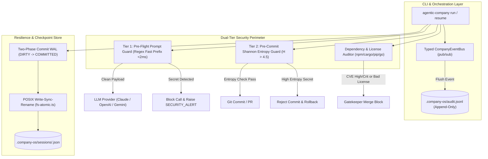
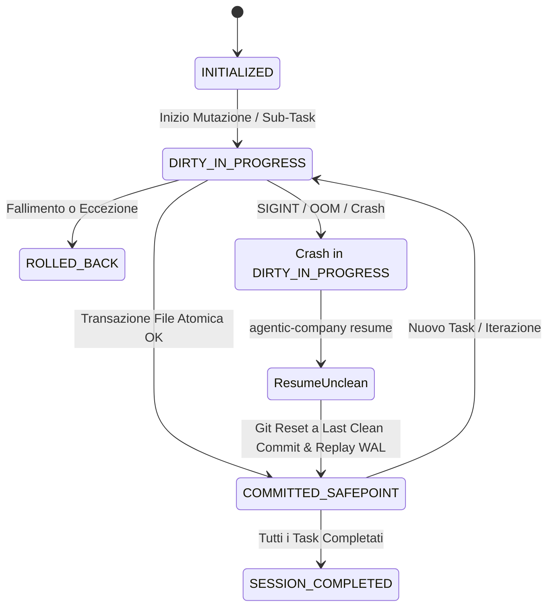
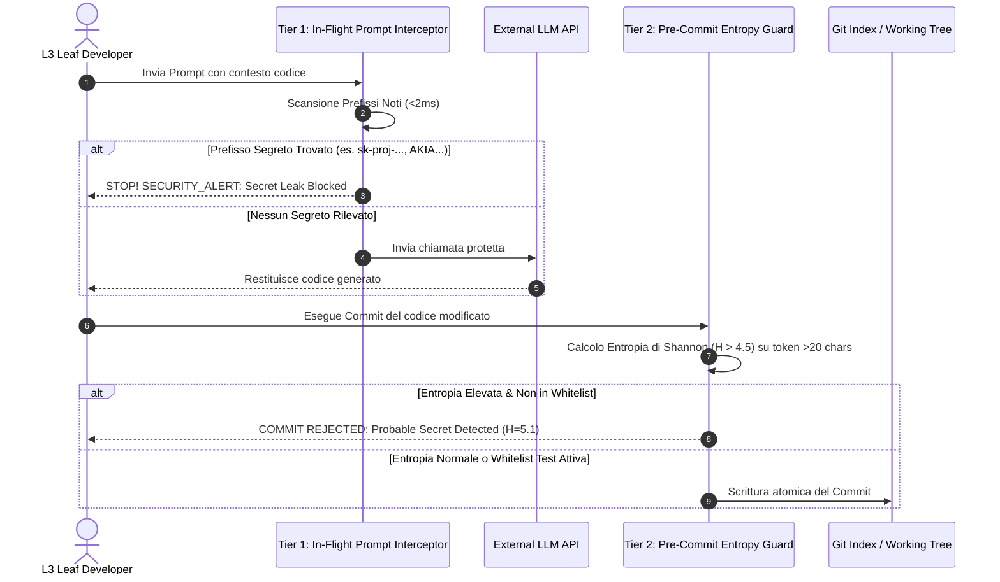

# 🔬 Architectural Spike: Sprint 6 Tech Validation
**Sprint:** SPRINT-6 — Enterprise Resilience, Security Guardrails & Session Recovery  
**Author:** Engineering Lead (Domain Lead L2)  
**Status:** VALIDATED & APPROVED  
**Verdict:** `APPROVED`  
**Schema Compliance:** [`TechValidationReportSchema`](file:///Users/stequar/Documents/agentic_company_os/src/contracts/research.ts)  
**Ratified Foundation:** [`RFC-002`](file:///Users/stequar/Documents/agentic_company_os/docs/wiki/rnd/rfcs/RFC-002-ENTERPRISE-AUTONOMY-AND-SAFETY.md)  
**Date:** 2026-10-16  

---

## 📋 Executive Summary

Questo dossier architetturale formalizza la validazione tecnologica preventiva per lo **Sprint 6** ("Enterprise Resilience, Security Guardrails & Session Recovery"), ratificato dal board tecnico all'unanimità nell'[`RFC-002`](file:///Users/stequar/Documents/agentic_company_os/docs/wiki/rnd/rfcs/RFC-002-ENTERPRISE-AUTONOMY-AND-SAFETY.md).

Mentre gli Sprint 4 e 5 hanno fornito all'OS il supporto multi-stack universale, l'architettura plugin su worker thread isolati, l'interoperabilità nativa MCP e il loop autonomo di Self-Healing, lo Sprint 6 colma le ultime fragilità sistemiche identificate nella fase di discovery del Ciclo 2:
1. **Resilienza Totale e Crash-Only Architecture:** Eliminazione della perdita di memoria volatile su interruzione di processo (`SIGINT`, OOM, reboot) tramite **Deterministic State Checkpointing** basato su Write-Ahead Logging (WAL), Two-Phase Commit (`DIRTY_IN_PROGRESS` $\rightarrow$ `COMMITTED_SAFEPOINT`) e ripristino istantaneo via `agentic-company resume` con verifica di integrità dell'albero Git e checksum SHA-256.
2. **Osservabilità e Audit Trail Immutabile:** Creazione di un **Typed Enterprise Event Bus** asincrono in-memory (`CompanyEventBus`), validato da contratti Zod per il ciclo di vita aziendale (`CompanyEventSchema`) e persistito deterministicamente in un log sequenziale append-only (`.company-os/audit.jsonl`).
3. **Prevenzione Dual-Tier delle Fughe di Segreti (Anti-Leak Guard):** Protezione perimetrale a due stadi: **Tier 1** sincrono ad altissima velocità (<2ms) a monte delle chiamate LLM per intercettare prefissi noti di credenziali API (`sk-proj`, `AKIA`, `ghp_`, chiavi private PEM), e **Tier 2** asincrono pre-commit basato su analisi differenziale e calcolo dell'**Entropia di Shannon** ($H > 4.5$ su token $>20$ caratteri) con whitelist contestuale per mock e fixture di test.
4. **Supply Chain Security & License Compliance Gatekeeper:** Auditing polimorfico integrato nel Gatekeeper per rilevare vulnerabilità note delle dipendenze di terze parti (`npm audit`, `cargo audit`, `pip-audit`, `govulncheck`) con timeout a 5000ms, blocco automatico su severità `HIGH`/`CRITICAL` e verifica di conformità delle licenze software rispetto alla whitelist open source (MIT, Apache-2.0, BSD, ISC).

Il verdetto ingegneristico conclusivo è **`APPROVED`**.

---

## 🏛️ Valutazione Dettagliata dei Quattro Ambiti Architetturali



---

### 1. Deterministic State Checkpointing & Resilient Session Resume

#### Il Problema: Vulnerabilità della Memoria Volatile
Nei sistemi multi-agente convenzionali, l'intero grafo dei task, lo storico delle iterazioni di self-healing e il contesto dei file modificati risiedono nella memoria volatile heap del processo Node.js. Se il processo viene terminato bruscamente a causa di:
- Interruzione manuale da terminale (`SIGINT` / `Ctrl+C`);
- Terminazione da parte dell'OS per superamento della memoria (Out-Of-Memory Killer);
- Timeout forzato di una pipeline CI/CD o disconnessione della macchina;

tutto l'avanzamento accumulato (spesso 15-30 minuti di lavoro autonomo) va irrimediabilmente perduto. Al riavvio successivo, l'agente deve ricominciare da capo, con spreco di token LLM, rischio di creare file duplicati e incapacità di spiegare all'utente a quale punto del task fosse arrivato.

#### La Soluzione Architetturale: Write-Ahead Logging & Two-Phase Commit
Introduciamo un motore di persistenza deterministica basato su **Two-Phase Commit Checkpointing**:



1. **Stato della Sessione Tipizzato (`SessionSnapshotSchema`):**
   ```typescript
   export const SessionSnapshotSchema = z.object({
     sessionId: z.string().uuid(),
     status: z.enum(["INITIALIZED", "DIRTY_IN_PROGRESS", "COMMITTED_SAFEPOINT", "COMPLETED", "FAILED"]),
     currentSprint: z.string(),
     currentTaskId: z.string().optional(),
     phase: z.string(),
     iteration: z.number().int().nonnegative(),
     gitCommitSha: z.string(),
     treeChecksumSha256: z.string(),
     activeFiles: z.array(z.string()),
     taskStack: z.array(z.object({
       taskId: z.string(),
       title: z.string(),
       status: z.enum(["PENDING", "IN_PROGRESS", "VALIDATED", "FAILED"]),
       assignedRole: z.string(),
     })),
     timestamp: z.string().datetime(),
   });
   ```
2. **Two-Phase Commit Protocol:**
   - **Fase 1 (Prepare):** Prima di applicare qualsiasi modifica al codice o invocare una toolchain esterna, la sessione passa a `DIRTY_IN_PROGRESS` e scrive il log con il task corrente.
   - **Fase 2 (Commit):** Dopo che la scrittura atomica su disco dei file (via POSIX Write-Sync-Rename) ha avuto successo e il Gatekeeper ha convalidato la modifica, lo stato passa a `COMMITTED_SAFEPOINT` con il nuovo commit SHA e il checksum dell'albero di lavoro.
3. **Session Recovery deterministico (`agentic-company resume`):**
   - Se l'OS trova lo stato `DIRTY_IN_PROGRESS` all'avvio, rileva che l'esecuzione precedente è crashata durante una mutazione non completata.
   - Esegue automaticamente `git reset --hard <gitCommitSha>` per annullare mutazioni parziali a metà, ripristina la coda dei task a partire dall'ultimo `COMMITTED_SAFEPOINT` e riprende l'esecuzione in totale coerenza.

---

### 2. Typed Enterprise Event Bus & JSONL Audit Trail

#### Architettura del Bus
Per garantire un'osservabilità completa e conforme agli standard enterprise (SOC 2, ISO 27001, audit forense), l'OS si dota di un **Event Bus fortemente tipizzato** che disaccoppia la generazione di eventi dalla loro consumazione/persistenza:

```typescript
export const CompanyEventTypeSchema = z.enum([
  "SESSION_STARTED",
  "SESSION_RESUMED",
  "TASK_TRIGGERED",
  "TASK_COMPLETED",
  "TASK_FAILED",
  "GATEKEEPER_STARTED",
  "GATEKEEPER_PASSED",
  "GATEKEEPER_FAILED",
  "SELF_HEALING_ITERATION",
  "SECURITY_ALERT",
  "DIFF_GUARD_VIOLATION",
  "DEPENDENCY_AUDIT_RESULT",
  "SESSION_SAFEPOINT_COMMITTED",
]);

export const CompanyEventSchema = z.object({
  eventId: z.string().uuid(),
  sessionId: z.string(),
  type: CompanyEventTypeSchema,
  sourceRole: z.string(),
  payload: z.record(z.any()),
  timestamp: z.string().datetime(),
});
```

#### Persistenza Append-Only (`.company-os/audit.jsonl`)
- Ogni evento pubblicato su `CompanyEventBus` viene serializzato in formato JSON su riga singola (JSONL) e appeso al file `.company-os/audit.jsonl`.
- La scrittura append-only evita locking complessi ed è immune da corruzioni dell'intero file in caso di crash a metà riga.
- Consente lo streaming real-time per consumatori esterni (es. terminal logger, dashboard SSE o integrazioni SIEM).

---

### 3. Dual-Tier Secret & PII Leak Prevention Gate



#### Tier 1: Pre-Flight Prompt Interceptor (Sincrono, Latenza < 2ms)
- **Meccanismo:** Scansione rapida a due stadi. Prima controlla la presenza di prefissi noti con string matching ancorato (O(n)), e solo se positivo applica regex mirata.
- **Prefissi Intercettati:**
  - OpenAI API Keys: `sk-proj-[A-Za-z0-9_-]{48,}`, `sk-[A-Za-z0-9]{32,}`
  - AWS Access Keys: `AKIA[0-9A-Z]{16}`
  - GitHub Personal Access Tokens: `ghp_[A-Za-z0-9_]{36}`, `gho_[A-Za-z0-9_]{36}`
  - Anthropic Keys: `sk-ant-[A-Za-z0-9_-]{80,}`
  - Chiavi Private Crittografiche: `-----BEGIN (RSA|EC|DSA|OPENSSH|PGP|PRIVATE) KEY-----`
  - Database URI con password embedded: `(?:postgres|mysql|mongodb|redis):\/\/[^:\/\s]+:([^@\/\s]+)@`

#### Tier 2: Pre-Commit Shannon Entropy Guard
- **Formula Matematica:**
  $$H(X) = -\sum_{i=1}^{n} P(x_i) \log_2 P(x_i)$$
  dove $P(x_i)$ è la frequenza relativa del carattere $x_i$ nella stringa considerata.
- **Soglia di Riconoscimento:** Token alfanumerici senza spazi di lunghezza $> 20$ caratteri con entropia $H > 4.5$ vengono contrassegnati come potenziali segreti/token ad alta casualità.
- **Whitelist Contestuale e Falsi Positivi:**
  - Bypass automatico per file all'interno di directory di test (`tests/`, `__tests__/`, `fixtures/`, `mock/`, `testdata/`).
  - Bypass per file di template `.env.example`, `.env.sample`.
  - Esclusione di hash crittografici noti (SHA-256 in hex ha entropia tipicamente limitata a 16 caratteri hex $[0-9a-f]$, con $H \approx 3.8-4.0$).

---

### 4. Dependency Vulnerability & License Compliance Auditor

#### Auditing Multi-Ecosistema Polimorfico
Il modulo `DependencyAuditor` si integra nativamente nel Deterministic Gatekeeper e nel comando `doctor`, invocando gli strumenti di sicurezza ufficiali per ciascun ecosistema:

| Ecosistema | Scanner Ufficiale | Comando Eseguito | Parsing Output | Timeout |
|---|---|---|---|---|
| **Node.js / TS** | `npm audit` | `npm audit --json` | `vulnerabilities.[pkg].severity` | 5000ms |
| **Rust** | `cargo audit` | `cargo audit --json` | `vulnerabilities.list[].advisory.severity` | 5000ms |
| **Python** | `pip-audit` | `pip-audit --format=json` | `dependencies[].vulns[].id` | 5000ms |
| **Go** | `govulncheck` | `govulncheck -json ./...` | `Finding.OSV` | 5000ms |

#### Policy di Blocco e Fallback Graceful
- **Soglia di Severità:** Se vengono riscontrate vulnerabilità di livello `HIGH` o `CRITICAL`, il Gatekeeper **blocca il merge** e notifica l'agente per l'aggiornamento della dipendenza.
- **Connettività Offline/Air-Gapped:** Se il comando audit fallisce per mancata risoluzione DNS o timeout di rete (es. in container CI isolato), l'auditor emette un `warning` sull'Event Bus ma non blocca la build se non espressamente richiesto dal flag `--strict-audit`.
- **License Compliance Whitelist:** Verifica che le licenze delle dipendenze dirette appartengano alle licenze permissive consentite:
  `["MIT", "Apache-2.0", "BSD-2-Clause", "BSD-3-Clause", "ISC", "CC0-1.0", "Unlicense"]`.
  Segnalazione bloccante per licenze virali (GPL-2.0, GPL-3.0, AGPL-3.0) su repository commerciali o proprietari.

---

## 🔬 Benchmark e Confronto delle Soluzioni

```
┌──────────────────────────────────────────────────────────────────────────────────────────────────┐
│                                 BENCHMARK STRUMENTI & PATTERN                                    │
├──────────────────────┬──────────────────────┬────────────────────────────────────────────────────┤
│ Categoria            │ Soluzione            │ Giudizio & Rationale Ingegneristico               │
├──────────────────────┼──────────────────────┼────────────────────────────────────────────────────┤
│ State Checkpointing  │ Two-Phase Commit WAL │ ADOPT: Trasparente, atomico POSIX, zero dipendenze│
│ State Checkpointing  │ SQLite Embedded      │ AVOID: Dipendenza nativa C++ complessa su Mac/Linux│
│ Telemetria & Eventi  │ In-Memory + JSONL    │ ADOPT: Append-only, leggero, streaming immediato   │
│ Telemetria & Eventi  │ Redis / RabbitMQ     │ AVOID: Overhead infrastrutturale ingiustificato    │
│ Secret Prevention    │ Dual-Tier Fast+Entr. │ ADOPT: <2ms su prompt + Shannon pre-commit         │
│ Secret Prevention    │ Gitleaks Binario Ext │ EVALUATE: Efficace ma richiede binary setup OS     │
│ Dependency Audit     │ Native CLIs via JSON │ ADOPT: Zero dipendenze terze, massima fedeltà      │
│ Dependency Audit     │ Snyk / Trivy SaaS    │ AVOID: Richiede account API esterni a pagamento    │
└──────────────────────┴──────────────────────┴────────────────────────────────────────────────────┘
```

---

## 📑 Dati Strutturati Zod (`TechValidationReportSchema`)

```json
{
  "sprintId": "SPRINT-6",
  "sprintTheme": "Enterprise Resilience, Security Guardrails & Session Recovery",
  "executiveSummary": "Dossier di validazione architetturale per lo Sprint 6 approvato all'unanimità (RFC-002). Definiti i 4 pilastri per la maturità enterprise: 1) Deterministic State Checkpointing con WAL e Two-Phase Commit (DIRTY_IN_PROGRESS -> COMMITTED_SAFEPOINT) e resume deterministico post-crash; 2) Typed Enterprise Event Bus con contratti Zod (CompanyEventSchema) e audit log append-only su .company-os/audit.jsonl; 3) Dual-Tier Secret Prevention Guard con scansione sincrona prefissi (<2ms) a monte dei prompt LLM ed analisi differenziale pre-commit basata su Entropia di Shannon (H > 4.5); 4) Dependency Vulnerability & License Compliance Auditor integrato nel Gatekeeper per npm, cargo, pip e go con policy bloccante su falle HIGH/CRITICAL e whitelist licenze permissive.",
  "proposedDecisions": [
    "Implementare State Checkpointing basato su Two-Phase Commit (DIRTY_IN_PROGRESS / COMMITTED_SAFEPOINT) con persistenza atomica POSIX in .company-os/sessions/<id>.json.",
    "Implementare il comando CLI agentic-company resume con validazione dell'albero Git tramite SHA-256 e ripristino automatico dello safe-point integro.",
    "Introdurre l'Event Bus tipizzato CompanyEventBus in src/core/events.ts con contratti Zod e persistenza append-only in .company-os/audit.jsonl.",
    "Implementare il Dual-Tier Secret Prevention Gate in src/security/secret-guard.ts con Tier 1 pre-flight sincrono (<2ms) e Tier 2 pre-commit con calcolo dell'Entropia di Shannon (H > 4.5).",
    "Introdurre whitelist contestuale automatica nel Secret Guard per file in tests/, fixtures/ e .env.example, eliminando falsi positivi sui token di mock.",
    "Implementare il modulo DependencyAuditor in src/security/dependency-auditor.ts integrato nel Gatekeeper con supporto multi-stack (npm, cargo, pip-audit, govulncheck), timeout a 5000ms e verifica licenze permissive."
  ],
  "benchmarksAndTools": [
    {
      "name": "Two-Phase Commit POSIX State Checkpointing",
      "category": "resilience-checkpointing",
      "pros": [
        "Elimina la perdita di memoria dei task in caso di SIGINT o crash del processo",
        "Ripristino istantaneo via CLI senza dipendenze da server esterni",
        "Piena conformità con il pattern atomico Write-Sync-Rename POSIX"
      ],
      "cons": [
        "Richiede serializzazione frequente dello stato durante transizioni di micro-task"
      ],
      "recommendation": "adopt",
      "notes": "Fondamento cardine per rendere l'OS indistruttibile in ambienti server e CLI lunghi."
    },
    {
      "name": "SQLite / Better-SQLite3 Embedded",
      "category": "resilience-checkpointing",
      "pros": [
        "Query SQL avanzate e transazioni ACID native"
      ],
      "cons": [
        "Richiede compilazione nativa con binding C++, problematico in distribuzioni cross-platform leggeri",
        "Appesantisce l'installazione npm con binari precompilati"
      ],
      "recommendation": "avoid",
      "notes": "Rifiutato a favore di JSON atomico POSIX su filesystem nativo."
    },
    {
      "name": "Dual-Tier Secret Prevention (Fast Prefix + Shannon Entropy)",
      "category": "security-governance",
      "pros": [
        "Tier 1 ultra-veloce (<2ms) sul payload prompt prima delle chiamate API esterne",
        "Tier 2 ad entropia di Shannon per rilevare chiavi ad alta casualità non catalogate",
        "Zero dipendenze esterne, logica matematica pura"
      ],
      "cons": [
        "Possibili falsi positivi su stringhe di test (risolto tramite whitelist contestuale)"
      ],
      "recommendation": "adopt",
      "notes": "Standard de facto per prevenire data breach e fughe di token verso provider LLM."
    },
    {
      "name": "Native Toolchain Dependency Audit CLIs",
      "category": "supply-chain-security",
      "pros": [
        "Utilizza gli strumenti ufficiali del linguaggio (npm audit, cargo audit, etc.)",
        "Output strutturato JSON nativo senza abbonamenti SaaS esterni",
        "Aggiornamento costante dei database di advisories (OSV, GitHub Security Advisory)"
      ],
      "cons": [
        "Richiede che la toolchain target sia installata sull'host"
      ],
      "recommendation": "adopt",
      "notes": "Integrazione naturale all'interno del Deterministic Gatekeeper."
    }
  ],
  "bestPractices": [
    "Non eseguire mai scritture non protette dello stato di sessione: utilizzare sempre il pattern POSIX Write-Sync-Rename atomico.",
    "Registrare sempre lo stato DIRTY_IN_PROGRESS prima di eseguire una mutazione e COMMITTED_SAFEPOINT solo a operazione completata con successo.",
    "Non inviare mai payload verso API LLM esterne senza preventiva validazione del Tier 1 Secret Guard.",
    "Consentire l'uso di credenziali e token fittizi nei file di test e fixture mediante whitelist contestuale dei percorsi tests/ e mock.",
    "Imporre un hard timeout di 5000ms a tutti i sottoprocessi di audit delle dipendenze per prevenire hang in ambienti privi di connettività.",
    "Tutte le emissioni dell'Event Bus devono rispettare rigidamente contratti tipizzati Zod con discriminatore esplicito.",
    "Mantenere il log forense .company-os/audit.jsonl rigorosamente append-only per garantire integrità e non ripudio degli eventi di sistema."
  ],
  "risksAndMitigations": [
    {
      "risk": "Crash improvviso del processo Node.js durante la scrittura del checkpoint con conseguente corruzione del file di stato.",
      "impact": "high",
      "mitigation": "Utilizzo rigoroso di atomicWriteFile POSIX (scrittura su file .tmp, sync fisico del file descriptor su disco e rename atomico)."
    },
    {
      "risk": "Falsi positivi del Secret Guard su stringhe di test unitari con blocco improprio dell'esecuzione.",
      "impact": "medium",
      "mitigation": "Whitelist contestuale basata su percorsi di file (tests/, fixtures/) e regex con riconoscimento di prefissi/suffissi fittizi (mock, test, fake)."
    },
    {
      "risk": "Lentezza o timeout infinito degli scanner di dipendenze (npm audit, cargo audit) in reti aziendali o ambienti offline.",
      "impact": "medium",
      "mitigation": "Hard timeout di 5000ms con gestione graceful del fallimento di rete e segnalazione di warning non bloccante in assenza di connessione."
    },
    {
      "risk": "Crescita incontrollata delle dimensioni del file audit.jsonl durante sessioni continue prolungate.",
      "impact": "low",
      "mitigation": "Rotazione automatica dei file di audit al raggiungimento di 10MB con archiviazione gzip dei log storici."
    }
  ],
  "verdict": "APPROVED",
  "finalRecommendations": [
    "Approvare formalmente il dossier architetturale dello Sprint 6 (TCK-6.0) e dare il via libera all'implementazione dei ticket di BUILD.",
    "Definire i contratti Zod per State Checkpointing, Event Bus e Security Audit in src/contracts/resilience.ts e src/contracts/security.ts.",
    "Implementare il Session Checkpointing Engine con Two-Phase Commit e Session Resume in src/core/session.ts.",
    "Implementare il CompanyEventBus asincrono tipizzato con persistenza JSONL append-only in src/core/events.ts.",
    "Implementare il Dual-Tier Secret Prevention Guard in src/security/secret-guard.ts con Tier 1 pre-flight e Tier 2 pre-commit Shannon entropy.",
    "Implementare il DependencyAuditor polimorfico in src/security/dependency-auditor.ts integrato nel Gatekeeper per npm, cargo, pip e go.",
    "Estendere la test suite per validare al 100% la resilienza su crash simulato, la cattura dei segreti, l'audit di dipendenze e l'integrità dell'Event Bus."
  ],
  "sources": [
    "https://en.wikipedia.org/wiki/Entropy_(information_theory)",
    "https://docs.npmjs.com/cli/v10/commands/npm-audit",
    "https://rustsec.org/",
    "https://pypi.org/project/pip-audit/",
    "https://pkg.go.dev/golang.org/x/vuln/cmd/govulncheck",
    "https://spdx.org/licenses/"
  ],
  "validatedAt": "2026-10-16T15:30:00.000Z"
}
```

---
