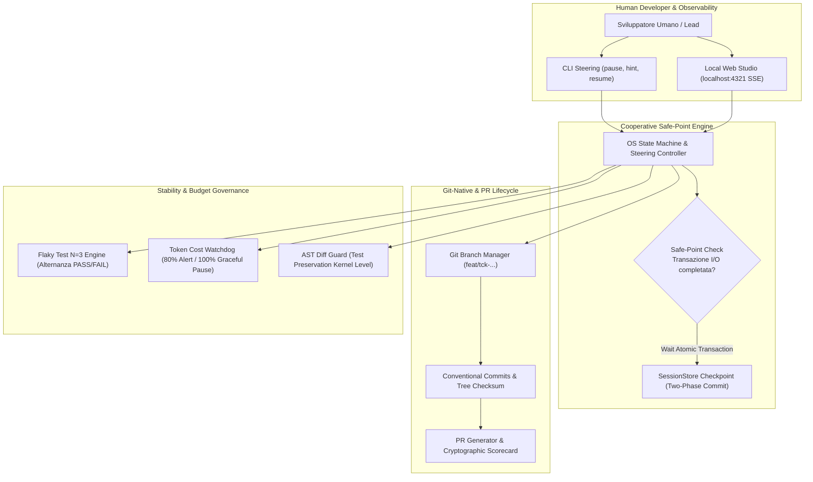
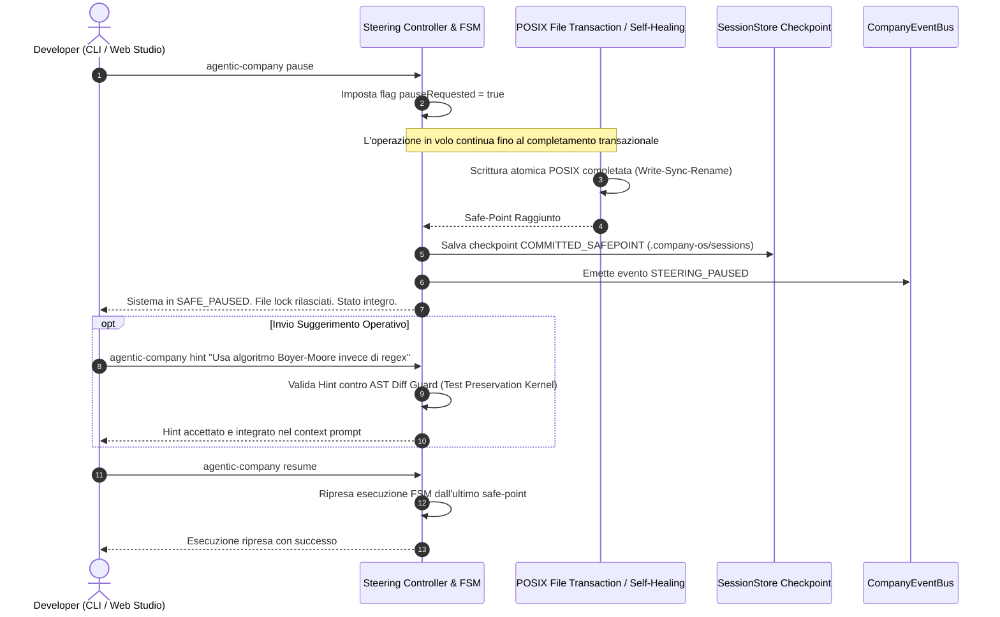

# 🔬 Architectural Spike: Sprint 7 Tech Validation
**Sprint:** SPRINT-7 — Git-Native Collaboration & Quality Governance  
**Author:** Engineering Lead (Domain Lead L2)  
**Status:** VALIDATED & APPROVED  
**Verdict:** `APPROVED`  
**Schema Compliance:** [`TechValidationReportSchema`](file:///Users/stequar/Documents/agentic_company_os/src/contracts/research.ts)  
**Ratified Foundation:** [`RFC-002`](file:///Users/stequar/Documents/agentic_company_os/docs/wiki/rnd/rfcs/RFC-002-ENTERPRISE-AUTONOMY-AND-SAFETY.md)  
**Date:** 2026-10-16  

---

## 📋 Executive Summary

Questo dossier architetturale formalizza la validazione tecnologica preventiva per lo **Sprint 7** ("Git-Native Collaboration & Quality Governance"), ratificato all'unanimità dal board tecnico nell'[`RFC-002`](file:///Users/stequar/Documents/agentic_company_os/docs/wiki/rnd/rfcs/RFC-002-ENTERPRISE-AUTONOMY-AND-SAFETY.md).

Mentre lo Sprint 6 ha blindato l'affidabilità sistemica dell'OS introducendo lo **State Checkpointing** con Two-Phase Commit, il **Typed Event Bus** con audit trail JSONL, il **Dual-Tier Secret Prevention Gate** e il **Dependency Vulnerability & License Auditor**, lo Sprint 7 apre Agentic Company OS alla **collaborazione ergonomica con sviluppatori umani** e ai flussi di lavoro Git di livello enterprise:

1. **Cooperative Safe-Point HITL Steering Engine:** Meccanismo non distruttivo di pausa, guida interattiva e ripresa (`pause`, `hint`, `resume`, `abort`). Il sistema non abortisce mai le transazioni I/O in volo: attende il completamento atomico (Write-Sync-Rename o iterazione di self-healing), salva lo stato coerente e rilascia i lock. L'**AST Diff Guard opera a livello kernel**, rendendo impossibile per un operatore umano o per l'LLM sopprimere test o asserzioni tramite hint.
2. **Automazione Git-Native & PR Scorecard:** Isolamento del ciclo di vita dei ticket su feature branch automatici (`feat/tck-<id>-<description>`), commit conformi a **Conventional Commits** e generazione automatica della Pull Request arricchita da una **Scorecard di Qualità e Sicurezza crittografica** (Gatekeeper, Secret Scan, Dependency Audit).
3. **Zero-Dependency Embedded Web Studio Dashboard:** Web server locale embedded su `localhost:4321` basato puramente su `node:http` e **Server-Sent Events (SSE)**. Avvio immediato (<50ms), footprint di memoria minimo (<15MB RAM), zero dipendenze npm esterne pesanti e massima sicurezza perimetrale (loopback bind `127.0.0.1`, bearer token effimero `0600`, protezione anti-CSRF e DNS rebinding).
4. **Flaky Test N=3 Quarantine Engine:** Algoritmo multi-run su $N=3$ iterazioni consecutive sullo stesso commit: isola in quarantena (`.gatekeeper/quarantine.json`) **solo** i test che alternano `PASS` e `FAIL`. Se un test fallisce $3/3$, è un fallimento deterministico reale e blocca la pipeline. Apertura automatica di ticket di debito tecnico e trasparenza nella PR.
5. **Token Cost Budget Watchdog:** Tracciamento in tempo reale dei token e calcolo dei costi in USD con avviso all'80% e graceful halt a safe-point al 100% (con buffer del 5% per completare il checkpoint atomico).

Il verdetto ingegneristico conclusivo è **`APPROVED`**.

---

## 🏛️ Architettura dei Cinque Ambiti dello Sprint 7



---

### 1. Cooperative Safe-Point HITL Steering Engine

#### Il Problema: Terminazioni Brutali e Rischio di Corruzione
Nei framework multi-agente convenzionali, l'interazione umana soffre di due estremi:
- **Nessun controllo:** L'agente opera come una "black box" per ore senza possibilità di sterzata fino alla fine del task.
- **Terminazione brutale:** I comandi di interruzione (es. `Ctrl+C` o `SIGKILL`) congelano il processo nel mezzo di una scrittura o di una transazione, lasciando il filesystem in stato incoerente, file temporanei `.tmp` orfani e lock non rilasciati.

#### La Soluzione: Cooperative Safe-Point Interrupts
Introduciamo il pattern a **Interruzione Cooperativa Guidata da Safe-Point**:



#### Inviolabilità dell'AST Diff Guard a Livello Kernel
Un principio architetturale non negoziabile: **la volontà dell'operatore umano o un suo suggerimento non possono violare le regole deterministiche di sicurezza**.
Se un operatore umano invia un suggerimento del tipo:
> *"Disabilita temporaneamente il test di autenticazione con .skip per farlo passare"*

l'**AST Diff Guard agisce a livello kernel** (layer inferiore e non sovrascrivibile): intercetta la patch, rileva la violazione del *Test Preservation Invariant* (introduzione di `.skip` o soppressione di `expect`), rigetta la patch ed emette un `GUARD_VIOLATION` con rollback automatico immediato.

---

### 2. Automazione Git-Native & PR Scorecard

#### Feature Branching e Conventional Commits
Ogni task assegnato a un Lead o a un sub-agente L3 opera in un **branch Git dedicato e isolato**:
- Pattern di naming: `feat/tck-<id>-<slug>` (es. `feat/tck-7.1-hitl-steering`).
- Messaggi di commit semantici:
  - `feat(<scope>): <desc>`
  - `fix(<scope>): <desc>`
  - `test(<scope>): <desc>`

#### Scorecard Crittografica Immutabile del Gatekeeper
La Pull Request generata automaticamente include un blocco riepilogativo deterministico:

```markdown
## 🛡️ Deterministic Gatekeeper Scorecard
- **Gatekeeper Verdict:** `PASSED` (0 errors, 175/175 tests green)
- **Typecheck (tsc):** `PASSED` (0 errors)
- **Linter:** `PASSED`
- **Secret Scan Tier-1 (Prompt):** `CLEAN` (0 leaks)
- **Secret Scan Tier-2 (Shannon):** `CLEAN` (H <= 4.5, 0 high-entropy keys)
- **Dependency Audit:** `PASSED` (0 High/Critical CVEs, All Licenses Permissive)
- **Flaky Tests:** `0 in quarantine`
- **Worktree Commit SHA:** `c8f12a3...`
- **Session Safe-Point:** `COMMITTED_SAFEPOINT`
```

---

### 3. Zero-Dependency Embedded Local Web Studio Dashboard

```mermaid
flowchart LR
    Browser["Browser Web UI (Vanilla HTML/CSS/JS)"]
    Server["Embedded Web Server (node:http on 127.0.0.1:4321)"]
    SSE["SSE Endpoint (/api/events text/event-stream)"]
    TokenFile[(".agents/.studio-token (Perms 0600)")]
    EventBus["CompanyEventBus"]

    Server -->|Read Token| TokenFile
    Browser -->|GET /?token=...| Server
    Browser -->|Connect EventSource| SSE
    EventBus -->|Live Events Push| SSE
    SSE -->|Stream Updates| Browser
    Browser -->|POST /api/steer (pause/hint/resume)| Server
```

#### Rationale Ingegneristico: Zero Dependency Bloat
Per preservare la leggerezza della CLI e garantire tempi di avvio fulminei (<50ms):
- **Nessun framework frontend pesante:** Niente React, Next.js, Vite o Express.
- **Server nativo `node:http`:** Utilizzo esclusivo delle API native del runtime Node.js.
- **Real-Time Push via Server-Sent Events (SSE):** Streaming unidirezionale leggero con riconnessione automatica del browser senza l'overhead di WebSocket o pacchetti esterni.
- **Memoria RAM < 15MB.**

#### Sicurezza Perimetrale Rigorosa
1. **Loopback-Only Bind:** Il server ascolta **esclusivamente su `127.0.0.1`**, rifiutando categoricamente bind su `0.0.0.0` per impedire l'accesso da reti locali condivise.
2. **Ephemeral Bearer Token:** All'avvio, il server genera un token crittografico casuale di 32 byte (`crypto.randomBytes(32).toString('hex')`) e lo persiste in `.agents/.studio-token` con permessi restrittivi POSIX `0600` (leggibile solo dal proprietario del processo).
3. **Protezione CSRF & DNS Rebinding:** Validazione obbligatoria dell'header `Host` (deve corrispondere a `localhost:4321` o `127.0.0.1:4321`) e dell'header `Origin` per ogni chiamata API mutante (`POST /api/steer`).

---

### 4. Flaky Test N=3 Quarantine Engine

#### Definizione Matematica e Regola di Alternanza Deterministica
Un test non deve essere qualificato come "flaky" a seguito di un singolo fallimento o di fallimenti continui.  
Dato un test $T$ che fallisce alla prima esecuzione su commit $C$:
1. Il runner esegue $T$ per altre 2 volte consecutive sullo **stesso identico albero di lavoro**, registrando il vettore di esiti $E = [e_1, e_2, e_3]$ dove $e_i \in \{\text{PASS}, \text{FAIL}\}$.
2. **Criterio di Quarantena:**
   $$\text{Quarantine}(T) \iff \exists i, j \text{ t.c. } e_i \neq e_j$$
   Se $E$ contiene sia `PASS` che `FAIL` (es. `[FAIL, PASS, PASS]` o `[FAIL, FAIL, PASS]`), il test è **intermittente/flaky**.
3. **Criterio di Fallimento Deterministico:**
   $$E = [\text{FAIL}, \text{FAIL}, \text{FAIL}] \implies \text{DETERMINISTIC REGRESSION}$$
   Se il test fallisce 3 volte su 3, **non è flaky**: è un bug reale introdotto dal codice e attiva il normale Gatekeeper/Self-Healing failure!

#### Registro Quarantena e Escalation Backlog
- I test flaky vengono isolati in `.gatekeeper/quarantine.json`.
- Viene emesso l'evento `FLAKY_TEST_QUARANTINED` su `CompanyEventBus`.
- Viene creato automaticamente un ticket prioritario in `docs/wiki/product/backlog.md` (`TCK-FLAKY-...`).
- Non è consentito promuovere a GA una release che superi la soglia massima consentita di test in quarantena (hard cap: max 2 test contemporanei nel repository).

---

### 5. Token Cost Budget Watchdog

#### Modello di Calcolo Finanziario
Il Watchdog accumula l'utilizzo di token per ciascuna chiamata API:
$$\text{Cost} = \sum (\text{PromptTokens} \times \text{Rate}_{\text{in}} + \text{CompletionTokens} \times \text{Rate}_{\text{out}})$$

| Modello | Input ($/M token) | Output ($/M token) |
|---|---|---|
| **Claude 3.5 Sonnet** | $3.00 | $15.00 |
| **GPT-4o** | $2.50 | $10.00 |
| **Gemini 1.5 Pro** | $1.25 | $5.00 |
| **Claude 3.5 Haiku / Flash** | $0.80 | $4.00 |

#### Thresholds e Grace Margin
- **Soglia di Avviso (80%):** Notifica l'utente e invia l'evento `BUDGET_WARNING` sul bus.
- **Soglia di Arresto (100%):** Transizione ordinata a `SAFE_PAUSED`.
- **Buffer di Grazia (+5%):** È concesso un margine di sforamento fino al 105% **esclusivamente** per consentire il completamento della transazione I/O in corso e la scrittura su disco del checkpoint di stato. In questo modo il processo non viene terminato a metà operazione, evitando sessioni corrotte.

---

## 🔬 Benchmark e Confronto delle Soluzioni

```
┌──────────────────────────────────────────────────────────────────────────────────────────────────┐
│                                 BENCHMARK STRUMENTI & PATTERN                                    │
├──────────────────────┬──────────────────────┬────────────────────────────────────────────────────┤
│ Categoria            │ Soluzione            │ Giudizio & Rationale Ingegneristico               │
├──────────────────────┼──────────────────────┼────────────────────────────────────────────────────┤
│ HITL Steering        │ Safe-Point Cooperativo│ ADOPT: Preserva l'atomicità POSIX, no data loss   │
│ HITL Steering        │ SIGINT / SIGSTOP raw │ AVOID: Corrompe file a metà scrittura, lock orfani │
│ Web Dashboard        │ node:http + SSE      │ ADOPT: <15MB RAM, avvio <50ms, zero dipendenze npm │
│ Web Dashboard        │ Express + React SPA  │ AVOID: >80MB dipendenze, build step superfluo      │
│ Flaky Quarantine     │ Alternanza N=3       │ ADOPT: Distingue flaky reali da bug deterministici │
│ Flaky Quarantine     │ Auto-skip cieco      │ AVOID: Maschera race conditions e bug reali        │
│ Cost Watchdog        │ In-flight + 5% grace │ ADOPT: Impedisce crash finanziario, salva lo stato │
│ Cost Watchdog        │ Hard-kill al 100%    │ AVOID: Lascia il task e il checkpoint corrotti     │
└──────────────────────┴──────────────────────┴────────────────────────────────────────────────────┘
```

---

## 📑 Dati Strutturati Zod (`TechValidationReportSchema`)

```json
{
  "sprintId": "SPRINT-7",
  "sprintTheme": "Git-Native Collaboration & Quality Governance",
  "executiveSummary": "Dossier architetturale di validazione tecnologica per lo Sprint 7 approvato (RFC-002). Definiti i 5 moduli chiave: 1) Cooperative Safe-Point HITL Steering Engine per pausa/ripresa senza terminazioni distruttive e inviolabilità dell'AST Diff Guard a livello kernel; 2) Git-Native Feature Branching (feat/tck-...) con Conventional Commits e generazione automatica di PR arricchita da Scorecard crittografica immutabile; 3) Zero-Dependency Embedded Web Studio su localhost:4321 basato su node:http e Server-Sent Events (SSE) con isolamento loopback 127.0.0.1 e token crittografico effimero 0600; 4) Flaky Test N=3 Quarantine Engine con regola di alternanza PASS/FAIL e apertura automatica di ticket nel backlog; 5) Token Cost Budget Watchdog con alert all'80% e graceful pause al 100% con grace buffer del 5% per la persistenza del checkpoint.",
  "proposedDecisions": [
    "Implementare il pattern Cooperative Safe-Point HITL Steering Engine in src/steering/controller.ts con contratti Zod per pause, hint, resume, abort.",
    "Garantire che l'AST Diff Guard rimanga sovrano e inviolabile a livello kernel: i suggerimenti dell'operatore non possono sopprimere test o asserzioni.",
    "Implementare il modulo GitAutomation in src/git/branch-manager.ts e src/git/pr-generator.ts con convenzione Conventional Commits e PR Scorecard integrata.",
    "Implementare il Web Studio Dashboard server in src/studio/server.ts su node:http e SSE (/api/events) con token di sicurezza effimero in .agents/.studio-token (0600).",
    "Implementare il Flaky Test Quarantine Engine in src/gatekeeper/quarantine.ts con criterio di alternanza N=3 (se 3/3 falliscono, è bug deterministico).",
    "Implementare il Token Cost Budget Watchdog in src/governance/cost-watchdog.ts con tracking in tempo reale e 5% grace buffer a safe-point."
  ],
  "benchmarksAndTools": [
    {
      "name": "Cooperative Safe-Point HITL Steering",
      "category": "human-in-the-loop",
      "pros": [
        "Elimina il rischio di corruzione del filesystem garantendo il completamento atomico",
        "Rilascia i lock prima di passare a SAFE_PAUSED",
        "Consente steering chirurgico dell'operatore umano in corso d'opera"
      ],
      "cons": [
        "Richiede polling o flag check tra i passaggi della FSM"
      ],
      "recommendation": "adopt",
      "notes": "Pattern fondamentale per l'ergonomia operativa enterprise senza violare l'integrità dei dati."
    },
    {
      "name": "Zero-Dependency Embedded HTTP Server + SSE",
      "category": "web-dashboard",
      "pros": [
        "Zero dipendenze npm esterne pesanti (Express, Fastify, React)",
        "Consumo RAM < 15MB e avvio in meno di 50ms",
        "Streaming reattivo Server-Sent Events nativo su node:http"
      ],
      "cons": [
        "UI vanilla HTML/CSS senza supporto per librerie complesse di componenti"
      ],
      "recommendation": "adopt",
      "notes": "Ideale per mantenere la CLI snella, veloce e sicura."
    },
    {
      "name": "Flaky Test Alternation N=3 Algorithm",
      "category": "qa-governance",
      "pros": [
        "Evita falsi positivi: isola solo i test che alternano PASS e FAIL",
        "Non maschera i bug deterministici reali (che falliscono 3/3)",
        "Genera ticket di riparazione tracciabili nel backlog"
      ],
      "cons": [
        "Richiede fino a 3 esecuzioni del test intermittente"
      ],
      "recommendation": "adopt",
      "notes": "Risolve il problema della degradazione del self-healing su test non deterministici."
    },
    {
      "name": "Cost Budget Watchdog with Grace Buffer",
      "category": "finops-governance",
      "pros": [
        "Impedisce spese finanziarie incontrollate su loop autonomi",
        "Il buffer del 5% salva lo stato a safe-point prima del congelamento",
        "Calcolo trasparente per token input/output/cache"
      ],
      "cons": [
        "Richiede tabelle di prezzo aggiornate per provider LLM"
      ],
      "recommendation": "adopt",
      "notes": "Protezione indispensabile per l'autonomia prolungata."
    }
  ],
  "bestPractices": [
    "Non interrompere mai bruscamente un'operazione di I/O o di auto-guarigione: attendere sempre il raggiungimento di un safe-point prima di applicare la pausa.",
    "Non consentire mai che gli hint dell'operatore umano disabilitino test o bypassino il Gatekeeper.",
    "Isolare ogni ticket di sviluppo su un branch Git feat/tck-... dedicato per garantire la tracciabilità delle modifiche.",
    "Includere sempre la scorecard del Gatekeeper e dell'auditing di sicurezza nel body della PR generata.",
    "Eseguire il bind del server Web Studio esclusivamente sull'interfaccia di loopback 127.0.0.1 con token di sicurezza effimero 0600.",
    "Un test può essere etichettato come flaky solo se alterna PASS e FAIL su N=3 prove dello stesso commit; se fallisce 3 volte su 3, deve bloccare il merge.",
    "Fornire sempre un buffer di grazia del 5% al superamento del budget per consentire la serializzazione atomica dello stato."
  ],
  "risksAndMitigations": [
    {
      "risk": "L'operatore umano tenta di usare il comando hint per far passare il gatekeeper disabilitando i test con .skip o rimuovendo expect.",
      "impact": "critical",
      "mitigation": "L'AST Diff Guard è implementato a livello kernel e prevale su qualsiasi hint umano, rifiutando categoricamente le patch che riducono test o asserzioni."
    },
    {
      "risk": "Accesso non autorizzato alla dashboard Web Studio da parte di altri processi o macchine sulla stessa rete locale.",
      "impact": "high",
      "mitigation": "Bind esclusivo su 127.0.0.1, autenticazione obbligatoria tramite bearer token effimero crittografico (permessi 0600) e validazione degli header Host e Origin."
    },
    {
      "risk": "Un test intermittente viene ignorato all'infinito accumulando debito tecnico.",
      "impact": "medium",
      "mitigation": "Apertura automatica di ticket con priorità alta nel backlog e hard-cap a massimo 2 test in quarantena consentiti nel repository."
    },
    {
      "risk": "Interruzione immediata al 100% del budget che lascia un file di sessione corrotto.",
      "impact": "medium",
      "mitigation": "Grace buffer del 5% che permette alla FSM di completare la transazione POSIX Write-Sync-Rename corrente prima dell'arresto."
    }
  ],
  "verdict": "APPROVED",
  "finalRecommendations": [
    "Approvare formalmente il dossier architetturale dello Sprint 7 (TCK-7.0) e sbloccare i ticket esecutivi di BUILD (TCK-7.1 - TCK-7.6).",
    "Definire i contratti Zod per steering, Git branch/PR, studio dashboard, quarantena e budget in src/contracts/steering.ts, src/contracts/git.ts e src/contracts/governance.ts.",
    "Implementare Cooperative Safe-Point HITL Steering Engine in src/steering/controller.ts con pause, hint, resume e garanzia di inviolabilità dell'AST Diff Guard.",
    "Implementare Git Automation e PR generator con Scorecard crittografica in src/git/branch-manager.ts e src/git/pr-generator.ts.",
    "Implementare Zero-Dependency Local Web Studio su node:http e SSE in src/studio/server.ts su localhost:4321.",
    "Implementare Flaky Test Quarantine Engine su alternanza N=3 in src/gatekeeper/quarantine.ts.",
    "Implementare Token Cost Budget Watchdog con alert 80% e 5% grace buffer in src/governance/cost-watchdog.ts.",
    "Estendere la test suite coprendo tutti i flussi di HITL steering, quarantena, dashboard SSE e git automation."
  ],
  "sources": [
    "https://www.conventionalcommits.org/",
    "https://developer.mozilla.org/en-US/docs/Web/API/Server-sent_events",
    "https://nodejs.org/api/http.html",
    "https://martinfowler.com/articles/nonDeterminism.html"
  ],
  "validatedAt": "2026-10-16T16:00:00.000Z"
}
```

---
