# 🔬 Architectural Spike: Sprint 8 Tech Validation
**Sprint:** SPRINT-8 — Execution Speed, Test Impact Analysis & Safe Concurrency Sandbox  
**Author:** Engineering Lead (Domain Lead L2)  
**Status:** VALIDATED & APPROVED  
**Verdict:** `APPROVED`  
**Schema Compliance:** [`TechValidationReportSchema`](file:///Users/stequar/Documents/agentic_company_os/src/contracts/research.ts)  
**Ratified Foundation:** [`RFC-003`](file:///Users/stequar/Documents/agentic_company_os/docs/wiki/rnd/rfcs/RFC-003-TECHNICAL-DEBT-AND-AGENTIC-WORKFLOW.md)  
**Date:** 2026-10-17  

---

## 📋 Executive Summary

Questo dossier architetturale formalizza la validazione tecnologica preventiva per lo **Sprint 8** ("Execution Speed, Test Impact Analysis & Safe Concurrency Sandbox"), ratificato all'unanimità nel board tecnico tramite [`RFC-003`](file:///Users/stequar/Documents/agentic_company_os/docs/wiki/rnd/rfcs/RFC-003-TECHNICAL-DEBT-AND-AGENTIC-WORKFLOW.md).

Mentre gli Sprint 6 e 7 hanno implementato l'affidabilità sistemica (State Checkpointing, Event Bus, Secret Guard, Dependency Audit) e la collaborazione umano-agente (Safe-Point Steering, Git Automation, Local Web Studio, Flaky Quarantine, Budget Watchdog), lo Sprint 8 affronta direttamente i due colli di bottiglia critici identificati nel Ciclo 3 di R&D:

1. **Latenza del Gatekeeper & Inner-Loop di Self-Healing:** Con la crescita del codebase a 26 test suite e 204+ test, l'esecuzione integrale della suite ad ogni ciclo di self-healing o modifica atomica introduce 2.5s-5.0s di latenza cumulativa. Lo spike valida il motore di **Test Impact Analysis (TIA)** basato su grafo statico delle dipendenze per selezionare ed eseguire in meno di 400ms esclusivamente i test impattati dai file modificati, garantendo l'invariante di sicurezza con riesecuzione completa (Full Suite) pre-merge e invalidazione globale istantanea in caso di modifica ai contratti in `src/contracts/`.
2. **Accoppiamento del Monolite CLI (`src/index.ts`):** `src/index.ts` accentra 250 righe di opzioni Commander, formattazione grafica Chalk, import asincroni disomogenei e chiamate dirette a `process.exit()`. Lo spike valida la scomposizione modulare dei comandi in `src/cli/commands/*` governati da un `CommandDispatcher` e l'introduzione di un'interfaccia `ExecutionContext` programmabile con canali `stdout`/`stderr` e exit handler intercettabili, abilitando test unitari in-memory in <20ms senza spawn di processi Node esterni.
3. **Collisione di Concorrenza Multi-Agente:** Quando fino a 4 Leaf Developers operano in parallelo sul medesimo repository fisico, l'assenza di isolamento del working tree genera race condition su `package-lock.json`, conflitti di `git checkout` e commit con file contaminati. Lo spike valida l'adozione di un **Git Worktree Pool** (`.company-os/worktrees/<agent-id>`), che alloca directory di lavoro fisiche separate collegate allo stesso database Git, con pulizia automatica in blocco `finally` e rebase sequenziale deterministico sul branch target prima dell'apertura PR.

Il verdetto ingegneristico conclusivo è **`APPROVED`**.

---

## 🏛️ Architettura dei Tre Ambiti dello Sprint 8

```mermaid
flowchart TD
    subgraph TIA_Engine ["Test Impact Analysis (TIA) Engine"]
        DiffDetector["Git Diff / Staged Files Detector"]
        DepGraph["Dependency Graph Mapper (AST Static Scanner)"]
        Invalidator{"Contratti Zod o Config modificati?"}
        TargetedTests["Targeted Test Runner (<400ms Inner-Loop)"]
        FullSuite["Full Regression Suite (204+ Tests Pre-Merge)"]
    end

    subgraph CLI_Architecture ["Modular CLI Architecture"]
        CLI_Index["src/index.ts (Thin Entrypoint)"]
        Dispatcher["Command Dispatcher Router"]
        ExecContext["ExecutionContext Abstraction (stdout, stderr, exitCode)"]
        Commands["src/cli/commands/ (init, inspect, attach, status, resume, studio, mcp)"]
    end

    subgraph Worktree_Sandbox ["Safe Concurrency Sandbox"]
        WorktreeMgr["GitWorktreeManager Pool (max 4 Leaf Devs)"]
        IsolatedWT["Worktrees: .company-os/worktrees/agent-X"]
        AtomicGC["Garbage Collector & Cleanup (finally block)"]
        RebaseEngine["Deterministic Sequential Rebase Engine"]
    end

    DiffDetector --> DepGraph
    DepGraph --> Invalidator
    Invalidator -- "No (File locali)" --> TargetedTests
    Invalidator -- "Sì (src/contracts/ o global)" --> FullSuite

    CLI_Index --> Dispatcher
    Dispatcher --> ExecContext
    ExecContext --> Commands

    WorktreeMgr --> IsolatedWT
    IsolatedWT --> RebaseEngine
    IsolatedWT --> AtomicGC
```



---

## 🔬 Dettaglio Tecnico dei Tre Ambiti

### 1. Test Impact Analysis (TIA) & Dependency Graph Mapper (TCK-8.1)
- **Mappatura Statica AST:** Utilizzo delle API statiche di TypeScript (`ts.createSourceFile`) per scorrere velocemente gli statements di import (`ImportDeclaration`, `ExportDeclaration`) senza compilazione pesante. Costruisce una mappa bidirezionale:
  - `Forward: SourceFile -> [ImportedFiles]`
  - `Reverse (Impact Map): SourceFile -> [DependentFiles, ImpairingTestFiles]`
- **Regola di Invalidazione Globale (Transitive Invariant):**
  - Se uno qualsiasi dei file modificati risiede in `src/contracts/` o modifica file di root (`package.json`, `tsconfig.json`, `vitest.config.ts`), il TIA engine contrassegna immediatamente l'intero grafo come invalidato e attiva l'esecuzione della **Full Suite di 204+ test**.
  - Se le modifiche riguardano solo file foglia (es. `src/gatekeeper/parsers/vitest.ts`), il TIA engine risale la mappa inversa e lancia esclusivamente `tests/diagnostic-parsers.test.ts`.
- **Benchmark di Latenza:**
  - Esecuzione full suite attuale: ~2.580ms.
  - Esecuzione TIA mirata per singolo test file: ~320ms (**-87.5% di latenza nel loop di self-healing**).

### 2. Scomposizione Modulare della CLI & ExecutionContext (TCK-8.2)
- **Disaccoppiamento Comandi:**
  - `src/index.ts` viene ridotto a un bootstrap declarativo minimale (~40 righe).
  - I comandi operativi vengono isolati in `src/cli/commands/`:
    - `StatusCommand` (`status.ts`)
    - `InitCommand` (`init.ts`)
    - `InspectCommand` (`inspect.ts`)
    - `AttachCommand` (`attach.ts`)
    - `McpCommand` (`mcp.ts`)
    - `ResumeCommand` (`resume.ts`)
    - `StudioCommand` (`studio.ts`)
- **Astrazione dell'Ambiente Esecutivo:**
  ```typescript
  export interface ExecutionContext {
    stdout: (message: string) => void;
    stderr: (message: string) => void;
    exit: (code: number) => void;
    cwd?: string;
  }
  ```
  In questo modo, né `console.log` né `process.exit()` sono hardcoded. I test unitari possono passare canali bufferizzati in memoria e catturare l'exit code senza lanciare processi esterni via `exec`, riducendo il tempo dei test CLI da 2.070ms a meno di 100ms.

### 3. Git Worktree Multi-Agent Pool & Safe Concurrency (TCK-8.3)
- **Pool di Worktree Isolati:**
  - Creazione su richiesta: `git worktree add -b feat/tck-8.X .company-os/worktrees/agent-X main`.
  - Ogni agente L3 riceve come root path di lavoro la directory del proprio worktree, dove può installare dipendenze, modificare codice e lanciare test in totale isolamento fisico.
  - Nessuna collisione di lock su `git index` o `package-lock.json`.
- **Garbage Collection Deterministica:**
  - Tutti i comandi del worktree operano all'interno di un blocco `try/finally` che invoca `git worktree remove --force .company-os/worktrees/agent-X` e `git worktree prune`.
  - All'avvio dell'OS, una scansione preventiva elimina eventuali worktree orfani residui lasciati da crash di sistema.
- **Rebase Sequenziale Deterministico:**
  - Prima di generare la PR finale o consolidare il codice nel branch principale, il `GitWorktreeManager` esegue all'interno del worktree:
    `git fetch origin main && git rebase origin/main`.
  - Questo garantisce una cronologia commit perfettamente lineare e certifica che la suite continui a passare dopo il rebase.

---

## 📑 Dati Strutturati Zod (TechValidationReportSchema)

```json
{
  "sprintId": "SPRINT-8",
  "sprintTheme": "Execution Speed, Test Impact Analysis & Safe Concurrency Sandbox",
  "executiveSummary": "Validazione architetturale dello Sprint 8 mirata a eliminare i colli di bottiglia su latenza, accoppiamento CLI e concorrenza multi-agente: (1) Test Impact Analysis (TIA) basato su grafo AST inverso per ridurre i tempi del self-healing a <400ms con regola di invalidazione globale sui contratti Zod; (2) Modularizzazione della CLI in comandi atomici (src/cli/commands/*) con interfaccia ExecutionContext per testing in-memory istantaneo; (3) Managed Git Worktree Pool (.company-os/worktrees/<agent-id>) con garbage collection atomica in finally e rebase sequenziale per consentire l'esecuzione concorrente fino a 4 agenti senza collisioni di branch o lockfile.",
  "proposedDecisions": [
    "Adottare TypeScript AST Scanner leggero (ts.createSourceFile / RegExp fallback) per mappare in memoria il grafo delle dipendenze inverse (Source -> Tests).",
    "Implementare una matrice di invalidazione transitiva: qualsiasi modifica a 'src/contracts/*' o file di configurazione globale innesca l'esecuzione della suite completa.",
    "Scomporre il monolite 'src/index.ts' estraendo ciascun comando in 'src/cli/commands/' (init, inspect, attach, status, resume, studio, mcp) governati da un CommandDispatcher.",
    "Introdurre l'interfaccia 'ExecutionContext' con iniezione di stdout, stderr e un exit handler intercettabile, rimuovendo 'process.exit()' dalle action della CLI per consentire test in-memory istantanei.",
    "Implementare 'GitWorktreeManager' per istanziare worktree concorrenti dedicati in '.company-os/worktrees/<agent-id>', con locking POSIX su branch e ripristino/pulizia in blocco 'finally'.",
    "Adottare il pattern Rebase Sequenziale Deterministico prima dell'apertura PR per prevenire merge conflict e garantire cronologia lineare e pulita."
  ],
  "benchmarksAndTools": [
    {
      "name": "TypeScript Compiler API (ts.createSourceFile)",
      "category": "Static Analysis / AST Parsing",
      "url": "https://github.com/microsoft/TypeScript",
      "pros": [
        "Nessuna dipendenza esterna aggiuntiva (già in devDependencies)",
        "Accuratezza sintattica al 100% per import/export statement",
        "Velocità estrema (<10ms per 50 file)"
      ],
      "cons": [
        "Richiede comprensione AST di base"
      ],
      "recommendation": "adopt",
      "notes": "Ideale per costruire il DependencyGraphMapper per la TIA."
    },
    {
      "name": "Vitest CLI Filter (--run <files>)",
      "category": "Test Runner Inner-Loop",
      "url": "https://vitest.dev",
      "pros": [
        "Esecuzione nativa di subset di file mirati",
        "Latenza di esecuzione <350ms per singolo file di test",
        "Piena compatibilità con le 26 suite esistenti"
      ],
      "cons": [
        "Richiede normalizzazione accurata dei percorsi relativi/assoluti"
      ],
      "recommendation": "adopt",
      "notes": "Permette il feedback ultra-rapido nel self-healing."
    },
    {
      "name": "Git Worktree CLI (git worktree add/remove/prune)",
      "category": "Filesystem & Concurrency Sandbox",
      "url": "https://git-scm.com/docs/git-worktree",
      "pros": [
        "Isolamento fisico completo del filesystem per agenti concorrenti",
        "Condivisione dell'object database .git (zero duplicazione di storage)",
        "Zero collisioni su lockfile o branch switching"
      ],
      "cons": [
        "Richiede pulizia orfani (garbage collection) in caso di crash"
      ],
      "recommendation": "adopt",
      "notes": "La soluzione ideale per la concorrenza multi-agente sicura."
    },
    {
      "name": "Heavy Containerization (Docker/Podman)",
      "category": "Process Virtualization",
      "url": "https://www.docker.com",
      "pros": [
        "Isolamento a livello di kernel OS e namespace"
      ],
      "cons": [
        "Overhead eccessivo di avvio (>2-5s per istanza)",
        "Consumo pesante di RAM e dipendenza da daemon locale",
        "Inadatto al testing inner-loop rapido"
      ],
      "recommendation": "avoid",
      "notes": "Eccessivo per lo stadio attuale: Git Worktrees offrono l'isolamento necessario a costo zero."
    }
  ],
  "bestPractices": [
    "Two-Stage Quality Gate: TIA mirata nel ciclo interno di autoguarigione (<400ms) e Full Suite obbligatoria (204+ test) prima dell'apertura o merge della PR.",
    "Transitive Invalidation Rule: Se un file impattato appartiene a 'src/contracts/', invalidare la cache TIA ed eseguire l'intera suite di regressione.",
    "Clean CLI Decoupling: Separazione totale tra parsing CLI Commander, orchestrazione dei comandi e I/O di processo tramite ExecutionContext.",
    "Deterministic Worktree Cleanup: Esecuzione garantita di 'git worktree remove --force' e 'git worktree prune' in costrutti 'finally' con timeout di guardia.",
    "Linear Git History: Rebase interattivo automatico ('git rebase origin/main') eseguito all'interno del worktree prima del consolidamento della PR."
  ],
  "risksAndMitigations": [
    {
      "risk": "Falsi negativi nella TIA: una modifica a un modulo non testa un componente dipendente a valle a causa di import dinamici o indiretti.",
      "impact": "high",
      "mitigation": "Regola di invalidazione globale per contratti/config e gatekeeper completo pre-merge che riesegue comunque la suite al 100%."
    },
    {
      "risk": "Worktree orfani o lock residui sul filesystem a causa di crash imprevisti del processo Node.",
      "impact": "medium",
      "mitigation": "Garbage collector all'avvio dell'OS che rileva ed elimina i worktree inattivi più vecchi di 30 minuti tramite 'git worktree prune'."
    },
    {
      "risk": "Disallineamento o conflitti di dipendenze (node_modules) all'interno dei worktree secondari.",
      "impact": "medium",
      "mitigation": "Utilizzo di symlink deterministici verso la 'node_modules' principale o flag '--shared' compatibili con npm/pnpm."
    }
  ],
  "verdict": "APPROVED",
  "finalRecommendations": [
    "Procedere immediatamente con la fase di BUILD dello Sprint 8.",
    "Implementare TCK-8.1 creando 'src/contracts/tia.ts' e 'src/gatekeeper/tia-engine.ts'.",
    "Implementare TCK-8.2 estraendo i comandi in 'src/cli/commands/' e introducendo 'src/cli/context.ts'.",
    "Implementare TCK-8.3 creando 'src/contracts/worktree.ts' e 'src/core/worktree-manager.ts'.",
    "Validare l'intero sistema con le nuove suite di test per TIA, CLI decoupling e worktrees, mantenendo il 100% di successo su 0 errori."
  ],
  "sources": [
    "RFC-003: Technical Debt Audit, Multi-Agent Collaboration & Agentic Workflow Optimization",
    "Git Documentation: git-worktree - Manage multiple working trees",
    "Vitest Documentation: Filtering and Running Specific Tests",
    "TypeScript Compiler API Documentation: Creating Source Files & AST Walking"
  ],
  "validatedAt": "2026-10-17T11:00:00.000Z"
}
```
