# 🗺️ Master Product Roadmap — Agentic Company OS

## 🎯 Vision Aziendale
Costruire il **primo Sistema Operativo Autonomo ed Estraibile per lo Sviluppo Software**, fondato su:
1. **Governance Gerarchica Deterministica:** Direzione CEO $\rightarrow$ Orchestrazione CTO $\rightarrow$ 5 Core Leads L2 $\rightarrow$ Domain Leads L2 di Progetto $\rightarrow$ Leaf Developers L3.
2. **Context as RAM (Principi di Karpathy):** Memoria persistente a lungo termine su disco (`docs/wiki/` + `.company-os/`), caricamento atomico progressivo e zero allucinazioni.
3. **Deterministic Quality Gatekeeper:** Garanzia assoluta pre-merge di `typecheck` a 0 errori e `npm test` al 100% verde con audit crittografico HMAC-SHA256 immutabile.
4. **Cognitive & Token Efficiency di Frontiera:** Two-tier prefix caching (>80% cache hit), context compaction con Invariant Protection, e protocollo Caveman-RPC per comunicazioni inter-agente a zero spreco di token.

---

## 🏛️ Fasi Evolutive dell'OS

```mermaid
flowchart TD
    subgraph Phase1 ["Fase 1: Fondamenta del Motore (Completata ✅)"]
        S1["Sprint 1: Stack Inspector & Gatekeeper"]
        S15["Sprint 1.5: Tech Validation Spike Protocol"]
        S2["Sprint 2: Dynamic Role & Team Generator"]
        S4["Sprint 4: Universal Multi-Stack & Native MCP"]
        S5["Sprint 5: Self-Healing Gatekeeper & AST Diff Guard"]
    end

    subgraph Phase2 ["Fase 2: Resilienza Enterprise & DevEx (Completata ✅)"]
        S6["Sprint 6: Two-Phase Commit WAL & Dual-Tier Secret Guard"]
        S7["Sprint 7: Safe Steering HITL, PR Automation & Local Studio"]
        S8["Sprint 8: Test Impact Analysis & Git Worktrees Sandbox"]
        S9["Sprint 9: Runtime Interceptor, Merkle Trail & HTML5 Kanban"]
    end

    subgraph Phase3 ["Fase 3: Cognitive Harness & R&D Frontier (Completata ✅)"]
        S10["Sprint 10: Two-Tier Prompt Caching & Anti-Rot Compactor"]
        S11["Sprint 11: Live FinOps Cockpit, Health Meter & Trajectory"]
        RND12["Sprint R&D-12: Lead Taxonomy & RACI Matrix"]
        RND13["Sprint R&D-13: Caveman Mode & System-1 Decision Gate"]
        RND14["Sprint R&D-14: Agile Ceremonies & War-Room Circuit Breaker"]
    end

    subgraph Phase4 ["Fase 4: Autonomous Agile Operations (Completata ✅)"]
        S15["Sprint 15: Agile Ceremonies Engine & Caveman-RPC (RFC-005)"]
        S16["Sprint 16: Studio Pro: Ceremony Board & Live War-Room"]
    end

    subgraph Phase5 ["Fase 5: Enterprise Dogfooding & Launch (IN CORSO 🚀)"]
        S17["Sprint 17: Multi-Repo Dogfooding (fitness_project) ✅"]
        S175["Sprint 17.5: Brownfield Symbiosis & Holistic Bootstrap (RFC-007) ✅"]
        S18["Sprint 18: Open Source Public Release (v1.0.0)"]
    end

    subgraph Phase6 ["Fase 6: Next-Gen Autonomous Frontiers & Self-Evolving Ecosystem (IN CORSO 🌌)"]
        S19["Sprint 19: JIT Dynamic MCP Synthesis ✅"]
        S20["Sprint 20: Neuro-Symbolic Invariant Prover"]
        S21["Sprint 21: Local SLM Speculative Distillation"]
        S22["Sprint 22: Antifragile Chaos Swarm"]
        S23["Sprint 23: Living Spatial Canvas & Voice Bridge"]
    end

    Phase1 --> Phase2
    Phase2 --> Phase3
    Phase3 --> Phase4
    Phase4 --> Phase5
    Phase5 --> Phase6
```

---

## 📦 Stato di Dettaglio degli Sprint

### 🏁 FASE 1: Fondamenta del Motore & Architettura Estraibile (COMPLETATA ✅)
- **Sprint 1 (Completato ✅):** Core Engine, Stack Inspector poliglotto (`src/inspector/detector.ts`) e Deterministic Gatekeeper Runner (`src/gatekeeper/runner.ts`).
- **Sprint 1.5 (Completato ✅):** Pre-Sprint Tech Validation Framework (Contratto Zod `research.ts`, stato `TECH_VALIDATION` nell'FSM, protocollo SPIKE).
- **Sprint 2 (Completato ✅):** Dynamic Role & Team Generator (Prompt modulari a kernel Karpathy) e modulo atomico POSIX Write-Sync-Rename (`src/utils/fs-atomic.ts`, CLI `agentic-company attach`).
- **Sprint 3 (SOSPESO / IN PAUSA ⏸️):** Dogfooding Live Attach & Cross-Domain API Contract Handshake su `fitness_project` (congelato per focus su maturità OS).
- **Sprint 4 (Completato ✅ — RFC-001):** Universal Multi-Stack Scaffolding (Go, Rust, KMP, Flutter), Sandbox Worker Threads (`node:worker_threads`) e Model Context Protocol (MCP Server & Client Bridge nativo).
- **Sprint 5 (Completato ✅ — RFC-001):** Autonomous Self-Healing Gatekeeper (budget 3 iterazioni, rollback atomico), AST Diff Guard (Test Preservation Invariant) e CLI Interactive Wizard `@clack/prompts`.

---

### 🏁 FASE 2: Resilienza Enterprise, Concorrenza & Collaborazione (COMPLETATA ✅)
- **Sprint 6 (Completato ✅ — RFC-002):** Deterministic State Checkpoint & Session Resume (Two-Phase Commit WAL su disco in `.company-os/sessions/`), Event Bus tipizzato Zod, Dual-Tier Secret Guard (<2ms in-flight + entropia pre-commit) e Dependency Vulnerability/License Auditor.
- **Sprint 7 (Completato ✅ — RFC-002):** Safe-Point HITL Steering Engine (`pause`, `hint`, `resume`, `abort`), Git-Native PR Automation con scorecard tabellare, Local Web Studio Dashboard SSE (`localhost:4321`), Flaky Test Quarantine ($N=3$), e Token Cost Budget Watchdog.
- **Sprint 8 (Completato ✅ — RFC-003):** Execution Speed & Concurrency: Test Impact Analysis (TIA AST crawler, feedback inner-loop <400ms), disaccoppiamento CLI in comandi modulari in-memory, e Git Worktree Multi-Agent Pool (fino a 4 Leaf Devs paralleli a zero collisioni).
- **Sprint 9 (Completato ✅ — RFC-003):** Runtime Contract Integrity: Intercettore Zod `.strict()` su FSM e payload inter-agente, Merkle Trail Logger con HMAC-SHA256 su `audit.jsonl`, Kanban Board drag-and-drop HTML5 con sync atomico bidirezionale su markdown, e Cooperation Metrics Aggregator (First-Pass Yield %).

---

### 🏁 FASE 3: Cognitive Harness, FinOps & Fondamenta R&D (COMPLETATA ✅)
- **Sprint 10 (Completato ✅ — RFC-004):** AI Harness Infrastructure: Two-Tier Prompt Engine & Prefix Caching a token 0 (>80% hit rate, TTFT <250ms), Invariant-Protected Context Compaction (soglia 40k token, Clean-Slate Self-Healing $O(1)$), e Dynamic Tool Pruner con decodifica vincolata a strict JSON Schema.
- **Sprint 11 (Completato ✅ — RFC-004):** FinOps Observability & Trajectory Studio: Matrice costi quadri-fascia, calcolo real-time del Risparmio Netto in dollari ($\Delta_{\text{savings}}$) e Cache Savings Ratio ($\eta$ %), Context Health Meter (0-100% con allarme preventivo anti-rot), e visualizzatore di traiettoria cognitiva con lettura inversa tail-first (<5MB RAM).
- **Sprint R&D-12 (Completato ✅):** Leads Taxonomy, Consolidation & Cognitive Boundaries: Audit dell'organigramma, codifica dei 5 Core Leads L2 e Domain Leads dinamici, matrice RACI deterministica per 8 fasi del ciclo di vita con unico Accountable, e standardizzazione Micro Role Cards (<150 token).
- **Sprint R&D-13 (Completato ✅):** Next-Gen AI Tooling Spike: Validazione Caveman Mode (taglio 77.6% token output inter-agente con zero compressione codice), Kahneman System-1 fast decision gate (sub-10ms a costo $0 per routing), disaccoppiamento Aider Architect/Editor e firme tipizzate DSPy.
- **Sprint R&D-14 (Completato ✅ — RFC-005):** Agile Multi-Agent Ceremonies & Inter-Agent Protocol: Formalizzazione delle 5 cerimonie native, protocollo Caveman-RPC machine-facing, ruolo obbligatorio Devil's Advocate / Red-Teamer contro echo-chambers, limite convergenza a 2 round con CTO Tie-Break, e Incident War Room con rollback automatico istantaneo su failure 3/3.

---

### 🚀 FASE 4: Autonomous Agile Operations & Next-Gen Tooling (IN CORSO ⚡)

#### 📅 **Sprint 15 (Completato ✅ — Ratificato da RFC-005): Agile Ceremonies Engine & Caveman-RPC Core**
- **Obiettivo:** Trasformare le specifiche di RFC-005 e R&D-13 in moduli eseguibili del Kernel.
- **Ticket Operativi Completati:**
  - `TCK-15.1`: **Caveman-RPC Telegraphic Formatter & Zero-Fluff Enforcer** (`src/core/caveman-formatter.ts`): serializzatore telegrafico envelope `[CAVEMAN-RPC]` per handoff L2 $\leftrightarrow$ L3 con validazione di preservazione codice/file al 100%.
  - `TCK-15.2`: **Kahneman System-1 Fast Decision Gate** (`src/core/fast-decision-gate.ts`): classificatore decisionale non-autoregressivo per triage e safety a latenza sub-10ms e costo token nullo ($0).
  - `TCK-15.3`: **Agile Ceremonies Dispatcher & Lifecycle Orchestrator** (`src/core/ceremony-dispatcher.ts`): automazione delle 5 cerimonie agili (Brainstorming, Refinement 1:1, Architecture Review, War Room, Retrospective) con persistenza su disco ed emissione eventi su `CompanyEventBus`.
  - `TCK-15.4`: **Incident War Room Circuit Breaker & Atomic Rollback Engine** (`src/gatekeeper/war-room.ts`): scatto automatico su Self-Healing 3/3 failure con revoca lock, rollback atomico allo snapshot integro SHA-256 e convocazione emergenza.
  - `TCK-15.5`: **Anti Echo-Chamber Engine con Devil's Advocate & 2-Round Convergence** (`src/core/consensus-engine.ts`): gestione strutturata del dissenso con Devil's Advocate obbligatorio e CTO Tie-Break automatico.
  - `TCK-15.6`: **Test Suite Sprint 15 & End-to-End Autonomous Simulation** (`tests/e2e-autonomous-agile.test.ts`): simulazione completa dell'intero ciclo agile a zero intervento del CEO.

#### 📅 **Sprint 16 (Completato ✅): Studio Pro — Agile Ceremony Board, Live War-Room & Fluff Telemetry**
- **Obiettivo:** Potenziare l'Agentic Web Studio locale (`localhost:4321`) con gli strumenti di visualizzazione agili.
- **Ticket Operativi Completati:**
  - `TCK-16.1`: **Agile Ceremony Board & Meeting Timeline** (`src/studio/agile-handler.ts`, `src/studio/server.ts`, `src/studio/ui.ts`): endpoint `GET /api/ceremonies` e visualizzazione interattiva dei verbali di Brainstorming, Refinement 1:1, Roundtable e Retrospettive con metrica FPY.
  - `TCK-16.2`: **Live Incident War-Room Cockpit & Interactive Rollback Controller**: endpoint `GET /api/war-room` e `POST /api/war-room/resolve`, visuale rossa d'emergenza con differenziale di codice critico e pulsanti di risoluzione guidata.
  - `TCK-16.3`: **Token Fluff Telemetry & Caveman Compression Gauge**: misuratore live del risparmio ottenuto eliminando i convenevoli comunicativi inter-agente (`GET /api/fluff-telemetry`).
  - `TCK-16.4`: **Test Suite Sprint 16 & Deterministic Gatekeeper Verification** (`tests/studio-agile-pro.test.ts`).

---

### 🎯 FASE 5: Real-World Enterprise Dogfooding & Public Launch (IN CORSO 🚀)

#### 📅 **Sprint 17 (Completato ✅): Enterprise Dogfooding & Multi-Repo Live Attach**
- **Obiettivo:** Testare l'OS con tutta la sua corazza (Prompt Caching, Worktrees, TIA, FinOps, RACI, Caveman, Cerimonie Agili, Studio Pro) su progetti software reali complessi.
- **Deliverable Completati:**
  - `TCK-17.1`: **Environment Doctor & CLI `agentic-company doctor`** (`src/contracts/doctor.ts`, `src/doctor/health.ts`, `src/cli/commands/doctor.ts`): verifica parallela non-bloccante di `git`, `python3`, `.venv`, `swiftc`, `docker`.
  - `TCK-17.2`: **Cross-Domain Contract Synchronizer** (`src/contracts/sync.ts`, `src/sync/contract-sync.ts`): generatore bidirezionale Python Pydantic v2 (`ConfigDict(populate_by_name=True, from_attributes=True)`) $\leftrightarrow$ Swift 6 (`Codable, Sendable, Hashable, Identifiable` con `nonisolated private enum CodingKeys`).
  - `TCK-17.3`: **Live Multi-Repo Dogfooding su `fitness_project`** (`src/dogfooding/fitness-runner.ts`): esecuzione reale delle 5 fasi (`INSPECT`, `DOCTOR`, `DRY_RUN_ATTACH`, `LIVE_ATTACH_AND_IDEMPOTENCY`, `CROSS_DOMAIN_CONTRACT_SYNC`) su [`/Users/stequar/fitness_project`](file:///Users/stequar/fitness_project) con sincronizzazione di `Exercise` e `UserProfile`.
  - `TCK-17.4`: **Test Suite Sprint 17** (`tests/dogfooding-sprint17.test.ts`).

#### 📅 **Sprint 17.5 (Completato ✅ — Ratificato da RFC-007): Brownfield Symbiosis, Autonomous Domain Expert Synthesis & 5-Phase Holistic Bootstrap**
- **Obiettivo:** Dotare l'OS di simbiosi non distruttiva per repository Brownfield, mining autonomo degli Esperti di Dominio (Tri-Ring Ontology) e bootstrap olistico in 5 fasi (`P0..P4`).
- **Deliverable Completati:**
  - `TCK-17.5.1`: **Hybrid AST Section Grafting & Smart-Merge** (`src/attach/smart-merge.ts`, `src/attach/injector.ts`): blocchi sentinella `<!-- AGENTIC-OS:MANAGED:START/END -->` con zero *Dark Memory*.
  - `TCK-17.5.2`: **Deep Polyglot Crawler, Hermetic Runner & Semantic Domain Miner** (`src/contracts/brownfield.ts`, `src/inspector/detector.ts`, `src/inspector/domain-miner.ts`): precedenza `.venv/bin/pytest` e sintesi autonoma Ring-1/Ring-2 anche senza `AGENTS.md`.
  - `TCK-17.5.3`: **Active Domain-Expert Ceremony Routing** (`src/core/ceremony-dispatcher.ts`): convocazione automatica degli esperti di dominio e iniezione `domainInvariants`.
  - `TCK-17.5.4`: **Semantic Drift Detector & 5-Phase Holistic Bootstrap (`P0..P4`)** (`src/sync/contract-introspector.ts`, `src/bootstrap/holistic-bootstrap.ts`, CLI `agentic-company bootstrap`).
  - `TCK-17.5.5`: **Test Suite Sprint 17.5** (`tests/brownfield-symbiosis.test.ts`).

#### 📅 **Sprint 17.8 (Completato ✅ — Governance & Central Settings Registry): Central Settings Configuration (`.company-os/settings.json`) & Configurable Spike Checkpoint Gate (`CFF-5`)**
- **Origine:** Direttiva strategica del CEO per introdurre un file di configurazione JSON centralizzato (`.company-os/settings.json`) con tutti gli interruttori operativi della libreria e un manuale di riferimento completo con i valori possibili ([`docs/wiki/engineering/settings-reference.md`](file:///Users/stequar/Documents/agentic_company_os/docs/wiki/engineering/settings-reference.md)).
- **Obiettivo:** Regolare l'intero comportamento di governance, Local SLM Swarm, Gatekeeper, Comunicazione e FinOps da un'unica fonte di verità validata con Zod, incluso il gate **CFF-5 (`governance.spikeCheckpoint`: `HITL_SPIKE_REVIEW` vs `AUTONOMOUS_FAST_TRACK`)**.
- **Ticket Completati:**
  - `TCK-17.8.0`: Architectural Spike Dossier (`docs/wiki/engineering/spikes/sprint-17-8-validation.md`) e Manuale Completo dei Valori Possibili (`docs/wiki/engineering/settings-reference.md`).
  - `TCK-17.8.1`: Schema Zod a 5 sezioni (`CompanySettingsSchema`, `SETTINGS_REFERENCE_CATALOG` in `src/contracts/settings.ts`) e `SettingsManager` (`src/core/settings-manager.ts`) con persistenza in `.company-os/settings.json`.
  - `TCK-17.8.2`: Enforcement deterministico di **CFF-5 (`SPIKE_CHECKPOINT_GATE_VIOLATION`)** in `src/core/state-machine.ts`, cablaggio vocale in `src/studio/voice-director.ts` e comandi CLI `workflow settings` / `workflow set-setting --key <dot.path> --value <val>` in `src/cli/commands/workflow.ts`.
  - `TCK-17.8.3`: Suite di test completa `tests/settings-and-spike-gate.test.ts`.

#### 📅 **Sprint 18 (Completato ✅ — v1.0.0 Release & Cross-Agent Compatibility): Open Source Public Release, Professional Persona Taxonomy & Claude Code / Codex Adapter**
- **Obiettivo:** Rilascio v1.0.0 pronto per GitHub e test cross-machine con **Anthropic Claude Code** e **OpenAI Codex**.
- **Ticket Completati:**
  - `TCK-18.0`: Architectural Spike Dossier ([`docs/wiki/engineering/spikes/sprint-18-validation.md`](file:///Users/stequar/Documents/agentic_company_os/docs/wiki/engineering/spikes/sprint-18-validation.md)).
  - `TCK-18.1`: **Professional Engineering Taxonomy & English-First Default** (`communication.personaPreset = "ENGINEERING_PROFESSIONAL"` con `Project Lead` & `Lead Orchestrator L1` e `communication.language = "en"` come default in [`src/contracts/settings.ts`](file:///Users/stequar/Documents/agentic_company_os/src/contracts/settings.ts) e [`src/generator/roles.ts`](file:///Users/stequar/Documents/agentic_company_os/src/generator/roles.ts)).
  - `TCK-18.2`: **Claude Code & OpenAI Codex Dual-Harness Adapter** ([`src/attach/harness-adapter.ts`](file:///Users/stequar/Documents/agentic_company_os/src/attach/harness-adapter.ts) e CLI `agentic-company workflow setup-harnesses`): generazione automatica di [`CLAUDE.md`](file:///Users/stequar/Documents/agentic_company_os/CLAUDE.md), `.claude/commands/{run-company,investigate-anomaly,rnd-roundtable,gatekeeper-audit}.md` e [`.mcp.json`](file:///Users/stequar/Documents/agentic_company_os/.mcp.json) oltre ad [`AGENTS.md`](file:///Users/stequar/Documents/agentic_company_os/AGENTS.md).
  - `TCK-18.3 & TCK-18.4`: **Packaging v1.0.0, MIT License, English GitHub Documentation & Test Suite** ([`package.json`](file:///Users/stequar/Documents/agentic_company_os/package.json), [`LICENSE`](file:///Users/stequar/Documents/agentic_company_os/LICENSE), [`README.md`](file:///Users/stequar/Documents/agentic_company_os/README.md), [`tests/sprint18-release-and-harnesses.test.ts`](file:///Users/stequar/Documents/agentic_company_os/tests/sprint18-release-and-harnesses.test.ts)).

---

### 🌌 FASE 6: Next-Gen Autonomous Frontiers & Self-Evolving Ecosystem (HORIZON 2026+ — RFC-006)

#### 📅 **Sprint 19 (Completato ✅): Self-Evolving Tooling & Dynamic Just-In-Time MCP Synthesis**
- **Obiettivo:** Consentire agli agenti L2 di estendere autonomamente le proprie capacità operative sintetizzando micro-server MCP tipizzati e testati in sandbox protetta.
- **Ticket Completati:**
  - `TCK-19.1`: Capability Gap Detector & Dynamic Tool Requirement Synthesizer (`src/mcp/synthesizer.ts`).
  - `TCK-19.2`: Isolated Sandbox Execution Worker con AST Security Verification (`src/mcp/sandbox-runner.ts`).
  - `TCK-19.3`: Hot-Reload MCP Registry & Ephemeral Tool Lifecycle Manager (`src/mcp/dynamic-registry.ts`).
  - `TCK-19.4`: Synthetic Test Generator per certificazione pre-volo dei tool sintetizzati (`src/mcp/fixture-generator.ts`, `tests/dynamic-mcp.test.ts`).

#### 📅 **Sprint 20 (Completato ✅): Neuro-Symbolic Formal AST Verification & Invariant Prover**
- **Obiettivo:** Introdurre la dimostrazione matematica di correttezza del codice prima del merge tramite verifica formale neuro-simbolica Hoare Logic `{P} C {Q}` e solver SMT/SAT (`Z3_SMT`, `CVC5`, `AST_TREE_SITTER_SAT`, `BUILTIN_PROVER`), eliminando divisioni per zero, dereferenziazioni nulle, out-of-bounds e violazioni contrattuali.
- **Ticket Completati:**
  - `TCK-20.0`: Architectural Spike & Tech Validation Dossier (`docs/wiki/engineering/spikes/sprint-20-validation.md`, `tests/spikes.test.ts`).
  - `TCK-20.1`: Symbolic AST Constraint Solver & Hoare Logic `{P} C {Q}` Extractor (`src/gatekeeper/formal-prover.ts`).
  - `TCK-20.2`: Automated Counterexample Generator (`generateCounterexampleFixture` per Vitest e Pytest) con hard-timeout 500ms (`SOLVER_TIMEOUT`) e rilevamento precondizioni contraddittorie (`UNSATISFIABLE`).
  - `TCK-20.3`: Zero-Island Kernel Wiring in `src/gatekeeper/self-healing.ts` (`enableFormalProver`), `src/mcp/server.ts` (`prove_ast_invariants`) e `src/cli/commands/workflow.ts`.
  - `TCK-20.4`: Suite di test completa `tests/formal-prover.test.ts` (8 test unitari e di integrazione).

#### 📅 **Sprint 21 (Completato ✅): Zero-Cost Local SLM Distillation & Hierarchical Speculative Swarm**
- **Obiettivo:** Ridurre dell'85% i costi cloud e accelerare l'esecuzione distribuendo i micro-task ripetitivi su modelli locali SOTA (Qwen3 / Qwen3-Coder 30B MoE, Gemma 3, Phi-4-Mini) con profilazione hardware adattiva, auto-discovery dei modelli installati e verifica speculativa formale.
- **Ticket Completati:**
  - `TCK-21.0`: Architectural Spike & Tech Validation Dossier (`docs/wiki/engineering/spikes/sprint-21-validation.md`, `tests/spikes.test.ts`).
  - `TCK-21.1`: High-FPY Trajectory Harvester (`src/distillation/harvester.ts`) con filtro deterministico `FPY = 100%` (zero retry di Self-Healing e firma Merkle valida).
  - `TCK-21.2`: Hardware-Adaptive Profiler (`LOW_RESOURCE_BYPASS`, `COMPACT_EDGE`, `BALANCED_PRO`, `WORKSTATION_ULTRA`), Auto-Discovery dei modelli locali installati (`scanInstalledLocalModels`) e Local SLM Adapter (`src/distillation/local-slm-adapter.ts`).
  - `TCK-21.3 & TCK-21.4`: Hierarchical Quad-Tier Inference Dispatcher (`src/distillation/quad-tier-dispatcher.ts`) con Speculative Formal Prover Escalation (Sprint 20) e cablaggio Zero-Island in `FinOpsEngine`, `src/mcp/server.ts` (`dispatch_quad_tier_inference`) e `src/cli/commands/workflow.ts`.
  - `TCK-21.5`: Suite di test completa `tests/local-slm-distillation.test.ts`.

#### 📅 **Sprint 22 (Completato ✅): Antifragile Chaos Swarm & Synthetic Fault Injection Engine**
- **Obiettivo:** Testare e certificare la resilienza dell'OS e della codebase aziendale tramite mutazioni sintetiche e simulazioni d'attacco controllate (Agentic Chaos Monkey) in un'arena effimera isolata (`os.tmpdir()`).
- **Ticket Completati:**
  - `TCK-22.0`: Architectural Spike & Tech Validation Dossier (`docs/wiki/engineering/spikes/sprint-22-validation.md`, `tests/spikes.test.ts`).
  - `TCK-22.1`: Agentic Chaos Monkey Daemon (`src/security/chaos-engine.ts`) con supporto completo ai 6 vettori di `ChaosFaultInjectionSchema` (`AST_MUTATION_OFF_BY_ONE`, `ADVERSARIAL_PROMPT_INJECTION`, `DISK_WAL_PARTIAL_CORRUPT`, `RACE_CONDITION_ASYNC_QUEUE`, `NETWORK_LATENCY_SPIKE`, `CIRCULAR_DEPENDENCY_DEADLOCK`).
  - `TCK-22.2`: Automated War-Room Trigger Stress-Tester & Atomic Rollback Recovery Benchmark.
  - `TCK-22.3`: Adversarial Prompt Injection & Defense-in-Depth Quarantine Verifier (`FastDecisionGate` + `SecretGuard`).
  - `TCK-22.4`: Resilience Score Calculator (`0-100`) & cablaggio Zero-Island in `src/mcp/server.ts` (`run_chaos_experiment`), `src/cli/commands/workflow.ts` (`chaosResilience`) e suite `tests/chaos-swarm.test.ts`.

#### 📅 **Sprint 23 (Completato ✅): Living Spatial Architecture Canvas & Executive Voice Director**
- **Obiettivo:** Rivoluzionare la DevEx e la governance executive con una mappa spaziale 2D/3D concentrica dell'architettura Tri-Ring e un'interfaccia vocale in italiano a latenza istantanea.
- **Ticket Completati:**
  - `TCK-23.0`: Architectural Spike & Tech Validation Dossier (`docs/wiki/engineering/spikes/sprint-23-validation.md`, `tests/spikes.test.ts`).
  - `TCK-23.1 & TCK-23.2`: Living Spatial Architecture Graph Builder & Real-Time Trajectory Heatmap (`src/studio/spatial-canvas.ts`, endpoint `GET /api/spatial-graph` in `src/studio/server.ts`).
  - `TCK-23.3`: Executive Voice Director in Italiano (`src/studio/voice-director.ts`, endpoint `POST /api/voice-director`, tool MCP `execute_voice_command`) con supporto al toggle vocale `TOGGLE_SPIKE_CHECKPOINT` (`HITL_SPIKE_REVIEW` vs `AUTONOMOUS_FAST_TRACK`).
  - `TCK-23.4`: Suite di test completa `tests/spatial-voice-studio.test.ts`.

---

## 📊 Metriche della Piattaforma allo Stato Attuale (Consolidamento Integrale Fase 1..6 & RFC-001..007)
* **Test Suites Vitest:** **62/62 superate al 100%**
* **Test Unitari & Integrazione:** **432/432 verdi al 100%**
* **TypeScript Typecheck:** **0 errori (Strict Mode)**
* **Produzione Build:** **Pulita e compilata in `dist/` (v1.0.0)**
* **RFC Ratificate & Consolidate:** **RFC-001, RFC-002, RFC-003, RFC-004, RFC-005, RFC-006, RFC-007**

---

<!-- AGENTIC-OS:MANAGED:START id="product-roadmap-governance" sha256="8cccad0a816502d76de94d1986575df325358cd266a7dbe9c12a6ad6f089ff6b" -->
# Product Roadmap & Strategic Vision

> Strategic vision, product evolution roadmap, and operational milestones for the workspace.

---

## 🎯 Product Vision

Build and evolve a resilient, scalable software platform developed through hierarchical multi-agent teams governed by typed contracts and a deterministic gatekeeper.

---

## 🗺️ Development Phases

### Phase 1: Foundation & Bootstrapping (Current)
- Non-destructive injection of the Knowledge Base and Tri-Ring role structure via Agentic System OS.
- Stack inspection and tailored specialist configuration.
- Definition of typed contracts and deterministic automated test pipelines.
- **Goal**: Fully typed, tested, and documented workspace baseline.

### Phase 2: Core Domain Implementation
- Implementation of key business domain capabilities.
- External API and service connector integration.
- Adoption of the Karpathy "Context as RAM" protocol for high-precision engineering.
- **Goal**: Working feature set with comprehensive unit test coverage.

### Phase 3: Hardening, Performance & Integration
- Stress testing and performance profiling.
- End-to-end validation via the Deterministic Gatekeeper.
- Quality-driven refactoring and security hardening.
- **Goal**: Production-ready software with zero regressions.

### Phase 4: Autonomous Operations & Continuous Evolution
- Autonomous backlog refinement by L2 Domain Leads.
- Runtime monitoring, self-healing verification, and continuous iteration.
- **Goal**: Sustainable, high-trust autonomous software maintenance.

---

## 📊 Key Performance Indicators (KPIs)
- **Reliability**: 100% of automated tests passing on every commit.
- **Contract Integrity**: 100% of boundary inputs/outputs validated via typed schemas.
- **Idempotency**: Zero unintended side effects on filesystem operations.
<!-- AGENTIC-OS:MANAGED:END id="product-roadmap-governance" -->
