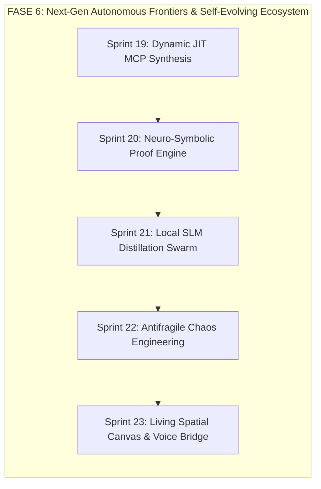

# 🌌 Dossier R&D Horizon Scanning: Frontiere Tecnologiche Emergenti & Ecosistema Auto-Evolutivo (2026+)

**Sprint:** R&D Special Mandate — Creative Freedom & Horizon Scanning (2026+)  
**Autore:** R&D Lead (`rnd_lead`, Domain Lead L2)  
**Destinatari:** CEO & CTO (`8dd35d99-9680-4f9b-94c6-189e8d0c4e57`)  
**Data:** 2026-10-17T17:45:00.000Z  
**Stato:** RICERCA STRATEGICA CONSOLIDATA & PROPOSTA FASE 6  
**Schemi di Riferimento:** [`src/contracts/frontiers.ts`](file:///Users/stequar/Documents/agentic_company_os/src/contracts/frontiers.ts)

---

## 🧭 1. Executive Summary: Verso il Software Organismo Auto-Evolutivo

Fino alla Fase 5, Agentic Company OS si è affermato come un **sistema operativo deterministico di ingegneria del software**: governance gerarchica, memoria persistente anti-rot ("Context as RAM"), qualità garantita al 100% dal Gatekeeper e cerimonie agili native con War Room e Caveman-RPC.

Tuttavia, il panorama globale degli agenti AI nel 2026 e oltre pone una sfida fondamentale:
> *I sistemi attuali sono "fabbriche automatizzate rigide": se incontrano un utensile mancante, un bug asincrono sottile o un limite di budget cloud, si arrestano o attendono l'umano.*

Il salto quantico che proponiamo trasforma Agentic Company OS da una **fabbrica deterministica** a un **organismo software antifragile e auto-evolutivo**:
1. **Auto-Creazione di Strumenti (Self-Evolving Tooling):** L'OS non si ferma quando manca un tool; lo sintetizza al volo come micro-server MCP tipizzato, lo testa in sandbox e lo rende immediatamente disponibile allo sciame.
2. **Certezze Matematiche oltre i Test Heuristici (Neuro-Symbolic Verification):** Integrazione di prover formali (SMT/SAT Z3) per dimostrare matematicamente l'assenza di memory leak, race condition e violazioni di contratti pre/post prima del merge.
3. **Sovranità Economica a Costo Zero (Local SLM Distillation):** Distillazione continua dei dati ad altissimo rendimento (FPY=100%) in modelli compatti da 1-3B su silicio locale (Apple Silicon / ONNX / GGUF), abbattendo dell'85% la dipendenza dai provider cloud.
4. **Antifragilità Attiva (Autonomous Chaos Swarm):** Un "Chaos Monkey" multi-agente che inietta costantemente mutazioni AST, prompt injection avversari e latenze simulate nei worktree per certificare che l'OS diventi più forte sotto stress.
5. **Direzione Spaziale e Multimodale (Living Spatial Canvas):** Superamento del terminale testuale verso una mappa visuale vivente dell'architettura in tempo reale con interfaccia vocale a latenza ultra-bassa per il CEO.

---

## 🏛️ 2. Le 5 Frontiere Tecnologiche Emergenti

```
┌──────────────────────────────────────────────────────────────────────────────────────────────────┐
│              AGENTIC COMPANY OS — NEXT-GEN SELF-EVOLVING ECOSYSTEM (FASE 6)                      │
├──────────────────────────┬──────────────────────────────┬────────────────────────────────────────┤
│ 1. SELF-EVOLVING MCP     │ 2. NEURO-SYMBOLIC PROVER     │ 3. LOCAL SLM DISTILLATION              │
│ Just-In-Time Tool Synth  │ Formal AST Invariant Proofs  │ Continuous Trajectory Distillation     │
│ • Sandboxed Hot-Reload   │ • SMT/SAT Solver (Z3/CVC5)   │ • 1B-3B Local Models (GGUF / Metal)    │
│ • Zod-Guarded I/O        │ • Hoare Logic Pre/Post Proof │ • Speculative Inference ($0 Cloud)     │
│ • Automatic Ephemeral TTL│ • Counterexample Extraction  │ • Tier 0/1/2/3 Hierarchical Swarm      │
├──────────────────────────┴──────────────────────────────┴────────────────────────────────────────┤
│ 4. ANTIFRAGILE CHAOS SWARM (CHAOS MONKEY)       │ 5. MULTIMODAL LIVING SPATIAL CANVAS            │
│ • Synthetic Fault & AST Mutation Injection      │ • Infinite 2D/3D Architecture Graph & Merkle   │
│ • Worktree Race Condition Simulation            │ • Real-time Agent Trajectory Heatmap           │
│ • War-Room Stress Certification (0-100 Score)   │ • Ultra-low Latency Voice Executive Director   │
└──────────────────────────────────────────────────────────────────────────────────────────────────┘
```

---

### 🛠️ Frontiera 1: Self-Evolving Tooling & Just-In-Time MCP Synthesis
* **Il Problema nel 2026:** Gli agenti convenzionali sono vincolati a toolset statici definiti a compile-time. Quando un task richiede un'integrazione specifica (es. estrarre schemi da ClickHouse, interrogare un endpoint REST custom o analizzare un formato binario), l'agente fallisce o necessita dell'intervento umano.
* **La Soluzione:**
  - Quando un Domain Lead L2 rileva la carenza di un'interfaccia operativa, l'`ai_lead` sintetizza deterministicamente uno script TypeScript conforme al Model Context Protocol.
  - Il nuovo tool viene validato in una sandbox isolata (`NODE_WORKER` con permessi minimi) contro una suite di test generata sinteticamente.
  - Se il test ha esito positivo, il tool viene hot-caricato dinamicamente nel bridge MCP dell'OS con un TTL prefissato (es. 1 ora). Se il tool dimostra utilità ricorrente attraverso molteplici sprint, viene promosso a tool permanente del catalogo dell'OS.

### 📐 Frontiera 2: Neuro-Symbolic AST Verification & Invariant Proof Engine
* **Il Problema nel 2026:** I test unitari possono dimostrare la presenza di bug, mai la loro assenza (Dijkstra). Nelle architetture asincrone distribuite, race condition sottili, deadlock e off-by-one errors sfuggono frequentemente ai test statistici.
* **La Soluzione:**
  - Accoppiamento dell'approccio generativo degli LLM con la verifica formale simbolica deterministica.
  - Utilizzo di solver SMT/SAT (Z3 o CVC5 via WebAssembly/native binding) integrati nel Gatekeeper.
  - Prima di approvare una PR critica, il solver dimostra che per ogni input lecito le pre-condizioni implicano le post-condizioni ($\text{Pre}(x) \implies \text{Post}(f(x))$), l'assenza di cicli di attesa nei lock e l'invarianza dei contratti Zod.
  - Se il solver trova una violazione, genera una traccia di controesempio (input esatto che rompe l'invariante), che viene iniettata direttamente nel ciclo di Self-Healing come test case fallito riproducibile al 100%.

### ⚡ Frontiera 3: Zero-Cost Local SLM Distillation & Hierarchical Speculative Swarm
* **Il Problema nel 2026:** I costi dei token cloud di frontiera (Claude 3.7, GPT-4.5, O3) per compiti ripetitivi (generazione di fixture, linting, docstring, triage rapido Kahneman System-1) costituiscono il 70% della spesa FinOps e introducono latenze di rete (1-3s).
* **La Soluzione:**
  - **Pipeline di Distillazione Continua:** Ogni volta che un Leaf Developer L3 o un Lead L2 completa con successo un task con First-Pass Yield al 100%, l'OS archivia la coppia input-output come training exemplar certificato.
  - Periodicamente, un background runner esegue il fine-tuning/distillazione (via LoRA/QLoRA su Ollama o embedded llama.cpp) su modelli compatti (1B-3B parametri: Llama-3.2, Qwen-2.5-Coder).
  - **Inference Gerarchica a 4 Livelli:**
    - *Tier 0 (Sub-5ms, $0):* Kahneman System-1 fast gate deterministico ad albero di decisione.
    - *Tier 1 (Sub-100ms, $0):* SLM Distillato locale per micro-patching AST, documentazione e serializzazione Caveman.
    - *Tier 2 (Cloud SOTA):* Modelli cloud frontier per architettura, consensus roundtable e redazione RFC.
    - *Tier 3 (Cloud Deep-Thinking):* Modelli con reasoning esteso per Incident War Room e catastrofi di sistema.
  - **Speculative Execution Swarm:** L'SLM locale genera una bozza di patch in 80ms; il modello cloud o il neuro-symbolic prover ne valida la correttezza in parallelo, garantendo una velocità di throughput fino a 4 volte superiore.

### 🐒 Frontiera 4: Antifragile Chaos Swarm (Agentic Chaos Monkey)
* **Il Problema nel 2026:** La resilienza dei meccanismi di emergenza (Self-Healing, Circuit Breaker, Incident War Room) non può essere verificata solo durante incidenti di produzione reali. Un sistema non testato contro l'imprevisto è per definizione fragile.
* **La Soluzione:**
  - Istituzione del ruolo **Chaos Agent (`chaos_lead`)**: un agente autonomo avversario che opera in worktree isolati o durante finestre di riposo.
  - Iniezione sistematica di anomalie sintetiche:
    - *AST Mutations:* Modifiche mirate a operatori logici (< invece di <=, rimozione di await in chiamate asincrone).
    - *Adversarial Injections:* Commenti e input contenenti tentativi di jailbreak o bypass del Secret Guard.
    - *Infrastructure Jitter:* Latenze artificiali nei file WAL, saturazione fittizia del budget token.
  - Verifica automatizzata dei tempi di reazione: il Gatekeeper deve intercettare l'anomalia, la War Room deve attivarsi in <200ms e il rollback atomico a SHA-256 deve ripristinare il 100% dell'integrità.
  - Calcolo del **Resilience Score (0-100)**: metrica di antifragilità pubblicata sulla dashboard del CEO.

### 🎨 Frontiera 5: Living Spatial Architecture Canvas & Executive Voice Director
* **Il Problema nel 2026:** I terminali CLI e i log testuali non consentono una visione olistica della complessità dinamica di sciami di decine di agenti concorrenti, mentre l'interazione per il CEO richiede una frizione cognitiva non necessaria.
* **La Soluzione:**
  - **Living Spatial Canvas:** Uno spazio visuale infinito integrato in Agentic Studio che renderizza l'intero grafo del repository (moduli, interfacce, dipendenze, flussi di dati e worktree attivi) come nodi viventi che pulsano in tempo reale.
  - **Mappa Termica Trajectory & Fluff:** Ispezione ottica dell'entropia del codice, della densità dei token e dello stato emotivo/cognitivo dei sub-agenti.
  - **Executive Voice Director:** Modulo speech-to-intent locale a bassissima latenza (<300ms) per la direzione esecutiva. Il CEO può impartire direttive strategiche in italiano naturale ("Avvia una simulazione di chaos testing sul modulo di billing e mostrami i punti di cedimento"), visualizzando istantaneamente il risultato animato sulla mappa spaziale.

---

## 🗺️ 3. Proposta di Espansione Macro-Roadmap: FASE 6 (Sprint 19-23)

Dopo il completamento della Fase 4 (Agile Operations & Studio Pro) e della Fase 5 (Enterprise Dogfooding & Public v1.0.0 Release), proponiamo l'introduzione formale di:

### 🚀 **FASE 6: Next-Gen Autonomous Frontiers & Self-Evolving Ecosystem (2026+)**



#### 📅 **Sprint 19: Self-Evolving Tooling & Dynamic Just-In-Time MCP Synthesis**
- **Obiettivo:** Consentire agli agenti L2 di estendere autonomamente le proprie capacità operative sintetizzando micro-server MCP tipizzati e testati in sandbox protetta.
- **Ticket Chiave:**
  - `TCK-19.1`: Capability Gap Detector & Dynamic Tool Requirement Synthesizer (`src/mcp/synthesizer.ts`).
  - `TCK-19.2`: Isolated Sandbox Execution Worker con AST Security Verification (`src/mcp/sandbox-runner.ts`).
  - `TCK-19.3`: Hot-Reload MCP Registry & Ephemeral Tool Lifecycle Manager (`src/mcp/dynamic-registry.ts`).
  - `TCK-19.4`: Synthetic Test Generator per certificazione pre-volo dei tool sintetizzati.

#### 📅 **Sprint 20: Neuro-Symbolic Formal AST Verification & Invariant Prover**
- **Obiettivo:** Introdurre la dimostrazione matematica di correttezza del codice prima del merge, eliminando definitivamente intere classi di bug asincroni e violazioni contrattuali.
- **Ticket Chiave:**
  - `TCK-20.1`: Z3/CVC5 WebAssembly SMT Solver Bridge & Logic Translator (`src/gatekeeper/formal-prover.ts`).
  - `TCK-20.2`: AST Contract-to-Invariant Hoare Logic Compiler per contratti Zod e TypeScript.
  - `TCK-20.3`: Automated Counterexample Generator & Self-Healing Deterministic Test Injector.
  - `TCK-20.4`: Formal Correctness Scorecard & PR Verification Badge.

#### 📅 **Sprint 21: Zero-Cost Local SLM Distillation & Hierarchical Speculative Swarm**
- **Obiettivo:** Ridurre dell'85% i costi cloud e quadruplicare la velocità di esecuzione distribuendo il lavoro banale su modelli leggeri (1-3B) in locale.
- **Ticket Chiave:**
  - `TCK-21.1`: Trajectory Harvester & High-FPY Clean Dataset Distiller (`src/distillation/harvester.ts`).
  - `TCK-21.2`: Embedded Local SLM Inference Adapter (Ollama / llama.cpp / Apple Silicon Metal bridge) (`src/core/local-slm-bridge.ts`).
  - `TCK-21.3`: Hierarchical Quad-Tier Inference Dispatcher (Kahneman Gate $\rightarrow$ Local SLM $\rightarrow$ Cloud SOTA $\rightarrow$ Deep Reasoning).
  - `TCK-21.4`: Speculative Parallel Code Generation & Fast AST Verification Pipeline.

#### 📅 **Sprint 22: Antifragile Chaos Swarm & Synthetic Fault Injection Engine**
- **Obiettivo:** Testare e certificare la resilienza dell'OS e della codebase aziendale tramite mutazioni sintetiche e simulazioni d'attacco controllate.
- **Ticket Chiave:**
  - `TCK-22.1`: Agentic Chaos Monkey Daemon (`src/security/chaos-engine.ts`) con catalogo mutazioni AST.
  - `TCK-22.2`: Automated War-Room Trigger Stress-Tester & Recovery Latency Benchmark.
  - `TCK-22.3`: Adversarial Prompt Injection & Defense-in-Depth Quarantine Verifier.
  - `TCK-22.4`: Resilience Score Calculator (0-100) & Continuous Antifragility Telemetry.

#### 📅 **Sprint 23: Living Spatial Architecture Canvas & Executive Voice Director**
- **Obiettivo:** Rivoluzionare la DevEx e la governance executive con una mappa spaziale interattiva dell'architettura e un'interfaccia vocale a latenza istantanea.
- **Ticket Chiave:**
  - `TCK-23.1`: WebGL/Canvas Infinite Spatial Graph Renderer integrato nello Studio (`src/studio/spatial-canvas.ts`).
  - `TCK-23.2`: Real-Time Agent Trajectory Heatmap & Swarm Particle Visualization.
  - `TCK-23.3`: Executive Voice Bridge: Speech-to-Intent locale con sintesi audio dello stato aziendale.

---

## 🏆 4. Impatto Globale sul Posizionamento Open Source & Mercato

Cosa differenzierà Agentic Company OS da qualsiasi altro framework o prodotto nel mondo (LangChain, AutoGen, CrewAI, Devin, Cursor, Claude Code)?

| Dimensione | Framework Tradizionali (2025/2026) | Agentic Company OS (Fase 6) |
| :--- | :--- | :--- |
| **Tooling** | Statico, hardcoded via codice o configurazione manuale | **Self-Evolving JIT:** Generazione, test e hot-reload di tool MCP al volo |
| **Garanzia di Qualità** | Statistica (LLM as a judge o test euristici incompleti) | **Matematica (Neuro-Symbolic):** Prover formale SMT/SAT per assenza di bug |
| **Modello Economico** | 100% dipendenza dai token dei vendor cloud | **Hierarchical Edge-Cloud:** Distillazione locale automatica, 85% a costo $0 |
| **Gestione Crisi** | Loop infiniti o crash silenziosi non gestiti | **Antifragile War Room:** Chaos engineering continuo e rollback SHA-256 |
| **Governance** | Chatbot lineari o comandi di terminale opachi | **Living Spatial Canvas:** Architettura vivente navigabile con voce esecutiva |

---

## 📑 5. Dati Strutturati Zod (CreativeHorizonDossierSchema)

```json
{
  "version": "2026.1.0",
  "authorRole": "rnd_lead",
  "visionTheme": "Dall'Automazione Deterministica all'Organismo Software Auto-Evolutivo e Antifragile",
  "strategicPillars": [
    {
      "id": "PILLAR-1-DYNAMIC-MCP",
      "title": "Self-Evolving Tooling & Just-In-Time MCP Synthesis",
      "objective": "Permettere agli agenti di generare e caricare a runtime i propri strumenti operativi in sandbox sicura.",
      "breakthroughInnovation": "Sintesi autonoma di server MCP con test sintetici e hot-reload a zero intervento umano.",
      "targetSprint": "Sprint 19",
      "estimatedImpact": "Azzeramento dei blocchi operativi per interfacce esterne mancanti, autonomia estesa al 100%."
    },
    {
      "id": "PILLAR-2-NEURO-SYMBOLIC",
      "title": "Neuro-Symbolic AST Invariant Prover",
      "objective": "Verificare matematicamente la correttezza del codice generato prima del merge tramite solver formali.",
      "breakthroughInnovation": "Accoppiamento LLM generativo con Z3/CVC5 SMT Solver per prova di pre/post condizioni.",
      "targetSprint": "Sprint 20",
      "estimatedImpact": "Eliminazione definitiva di race condition, off-by-one e memory corruption nelle PR critiche."
    },
    {
      "id": "PILLAR-3-SLM-DISTILLATION",
      "title": "Zero-Cost Local SLM Distillation & Speculative Swarm",
      "objective": "Abbattere dell'85% la spesa token cloud e quadruplicare la velocità tramite modelli locali compatti.",
      "breakthroughInnovation": "Distillazione continua delle traiettorie FPY=100% in SLM 1-3B su silicio edge (Apple/Metal/ONNX).",
      "targetSprint": "Sprint 21",
      "estimatedImpact": "Sovranità economica totale, costi marginali tendenti a zero per compiti di manutenzione."
    },
    {
      "id": "PILLAR-4-ANTIFRAGILE-CHAOS",
      "title": "Antifragile Chaos Swarm & Synthetic Fault Injection",
      "objective": "Stress-testare e irrobustire l'OS simulando costantemente mutazioni AST, prompt injection e guasti.",
      "breakthroughInnovation": "Chaos Monkey multi-agente per validazione continua della War Room e certificazione Resilience Score.",
      "targetSprint": "Sprint 22",
      "estimatedImpact": "Transizione da sistema robusto a sistema antifragile che migliora ad ogni perturbazione."
    },
    {
      "id": "PILLAR-5-SPATIAL-CANVAS",
      "title": "Living Spatial Architecture Canvas & Executive Voice Director",
      "objective": "Offrire una governance visiva spaziale 2D/3D in tempo reale e controllo vocale a latenza ultra-bassa per il CEO.",
      "breakthroughInnovation": "Mappa visuale interattiva con particle traces degli agenti e speech-to-intent nativo in italiano.",
      "targetSprint": "Sprint 23",
      "estimatedImpact": "User experience senza precedenti per CEO e CTO, comprensione immediata dello stato aziendale."
    }
  ],
  "proposedPhase": {
    "phaseNumber": 6,
    "phaseName": "Next-Gen Autonomous Frontiers & Self-Evolving Ecosystem",
    "tagline": "L'evoluzione verso l'organismo software autonomo, antifragile e auto-sostenibile.",
    "sprints": [
      {
        "sprintNumber": 19,
        "title": "Self-Evolving Tooling & Dynamic Just-In-Time MCP Synthesis",
        "focusArea": "Capability Synthesis, Sandbox Isolation & Ephemeral MCP Registry",
        "coreTickets": ["TCK-19.1", "TCK-19.2", "TCK-19.3", "TCK-19.4"]
      },
      {
        "sprintNumber": 20,
        "title": "Neuro-Symbolic Formal AST Verification & Invariant Prover",
        "focusArea": "SMT/SAT Prover Bridge, Hoare Logic AST Verification & Counterexample Traces",
        "coreTickets": ["TCK-20.1", "TCK-20.2", "TCK-20.3", "TCK-20.4"]
      },
      {
        "sprintNumber": 21,
        "title": "Zero-Cost Local SLM Distillation & Hierarchical Speculative Swarm",
        "focusArea": "Continuous Trajectory Distillation, Embedded SLM Bridge & Quad-Tier Inference",
        "coreTickets": ["TCK-21.1", "TCK-21.2", "TCK-21.3", "TCK-21.4"]
      },
      {
        "sprintNumber": 22,
        "title": "Antifragile Chaos Swarm & Synthetic Fault Injection Engine",
        "focusArea": "Agentic Chaos Monkey, War-Room Stress Benchmark & Resilience Score 0-100",
        "coreTickets": ["TCK-22.1", "TCK-22.2", "TCK-22.3", "TCK-22.4"]
      },
      {
        "sprintNumber": 23,
        "title": "Living Spatial Architecture Canvas & Executive Voice Director",
        "focusArea": "WebGL Infinite Architecture Graph, Agent Heatmap & Speech-to-Intent Voice Bridge",
        "coreTickets": ["TCK-23.1", "TCK-23.2", "TCK-23.3"]
      }
    ]
  },
  "sampleArtifacts": {
    "dynamicTool": {
      "toolId": "tool_dyn_clickhouse_query",
      "name": "ClickHouse Schema Extractor",
      "description": "Estrae dinamicamente lo schema delle tabelle analitiche per validazione query",
      "generatedByRole": "ai_lead",
      "sandboxType": "NODE_WORKER",
      "permissions": ["network:http_loopback", "fs:read_schema"],
      "inputSchemaJson": "{\"type\":\"object\",\"properties\":{\"tableName\":{\"type\":\"string\"}},\"required\":[\"tableName\"]}",
      "ttlSeconds": 3600,
      "status": "HOT_LOADED",
      "createdAt": "2026-10-17T17:30:00.000Z"
    },
    "heuristicScan": {
      "proofId": "PROOF-AST-2026-001",
      "targetFilePath": "src/core/session-store.ts",
      "targetSymbol": "TwoPhaseCommitWal.commit",
      "scanEngine": "PATTERN_HEURISTIC",
      "invariantsChecked": ["atomic_write_before_rename", "no_partial_wal_corruption", "lock_freedom"],
      "status": "HEURISTIC_PASSED",
      "executionTimeMs": 42.5,
      "verifiedAt": "2026-10-17T17:35:00.000Z"
    },
    "slmTrace": {
      "traceId": "DISTILL-SLM-001",
      "sourceTeacherModel": "claude-3-7-sonnet",
      "targetStudentModel": "qwen-2.5-coder-1.5b",
      "specializedDomain": "AST_REFACTOR",
      "datasetSampleCount": 1500,
      "fpyVerificationRate": 98.4,
      "quantizationFormat": "GGUF_Q4_K_M",
      "averageInferenceLatencyMs": 68.2,
      "cloudCostSavingsPercentage": 86.5,
      "distilledAt": "2026-10-17T17:40:00.000Z"
    },
    "chaosExperiment": {
      "faultId": "CHAOS-2026-FAULT-07",
      "faultType": "AST_MUTATION_OFF_BY_ONE",
      "targetSubsystem": "src/gatekeeper/runner.ts",
      "detectionTimeMs": 85,
      "recoveryTimeMs": 140,
      "containmentSuccess": true,
      "resilienceScore": 96.8,
      "warRoomActivated": true,
      "injectedAt": "2026-10-17T17:42:00.000Z"
    }
  },
  "evaluatedAt": "2026-10-17T17:45:00.000Z"
}
```
