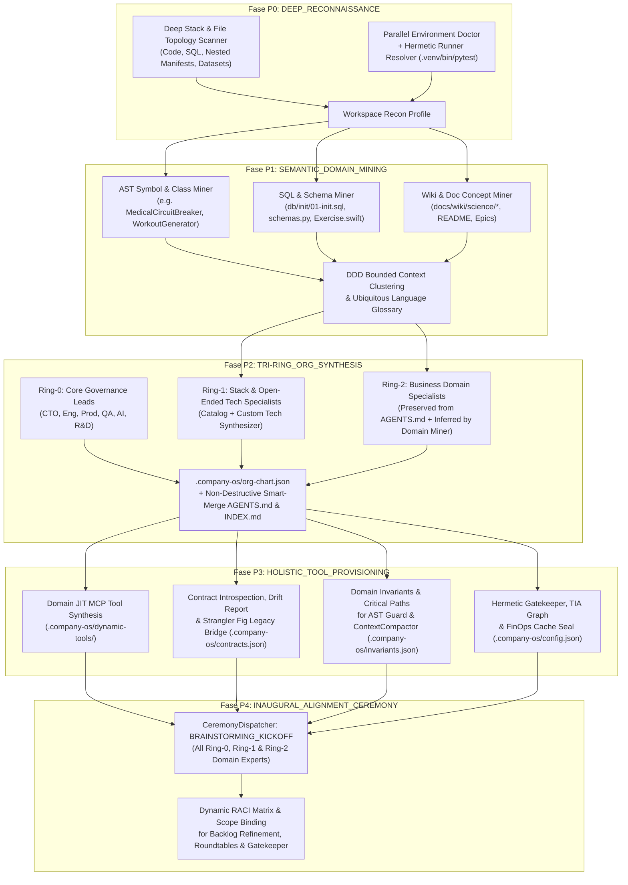

# 📄 RFC-007: Brownfield Symbiosis, Autonomous Domain Expert Synthesis & Holistic Library Bootstrap

**RFC ID:** `RFC-007-BROWNFIELD-SYMBIOSIS-AND-SMART-ADOPTION`  
**Titolo:** Brownfield Symbiosis, Autonomous Domain Expert Synthesis & Holistic Library Bootstrap  
**Autore:** R&D & Innovation Lead (`rnd_lead`, Domain Lead L2)  
**Stato:** `RATIFIED_BY_CTO` (Consenso unanime 7/7 raggiunto e ratificato — Include Espansione Ciclo 7.2)  
**Data Creazione:** `2026-11-04T12:50:00.000Z`  
**Data Aggiornamento:** `2026-11-04T13:52:00.000Z`  
**Schema di Riferimento:** [`ConsensusRfcSchema`](file:///Users/stequar/Documents/agentic_company_os/src/contracts/rnd.ts)  
**Roundtable Associata:** [`docs/wiki/rnd/roundtables/2026-11-roundtable-rfc-007.md`](file:///Users/stequar/Documents/agentic_company_os/docs/wiki/rnd/roundtables/2026-11-roundtable-rfc-007.md)  
**Audit di Origine:** [`docs/wiki/rnd/audits/sprint-17-dogfooding-retrospective.md`](file:///Users/stequar/Documents/agentic_company_os/docs/wiki/rnd/audits/sprint-17-dogfooding-retrospective.md)

---

## 🧭 Visione Condivisa (Shared Vision)

Evolvere **Agentic Company OS** da semplice generatore di scaffolding a **Sistema Operativo Autonomo Auto-Configurante (*Holistic Workspace Bootstrap & Brownfield Symbiosis*)**:
1. Quando atterra su un repository esistente (*Brownfield*) o nuovo (*Greenfield*), l'OS preserva al 100% la conoscenza preesistente tramite *Hybrid AST Section Grafting & Managed Sentinel Blocks*.
2. Attraverso il **Semantic Domain & Bounded Context Miner** e l'**Open-Ended Tech Specialist Synthesizer**, l'OS non si limita ai ruoli statici o a quelli già scritti in `AGENTS.md`, ma **scopre e sintetizza autonomamente** sia gli specialisti tecnologici per stack non-standard (Ring-1) sia gli **Esperti di Dominio di Business (Ring-2)** analizzando codice, AST, schemi SQL e documentazione.
3. Gli esperti creati diventano **agenti attivi nel runtime** (`.company-os/org-chart.json`) che partecipano automaticamente alle cerimonie agili (`CeremonyDispatcher`), al refinement dei ticket nel loro `domainScope`, alle Roundtable (come *Domain Devil's Advocate*) e alla validazione delle invarianti.
4. Il **Setup Globale in 5 Fasi (`P0..P4`)** orchestra il provisioning olistico dell'intero workspace: sintesi di tool MCP dinamici di dominio (Sprint 19), reverse-engineering dei contratti (`.company-os/contracts.json`) con *Semantic Drift Report* e *Strangler Fig Bridge*, configurazione delle invarianti `AST Diff Guard` / `ContextCompactor` e cablaggio ermetico dei test runner (`.venv/bin/pytest`).

---

## 🏛️ Architettura del Ciclo di Preparazione a 5 Fasi (`P0..P4`) & Simbiosi Olistica



---

## 📌 Topic 1: Non-Destructive Document Grafting (`TOPIC-1-BROWNFIELD-DOCUMENT-GRAFTING`)
- **Interviste di Origine:** `1ON1-2026-11-C7-ENG`, `1ON1-2026-11-C7-PROD`, `1ON1-2026-11-C7-AI`
- **Problema:** La sovrascrittura statica di `AGENTS.md`, `docs/wiki/INDEX.md`, `roadmap.md` e `backlog.md` nascondeva la conoscenza di dominio preesistente (*Brownfield Amnesia* / *Dark Memory*).
- **Soluzione:** **Hybrid AST Section Grafting + SHA-256 Managed Sentinel Blocks** (`<!-- AGENTIC-OS:MANAGED:START id="..." sha256="..." --> ... <!-- AGENTIC-OS:MANAGED:END -->`). Preserva il 100% delle sezioni di dominio, delle Epiche e dei Ticket esistenti, indicizza automaticamente tutti i file presenti in `docs/wiki/**/*` dentro `INDEX.md`, e garantisce `SKIPPED_UNCHANGED` al secondo passaggio.

---

## 📌 Topic 2: Tri-Ring Role Ontology, Open-Ended Tech Synthesis & Semantic Domain Mining (`TOPIC-2-AUTONOMOUS-DOMAIN-EXPERT-SYNTHESIS`)
- **Interviste di Origine:** `1ON1-2026-11-C7-AI`, `1ON1-2026-11-C7-ENG`, `1ON1-2026-11-C7-PROD`
- **Problema Sollevato dal CEO:**
  1. I ruoli derivati dallo stack tramite template fissi non bastano quando una repo utilizza tecnologie diverse o specialistiche (es. PostgreSQL/Supabase, GraphQL, PyTorch/CUDA, pipeline ETL).
  2. I ruoli di dominio di business (`medical_rehab_specialist`, `nutrition_specialist`, `ai_coaching_specialist`) spesso **non sono già scritti** in un `AGENTS.md` preesistente nella repo in cui viene installata la libreria.
  3. Una volta creati, questi esperti devono intervenire attivamente nello sviluppo e nelle cerimonie, non restare testo statico.
- **Soluzione Proposta:**
  1. **Tri-Ring Role Ontology (`.company-os/org-chart.json`):**
     - **Ring-0 (Core Governance Leads):** `cto`, `engineering_lead`, `product_lead`, `qa_lead`, `ai_lead`, `rnd_lead`.
     - **Ring-1 (Stack & Open-Ended Tech Specialists):** Unisce i Lead standard dello stack con l'**Open-Ended Tech Specialist Synthesizer**, che analizza dipendenze (`requirements.txt`, `pyproject.toml`, `package.json`, `docker-compose.yml`), file `.sql`/migrazioni e script infrastrutturali per sintetizzare specialisti tecnici su misura (es. `database_sql_specialist` quando rileva schemi relazionali complessi in `db/init/01-init.sql` e `database_schema.sql`).
     - **Ring-2 (Business Domain Experts — Preserved + Inferred):**
       - *Preserved:* Importa qualsiasi ruolo già descritto in `AGENTS.md` o `.company-os/roles.json`.
       - *Inferred via Semantic Domain & Bounded Context Miner:* Anche in totale assenza di `AGENTS.md`, il Miner scansiona simboli AST (`MedicalCircuitBreaker`, `WorkoutGenerator`), tabelle SQL (`exercises`, `muscles`, `users`), modelli e documenti (`docs/wiki/science/*`, `README.md`), raggruppandoli in **DDD Bounded Contexts** (max 5 cluster ad alta coesione per evitare role bloat). Per ciascun cluster genera una `SynthesizedDomainExpert` completa di:
         * `id`, `name`, `ring: "RING_2_DOMAIN_EXPERT"`
         * `boundedContext`: nome del dominio di business (es. `"Biomechanical Rehab & Injury Prevention"`, `"Clinical Nutrition & TDEE"`, `"Adaptive AI Workout Recommendation"`)
         * `domainScope`: glob/path dei file di competenza (es. `["src/ai/decision_engine.py", "docs/wiki/science/rehab_protocols.md"]`)
         * `domainInvariants`: regole inviolabili estratte dal codice/wiki che devono essere verificate ad ogni modifica
         * `microRoleCard`: scheda compatta `<150 token` per il Prompt Caching
  2. **Active Runtime Integration nelle Cerimonie e nello Sviluppo (`CeremonyDispatcher` & `RaciMatrix`):**
     - **Refinement 1:1 Automatico:** Ogni ticket che modifica file inclusi nel `domainScope` di un esperto Ring-2 attiva automaticamente quell'esperto nel `BACKLOG_REFINEMENT_1ON1` per dettare i criteri di accettazione di dominio.
     - **Domain Devil's Advocate nelle Roundtable:** In `ARCHITECTURE_REVIEW_ROUNDTABLE`, lo specialista Ring-2 del contesto impattato partecipa obbligatoriamente e verifica il rispetto delle `domainInvariants`.
     - **Sviluppo & Gatekeeper:** L'esperto Ring-2 co-firma la code review dei Leaf Developers L3 sui file del proprio perimetro.

---

## 📌 Topic 3: Contract Introspection, Semantic Drift Detection & Strangler Fig Adapter (`TOPIC-3-CONTRACT-INTROSPECTION-AND-STRANGLER-FIG`)
- **Interviste di Origine:** `1ON1-2026-11-C7-QA`, `1ON1-2026-11-C7-BACKEND`, `1ON1-2026-11-C7-MOBILE`
- **Problema:** Contratti cablati nell'OS e disallineamento tra i nuovi file sincronizzati (`synced_schemas.py`, `SyncedModels.swift`) e i modelli legacy (`app/schemas.py` con `id: int` e `app/Models/Exercise.swift`).
- **Soluzione:** Caricamento dichiarativo da `.company-os/contracts.json` con auto-introspezione da Python/Swift/SQL, **Semantic Contract Drift Detector** (`TYPE_MISMATCH`, `MISSING_FIELD`, `MISSING_CODING_KEYS`) e **Strangler Fig Legacy Bridge** con backup `.bak` per riesportare o allineare i modelli legacy senza collisioni di compilazione.

---

## 📌 Topic 4: Holistic 5-Phase Library Bootstrap & Global Tool Provisioning (`TOPIC-4-HOLISTIC-WORKSPACE-BOOTSTRAP`)
- **Interviste di Origine:** `1ON1-2026-11-C7-ENG`, `1ON1-2026-11-C7-AI`, `1ON1-2026-11-C7-QA`
- **Problema Sollevato dal CEO:** Come strutturare le fasi di preparazione in cui si creano gli esperti e come estendere il concetto di setup globale della libreria a **tutti i tool necessari** (non solo ai ruoli).
- **Soluzione Proposta (Pipeline di Bootstrap Olistico `P0..P4`):**
  1. **Fase P0 (`DEEP_RECONNAISSANCE`):** Stack detection profonda (incluso SQL, manifest annidati, AI modules), `runEnvironmentDoctor` parallelo e risoluzione ermetica dei test runner (`.venv/bin/pytest > uv run pytest > poetry run pytest > pytest`).
  2. **Fase P1 (`SEMANTIC_DOMAIN_MINING`):** Estrazione dell'Ubiquitous Language e dei Bounded Contexts dal codice sorgente, database e documentazione.
  3. **Fase P2 (`TRI-RING_ORG_SYNTHESIS`):** Sintesi di Ring-0, Ring-1 (Tech) e Ring-2 (Domain Experts), salvataggio in `.company-os/org-chart.json` e Smart-Merge non distruttivo in `AGENTS.md` e `docs/wiki/INDEX.md`.
  4. **Fase P3 (`HOLISTIC_TOOLING_AND_GUARDRAIL_PROVISIONING`):**
     - *4a. Domain JIT MCP Tool Pre-Synthesis:* Individua e pre-sintetizza micro-tool MCP specifici per il dominio del repo (es. validatori schema/dataset) registrandoli nel `DynamicMcpRegistry`.
     - *4b. Contract & Drift Baseline:* Genera `.company-os/contracts.json`, esegue il Drift Report e applica opzionalmente lo Strangler Fig Bridge.
     - *4c. Domain Invariants & Critical Paths (`.company-os/invariants.json`):* Configura i `criticalPaths` (es. `src/ai/decision_engine.py`, `db/init/01-init.sql`) protetti da `AST Diff Guard` e `ContextCompactor`.
     - *4d. Hermetic Gatekeeper & TIA Profile (`.company-os/config.json`):* Cabla i test runner ermetici e il grafo TIA.
  5. **Fase P4 (`INAUGURAL_ALIGNMENT_CEREMONY`):** Lancia tramite `CeremonyDispatcher` la cerimonia `BRAINSTORMING_KICKOFF` con tutti gli esperti sintetizzati e produce il `WorkspaceBootstrapReport`.

---

## ⚖️ Trade-Off Risolti (Resolved Trade-Offs)

1. **Trade-off 1 (Smart-Merge vs Idempotenza):** L'accoppiata AST Section Grafting + blocchi sentinella `<!-- AGENTIC-OS:MANAGED:START/END -->` preserva il 100% dei contenuti preesistenti garantendo `SKIPPED_UNCHANGED` al secondo passaggio.
2. **Trade-off 2 (Sintesi Autonoma di Esperti vs Role Bloat):** Il Semantic Domain Miner applica un clustering deterministico con soglia di coesione e un tetto massimo di **5 Bounded Context Specialists (Ring-2)**, ancorando ogni esperto a file realmente esistenti su disco (`domainScope`).
3. **Trade-off 3 (Side-by-Side Sync vs Legacy Wiring):** Il pattern Strangler Fig Facade aggiorna o riesporta i modelli nei file legacy con backup atomico `.bak`, evitando sia data loss sia errori di doppia dichiarazione Swift (`struct Exercise`).
4. **Trade-off 4 (Setup Globale Olistico vs Velocità di Bootstrap):** Tutte le 5 fasi `P0..P4` operano tramite analisi AST/lessicale deterministica locale e caching SHA-256, completando l'intero bootstrap del workspace in `< 500ms` senza chiamate di rete bloccanti.

---

## ✍️ Firme dei Lead (Signatures)

- `rnd_lead`: 2026-11-04T13:50:00.000Z
- `ai_lead`: 2026-11-04T13:50:10.000Z
- `engineering_lead`: 2026-11-04T13:50:20.000Z
- `product_lead`: 2026-11-04T13:50:30.000Z
- `qa_lead`: 2026-11-04T13:50:40.000Z
- `backend_lead`: 2026-11-04T13:50:50.000Z
- `mobile_lead`: 2026-11-04T13:51:00.000Z

---

## 🎫 Ticket Operativi Azionabili (Sprint 17.5: Brownfield Symbiosis, Domain Expert Synthesis & Holistic Bootstrap)

- `TCK-17.5.0`: **Tech Validation Spike (Sprint 17.5)** (`docs/wiki/engineering/spikes/sprint-17-5-validation.md`)
- `TCK-17.5.1`: **Non-Destructive Brownfield Smart-Merge Engine & Managed Sentinel Blocks** (`src/attach/injector.ts`, `src/attach/smart-merge.ts`)
- `TCK-17.5.2`: **Deep Stack Topology Scanner, Hermetic `.venv` Resolver & Open-Ended Tech Specialist Synthesizer (Ring-1)** (`src/inspector/detector.ts`, `src/generator/roles.ts`)
- `TCK-17.5.3`: **Semantic Domain & Bounded Context Miner (Ring-2 Autonomous Expert Synthesis) + Active Ceremony Routing** (`src/inspector/domain-miner.ts`, `src/generator/roles.ts`, `src/core/ceremony-dispatcher.ts`)
- `TCK-17.5.4`: **Declarative `.company-os/contracts.json` Loader, Semantic Schema Drift Detector & Strangler Fig Legacy Bridge** (`src/sync/contract-sync.ts`, `src/contracts/sync.ts`)
- `TCK-17.5.5`: **5-Phase Holistic Workspace Bootstrap Pipeline (`P0..P4`: Org-Chart, JIT MCP Tools, Invariants, Contracts & Kickoff Ceremony) + Test Suite** (`src/dogfooding/fitness-runner.ts`, `tests/brownfield-symbiosis-sprint17-5.test.ts`)

---

## 📑 Dati Strutturati Zod (ConsensusRfcSchema)

```json
{
  "rfcId": "RFC-007-BROWNFIELD-SYMBIOSIS-AND-SMART-ADOPTION",
  "title": "Brownfield Symbiosis, Autonomous Domain Expert Synthesis & Holistic Library Bootstrap",
  "authorRole": "rnd_lead",
  "status": "RATIFIED_BY_CTO",
  "sharedVision": "Evolvere Agentic Company OS in un Sistema Operativo Autonomo Auto-Configurante: preservare al 100% la conoscenza di dominio preesistente tramite Hybrid AST Section Grafting e Managed Sentinel Blocks, scoprire e sintetizzare autonomamente sia gli specialisti tecnologici per stack non-standard (Ring-1) sia gli Esperti di Dominio di Business (Ring-2) tramite Semantic Domain & Bounded Context Mining anche quando assenti in AGENTS.md, renderli partecipanti attivi nelle cerimonie agili e nel Gatekeeper, ed eseguire un Setup Globale Olistico in 5 Fasi (P0..P4) che pre-configura tool MCP dinamici, contratti cross-domain con Drift Detector, invarianti AST Guard e runner ermetici (.venv/bin/pytest).",
  "topics": [
    {
      "id": "TOPIC-1-BROWNFIELD-DOCUMENT-GRAFTING",
      "title": "Non-Destructive Document Grafting via AST Section Parsing & Managed Sentinel Blocks",
      "originatingInterviews": [
        "1ON1-2026-11-C7-ENG",
        "1ON1-2026-11-C7-PROD",
        "1ON1-2026-11-C7-AI"
      ],
      "problemStatement": "L'iniezione statica in attachWorkspace sovrascrive i file AGENTS.md, INDEX.md, roadmap.md e backlog.md preesistenti con template boilerplate, occultando la conoscenza di dominio (docs/wiki/science/*, Epiche e Ticket reali) anche se salvata nei file .bak.",
      "proposedSolution": "Implementare un motore Smart-Merge basato su AST Section Grafting e Managed Sentinel Blocks (<!-- AGENTIC-OS:MANAGED:START/END -->) che preserva il 100% delle sezioni di dominio e dei link preesistenti in docs/wiki/ mantenendo l'idempotenza SHA-256.",
      "managerFeedbacks": [
        {
          "managerRole": "engineering_lead",
          "topicId": "TOPIC-1-BROWNFIELD-DOCUMENT-GRAFTING",
          "opinion": "Combina l'affidabilità dei marker Projen/Chezmoi con il rispetto strutturale del Markdown esistente.",
          "concerns": [
            "Garantire che il secondo passaggio di attachWorkspace rimanga 100% SKIPPED_UNCHANGED."
          ],
          "proposedTradeOffs": [
            "Incorporare un hash deterministico sha256 nel marker del blocco gestito per verificare istantaneamente l'idempotenza."
          ],
          "approvalStatus": "APPROVED"
        },
        {
          "managerRole": "product_lead",
          "topicId": "TOPIC-1-BROWNFIELD-DOCUMENT-GRAFTING",
          "opinion": "Fondamentale per la DevEx: nessuna roadmap o backlog di un team esistente verrà mai più nascosto durante l'onboarding.",
          "concerns": [
            "Evitare duplicazioni di ticket se attach viene lanciato più volte."
          ],
          "proposedTradeOffs": [
            "Isolare i ticket di governance dentro il blocco sentinella gestito dall'OS."
          ],
          "approvalStatus": "APPROVED"
        }
      ],
      "consensusReached": true
    },
    {
      "id": "TOPIC-2-AUTONOMOUS-DOMAIN-EXPERT-SYNTHESIS",
      "title": "Tri-Ring Role Ontology, Open-Ended Tech Synthesis & Semantic Bounded Context Domain Mining",
      "originatingInterviews": [
        "1ON1-2026-11-C7-AI",
        "1ON1-2026-11-C7-ENG",
        "1ON1-2026-11-C7-PROD"
      ],
      "problemStatement": "I ruoli derivati dai template statici dello stack non coprono tecnologie specialistiche o non-standard, e i Domain Experts di business (es. medical_rehab_specialist, nutrition_specialist, ai_coaching_specialist) spesso non sono pre-esistenti nella repo target. Inoltre, gli esperti creati devono partecipare attivamente a cerimonie e sviluppo.",
      "proposedSolution": "Istituire la Tri-Ring Role Ontology (.company-os/org-chart.json) alimentata da (1) un Open-Ended Tech Specialist Synthesizer per tecnologie custom (Ring-1) e (2) un Semantic Domain & Bounded Context Miner che analizza AST, tabelle SQL, modelli e docs per inferire e sintetizzare automaticamente gli Esperti di Dominio (Ring-2) con domainScope e domainInvariants, collegandoli al CeremonyDispatcher e alla matrice RACI.",
      "managerFeedbacks": [
        {
          "managerRole": "ai_lead",
          "topicId": "TOPIC-2-AUTONOMOUS-DOMAIN-EXPERT-SYNTHESIS",
          "opinion": "Il Semantic Domain Miner permette all'OS di comprendere autonomamente il business di qualsiasi repository e di istanziare gli specialisti cognitivi necessari anche partendo da zero.",
          "concerns": [
            "Evitare la proliferazione eccessiva di micro-ruoli (Role Bloat) su codebase di grandi dimensioni."
          ],
          "proposedTradeOffs": [
            "Applicare un clustering semantico con tetto massimo di 5 Bounded Context Specialists Ring-2 ancorati a path reali."
          ],
          "approvalStatus": "APPROVED"
        },
        {
          "managerRole": "product_lead",
          "topicId": "TOPIC-2-AUTONOMOUS-DOMAIN-EXPERT-SYNTHESIS",
          "opinion": "Il cablaggio diretto con CeremonyDispatcher rende gli esperti sintetizzati protagonisti reali nei Refinement 1:1, nelle Roundtable e nelle Retrospettive.",
          "concerns": [
            "Mantenere leggero il costo in token durante le cerimonie multi-esperto."
          ],
          "proposedTradeOffs": [
            "Convocare in ogni cerimonia solo gli esperti il cui domainScope interseca i file o gli obiettivi del ticket."
          ],
          "approvalStatus": "APPROVED"
        }
      ],
      "consensusReached": true
    },
    {
      "id": "TOPIC-3-CONTRACT-INTROSPECTION-AND-STRANGLER-FIG",
      "title": "Declarative Contract Discovery, Semantic Drift Detection & Strangler Fig Legacy Bridge",
      "originatingInterviews": [
        "1ON1-2026-11-C7-QA",
        "1ON1-2026-11-C7-BACKEND",
        "1ON1-2026-11-C7-MOBILE"
      ],
      "problemStatement": "I contratti cross-domain richiedevano definizioni cablate in TypeScript dentro l'OS, e i file generati side-by-side lasciavano i modelli legacy (app/schemas.py con id: int e app/Models/Exercise.swift) scollegati o con simboli Swift duplicati.",
      "proposedSolution": "Introdurre il caricamento dichiarativo da .company-os/contracts.json con auto-introspection da Python/Swift/SQL, un Semantic Drift Detector e un bridge Strangler Fig per riallineare o riesportare i modelli nei file legacy.",
      "managerFeedbacks": [
        {
          "managerRole": "qa_lead",
          "topicId": "TOPIC-3-CONTRACT-INTROSPECTION-AND-STRANGLER-FIG",
          "opinion": "Il Drift Detector trasforma un bug silenzioso tra DB, Backend e iOS in una diagnosi esplicita e verificabile.",
          "concerns": [
            "Prevenire collisioni di simboli Swift quando esistono sia Exercise.swift legacy sia SyncedModels.swift."
          ],
          "proposedTradeOffs": [
            "Applicare il bridge Strangler Fig con backup .bak sui file modello legacy."
          ],
          "approvalStatus": "APPROVED"
        }
      ],
      "consensusReached": true
    },
    {
      "id": "TOPIC-4-HOLISTIC-WORKSPACE-BOOTSTRAP",
      "title": "5-Phase Preparation Lifecycle (P0..P4) & Holistic Global Tooling Bootstrap",
      "originatingInterviews": [
        "1ON1-2026-11-C7-ENG",
        "1ON1-2026-11-C7-AI",
        "1ON1-2026-11-C7-QA"
      ],
      "problemStatement": "Il setup iniziale della libreria si limitava a generare file Markdown, senza orchestrare in modo unificato la sintesi degli esperti, la pre-sintesi dei tool MCP di dominio, la protezione delle invarianti AST e la risoluzione ermetica dei test runner (.venv).",
      "proposedSolution": "Formalizzare il Preparation Lifecycle in 5 Fasi (P0 Deep Reconnaissance, P1 Semantic Domain Mining, P2 Tri-Ring Org Synthesis, P3 Holistic Tooling & Guardrail Provisioning, P4 Inaugural Alignment Ceremony) che configura automaticamente org-chart.json, dynamic MCP tools, contracts.json, invariants.json e i test runner ermetici (.venv/bin/pytest).",
      "managerFeedbacks": [
        {
          "managerRole": "engineering_lead",
          "topicId": "TOPIC-4-HOLISTIC-WORKSPACE-BOOTSTRAP",
          "opinion": "Unifica tutti i moduli avanzati dell'OS (Doctor, Inspector, Domain Miner, Contract Sync, JIT MCP Synthesis, AST Guard e Ceremonies) in un'unica pipeline di bootstrap deterministica.",
          "concerns": [
            "Mantenere l'esecuzione del bootstrap rapida e deterministica."
          ],
          "proposedTradeOffs": [
            "Eseguire le 5 fasi in modo deterministico con persistenza atomica in .company-os/ e verifica di idempotenza."
          ],
          "approvalStatus": "APPROVED"
        }
      ],
      "consensusReached": true
    }
  ],
  "resolvedTradeOffs": [
    "Trade-off 1 (Smart-Merge vs Idempotenza): L'accoppiata AST Section Grafting + blocchi sentinella <!-- AGENTIC-OS:MANAGED:START/END --> preserva il 100% dei contenuti preesistenti garantendo SKIPPED_UNCHANGED al secondo passaggio.",
    "Trade-off 2 (Sintesi Autonoma di Esperti vs Role Bloat): Il Semantic Domain Miner applica un tetto massimo di 5 Bounded Context Specialists (Ring-2) ancorati a file reali (domainScope).",
    "Trade-off 3 (Side-by-Side Sync vs Legacy Wiring): Il pattern Strangler Fig Facade aggiorna o riesporta i modelli nei file legacy con backup atomico .bak.",
    "Trade-off 4 (Setup Globale Olistico vs Velocità di Bootstrap): Le 5 fasi P0..P4 operano con analisi AST/lessicale deterministica e caching SHA-256 in meno di 500ms."
  ],
  "signatures": [
    { "role": "rnd_lead", "signedAt": "2026-11-04T13:50:00.000Z" },
    { "role": "ai_lead", "signedAt": "2026-11-04T13:50:10.000Z" },
    { "role": "engineering_lead", "signedAt": "2026-11-04T13:50:20.000Z" },
    { "role": "product_lead", "signedAt": "2026-11-04T13:50:30.000Z" },
    { "role": "qa_lead", "signedAt": "2026-11-04T13:50:40.000Z" },
    { "role": "backend_lead", "signedAt": "2026-11-04T13:50:50.000Z" },
    { "role": "mobile_lead", "signedAt": "2026-11-04T13:51:00.000Z" }
  ],
  "actionableBacklogTickets": [
    "TCK-17.5.0",
    "TCK-17.5.1",
    "TCK-17.5.2",
    "TCK-17.5.3",
    "TCK-17.5.4",
    "TCK-17.5.5"
  ],
  "createdAt": "2026-11-04T12:50:00.000Z",
  "updatedAt": "2026-11-04T13:52:00.000Z"
}
```
