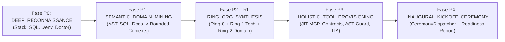

# 🏛️ R&D Cross-Review Roundtable: RFC-007 (Ciclo 7 & 7.2 — Brownfield Symbiosis, Autonomous Domain Expert Synthesis & Holistic Bootstrap)

- **Ceremony ID:** `CEREMONY-ARCHITECTURE_REVIEW_ROUNDTABLE-1793797010729`
- **Data:** `2026-11-04T13:50:00.000Z`
- **Moderatore (Chair):** R&D & Innovation Lead (`rnd_lead`)
- **Devil's Advocate / Red-Teamer Designato (RFC-005):** QA Lead (`qa_lead`)
- **Partecipanti:**
  - `cto` (Executive Orchestrator L1)
  - `rnd_lead` (Moderatore & Ricerca Metodologica L2)
  - `engineering_lead` (Architettura I/O, AST, Open-Ended Tech Synthesis & Toolchain L2)
  - `product_lead` (DevEx, Holistic Bootstrap Lifecycle & Backlog Preservation L2)
  - `qa_lead` (Devil's Advocate, Drift Detection, Domain Invariants & Gatekeeper L2)
  - `ai_lead` (Karpathy Context as RAM, Tri-Ring Role Ontology & Semantic Domain Miner L2)
  - `backend_lead` (Pydantic v2, SQL Introspection & Strangler Fig Adapter L2)
  - `mobile_lead` (Swift 6 Codable, Module Namespace & CodingKeys L2)

**Oggetto:** Sintesi delle interviste 1:1, ricerca stato dell'arte e dibattito con Devil's Advocate per la ratifica di `RFC-007-BROWNFIELD-SYMBIOSIS-AND-SMART-ADOPTION` (inclusa l'espansione **Ciclo 7.2**: *Autonomous Domain Expert Discovery/Synthesis, Active Runtime Ceremony Routing, 5-Phase Preparation Lifecycle & Holistic Library Bootstrap*).

---

## 🔬 1. Sintesi della Fase 1: Ricerca Stato dell'Arte & I 6 Pilastri Architetturali

In risposta alle due direttive strategiche del CEO:
1. *"non basta trovare i punti e definire i ticket. dobbiamo approfittare di questa prima analisi per portare i principi scoperti nella nostra libreria, capire quali sono le best practices per loro, analizzare le tecniche, fare ricerca."*
2. *"vorrei toccare maggiormente il punto degli esperti di dominio... come possiamo migliorare la library aggiungendo la possibilità di analizzare la repo e automaticamente creare degli esperti di dominio che interverranno poi successivamente nello sviluppo, nelle cerimonie ecc? quali sono le fasi di preparazione in cui si creano? e come può essere allargato il concetto di setup globale della library (quindi non solo a livello di esperti di dominio, ma in generale su tutti i tool necessari)?"*

Il Dipartimento R&D ha condotto uno studio comparativo sulle tecniche stato dell'arte (Projen/Chezmoi Managed Blocks, Aider RepoMap, Martin Fowler's Strangler Fig, DDD Bounded Context & Ubiquitous Language Mining via AST/Symbol Clustering, AutoAgents / Agent-Swarm Role Emergence):

---

### Pilastro 1: Non-Destructive Document & Config Grafting (`attachWorkspace`)
Abbiamo confrontato tre paradigmi:
1. **Managed Sentinel Blocks (stile Projen / Terraform / Chezmoi `modify_`):** Delimitatori commentati `<!-- AGENTIC-OS:MANAGED:START id="governance-kernel" sha256="<hash>" --> ... <!-- AGENTIC-OS:MANAGED:END -->` con *Tamper/Drift Detection* basata su `sha256`.
2. **Markdown AST Section Grafting (Parsing strutturale H1/H2/H3):** Preservazione al 100% dei capitoli di dominio esistenti (`## 🔬 Dipartimento Scientifico`, `Epic 0..5`, `TCK-0.1..TCK-4.2`) e scansione `docs/wiki/**/*` per impedire che documenti preesistenti diventino **Dark Memory**.
3. **Three-Way Merge (`diff3`):** Scartato come meccanismo primario perché può lasciare conflitti `<<<<<<<` che corrompono i prompt.
- **Tecnica Scelta:** **Hybrid AST Section Grafting + SHA-256 Managed Sentinel Blocks**.

---

### Pilastro 2: Tri-Ring Role Ontology & Autonomous Specialist Synthesis (Quando non bastano i template o non esiste `AGENTS.md`)

L'analisi del CEO ha centrato il limite fondamentale dei generatori statici:
- **Problema A (Tech Stack Non-Standard):** Se una repo usa tecnologie fuori dai 6 template statici (es. `PostgreSQL/PostGIS`, `Supabase`, `GraphQL`, `Solidity`, `CUDA/PyTorch`, `Elixir`, `Kubernetes/Terraform`, `Data Ingestion Pipelines`), i template predefiniti non bastano.
- **Problema B (Domain Experts Assenti nella Repo):** Nel 95% dei repository reali non esiste ancora un `AGENTS.md` con `medical_manager` o `nutrition_manager`. L'OS deve saper **inferire e sintetizzare autonomamente** gli esperti di dominio direttamente dal codice, dal database e dalla documentazione!

#### Soluzione Architetturale: Tri-Ring Role Ontology + Dual Emergence Engine
L'organigramma generato dall'OS viene formalizzato su **3 Anelli Concentrici** salvati in `.company-os/org-chart.json`:
1. **Ring-0 (Core Governance Kernel Leads):** Ruoli invarianti di sistema (`cto`, `engineering_lead`, `product_lead`, `qa_lead`, `ai_lead`, `rnd_lead`).
2. **Ring-1 (Stack & Infrastructure Leads — Catalog + Dynamic Tech Synthesizer):**
   - Include sia i Lead standard (`backend_manager`, `mobile_manager`, `frontend_manager`, `go_manager`, `rust_manager`) sia l'**Open-Ended Tech Specialist Synthesizer**:
   - *Come funziona:* Scansiona dipendenze (`requirements.txt`, `pyproject.toml`, `package.json`, `Cargo.toml`, `docker-compose.yml`), estensioni (`.sql`, `.graphql`, `.proto`, `.sol`, `.cu`) e cartelle infrastrutturali (`db/init/`, `k8s/`, `scripts/`). Quando rileva uno stack specializzato ad alto peso (es. `PostgreSQL + Dataset ETL` in `db/init/01-init.sql` e `scripts/`, o `PyTorch/CUDA`, o `Supabase`), sintetizza dinamicamente un ruolo L2/L3 dedicato (es. `data_database_specialist`) con **Micro Role Card (<150 token)**, regole tecniche specifiche e comando di verifica deterministico.
3. **Ring-2 (Business Domain Experts — Preserved + Semantic Domain & Bounded Context Miner):**
   - **Modalità 2A (Preservation):** Se esistono già ruoli in `AGENTS.md` o `.company-os/roles.json`, vengono preservati al 100%.
   - **Modalità 2B (Autonomous DDD Ubiquitous Language & Bounded Context Mining):** Anche se nella repo **non esiste alcun `AGENTS.md`**, il modulo **Semantic Domain Miner** estrae il *Linguaggio Ubiquo (Ubiquitous Language)* da 5 sorgenti del repository:
     1. *Classi, Funzioni e Simboli AST:* es. `MedicalCircuitBreaker`, `WorkoutGenerator`, `contraindications`, `filter_exercises` in `src/ai/decision_engine.py`.
     2. *Schemi Database & Tabelle SQL:* es. `CREATE TABLE exercises`, `muscles`, `equipments`, `users` in `db/init/01-init.sql`.
     3. *Modelli & Router API:* es. `Exercise`, `UserProfile`, `weight_kg`, `muscle_group` in `app/schemas.py` e `Exercise.swift`.
     4. *Topologia Cartelle & Dataset:* es. `src/ai/`, `dataset_raw/`, `docs/wiki/science/`.
     5. *Documentazione & Spec:* es. `rehab_protocols.md`, `nutrition_protocols.md`, `recommendation_algorithm.md`, `README.md`.
   - **Bounded Context Clustering:** Il Miner raggruppa i token semantici ad alta densità in **Bounded Contexts** distinti e sintetizza automaticamente gli **Inferred Domain Experts (Ring-2)**!
     - Esempio su `fitness_project` (anche ipotizzando zero `AGENTS.md` iniziale):
       * Trova `MedicalCircuitBreaker`, `contraindications`, `knee_injury`, `rehab_protocols.md` $\rightarrow$ Sintetizza **`medical_rehab_specialist`** (*Medical & Biomechanical Rehab Specialist*, scope: `["src/ai/decision_engine.py", "docs/wiki/science/rehab_protocols.md"]`, invariante: *"Zero esercizi controindicati su articolazioni infortunate"*).
       * Trova `nutrition_protocols.md`, `TDEE`, `macro`, `weight_kg` $\rightarrow$ Sintetizza **`nutrition_metabolic_specialist`** (*Clinical Nutrition & TDEE Specialist*, scope: `["docs/wiki/science/nutrition_protocols.md", "docs/wiki/product/epic2_nutrition_spec.md"]`).
       * Trova `WorkoutGenerator`, `recommendation_algorithm.md`, `src/ai/` $\rightarrow$ Sintetizza **`ai_coaching_specialist`** (*Adaptive AI Workout & RL Specialist*, scope: `["src/ai/", "docs/wiki/science/recommendation_algorithm.md"]`).

---

### Pilastro 3: Active Runtime Participation (Come gli Esperti Intervengono nello Sviluppo e nelle Cerimonie)

Un esperto di dominio sintetizzato **non è testo decorativo dentro `AGENTS.md`**, ma un agente operativo registrato nel runtime (`.company-os/org-chart.json`) con **Scope Glob Matching** e **Dynamic RACI Binding**:

1. **`BRAINSTORMING_KICKOFF` (Convocazione Context-Aware):**
   - `CeremonyDispatcher` interseca le parole chiave dell'iniziativa con i `domainKeywords` e `domainScope` di `.company-os/org-chart.json` e convoca automaticamente gli esperti Ring-1 e Ring-2 pertinenti al tavolo di kickoff.
2. **`BACKLOG_REFINEMENT_1ON1` (Co-Ownership e Criteri di Accettazione di Dominio):**
   - Quando un ticket (`TCK-X.Y`) tocca un file che ricade nel `domainScope` di uno specialista Ring-2 (es. `src/ai/decision_engine.py`), la matrice RACI dinamica assegna automaticamente lo specialista (`medical_rehab_specialist` / `ai_coaching_specialist`) come **Consulted/Responsible (`C`/`R`) obbligatorio**. Lo specialista inietta nel ticket le **Domain Invariants** (es. test obbligatorio che `knee_injury` escluda sempre `squat` e `lunges`).
3. **`ARCHITECTURE_REVIEW_ROUNDTABLE` & `ConsensusEngine` (Domain Devil's Advocate & Veto):**
   - Nelle Roundtable che toccano il suo Bounded Context, l'esperto di dominio assume il ruolo di **Domain Red-Teamer / Devil's Advocate**, con facoltà di sollevare `UNRESOLVED_BLOCKER` se una modifica viola un'invariante di dominio (es. rimozione del filtro `MedicalCircuitBreaker` o perdita di precisione nei calcoli TDEE).
4. **Sviluppo, Code Review & Gatekeeper (`Domain Invariant Verification`):**
   - Durante l'esecuzione del ticket, l'esperto Ring-2 valida che le `domainInvariants` e i test di dominio associati passino al 100% prima del merge.
5. **`SPRINT_RETROSPECTIVE` (Domain Drift Audit):**
   - A fine sprint, gli esperti Ring-2 verificano se il codice implementato ha introdotto *Domain Drift* rispetto alla documentazione in `docs/wiki/`.

---

### Pilastro 4: Il Ciclo di Vita di Preparazione a 5 Fasi ("Preparation & Onboarding Lifecycle")

Dove e quando vengono creati gli esperti e preparati tutti i tool? Nel nuovo ciclo di vita standardizzato di onboarding in **5 Fasi di Preparazione (`P0` .. `P4`)**, orchestrato quando la libreria viene inizializzata o agganciata a una repo (`bootstrap` / `attach`):

- **Fase P0 — `DEEP_RECONNAISSANCE` (Topologia, Stack & Hermetic Toolchain Audit):**
  - Esegue `detectProjectStack` (profondità 5, SQL, manifest annidati, entry point profondi) + `runEnvironmentDoctor` + risoluzione ermetica dei runner (`.venv/bin/pytest`).
- **Fase P1 — `SEMANTIC_DOMAIN_MINING` (Ubiquitous Language & Bounded Context Discovery):**
  - Scansiona simboli AST, tabelle SQL, modelli Pydantic/Swift/TS e documentazione per estrarre il glossario di dominio e i Bounded Contexts, oltre a leggere eventuali ruoli preesistenti in `AGENTS.md`.
- **Fase P2 — `TRI-RING_ORG_SYNTHESIS` (Sintesi Organigramma Tri-Ring & Smart-Merge):**
  - Compone i ruoli **Ring-0** (Core), **Ring-1** (Tech Leads da catalogo + sintetizzati per tech non-standard) e **Ring-2** (Domain Specialists preservati + inferiti dal Semantic Miner).
  - Salva il manifesto runtime `.company-os/org-chart.json` ed esegue lo **Smart-Merge non distruttivo** (`Managed Sentinel Blocks`) su `AGENTS.md` e `docs/wiki/INDEX.md`.
- **Fase P3 — `HOLISTIC_TOOLING_AND_GUARDRAIL_PROVISIONING` (Setup Globale di tutti i Tool):**
  - Configura automaticamente contratti, drift report, tool MCP dinamici JIT, invarianti AST Guard e profili Gatekeeper (vedi Pilastro 5).
- **Fase P4 — `INAUGURAL_ALIGNMENT_CEREMONY` (Cerimonia di Kickoff & Readiness Report):**
  - Convoca automaticamente tramite `CeremonyDispatcher` la cerimonia inaugurale `BRAINSTORMING_KICKOFF` con tutti i Lead Ring-0, Ring-1 e i nuovi Domain Specialists Ring-2, producendo il verbale in `.company-os/ceremonies/` e il certificato `.company-os/bootstrap-report.json`.

---

### Pilastro 5: Il Concetto Allargato di "Setup Globale della Libreria" (Holistic Workspace Provisioning)

Quando **Agentic Company OS** viene installato su una repository, il setup globale (`Fase P3`) non si limita a scrivere `AGENTS.md`, ma esegue il **Provisioning Olistico di 5 Sottosistemi Tecnici** in `.company-os/`:

1. **JIT MCP Domain Tool Pre-Synthesis (`.company-os/dynamic-tools/` — Connessione con Sprint 19):**
   - Analizzando le risorse della repo (es. dataset JSON in `dataset_raw/`, schemi SQL in `db/init/01-init.sql`, protocolli clinici in `docs/wiki/science/`), l'OS individua i **Capability Gaps di Dominio** e pre-sintetizza micro-tool MCP su misura per il repository (es. `tool_dyn_sql_pydantic_parity_checker` o `tool_dyn_medical_contraindication_validator`), collaudandoli nella Worker Sandbox prima ancora che inizi il primo sprint!
2. **Contract Introspection, `.company-os/contracts.json` & Semantic Drift Baseline:**
   - Estrae o carica i contratti cross-domain, salva `.company-os/contracts.json`, esegue il **Semantic Drift Detector** tra DB (`01-init.sql`), Backend (`app/schemas.py`) e Mobile (`Exercise.swift`), e predispone il **Strangler Fig Bridge**.
3. **Domain-Aware AST Guard & Context Compactor Invariants (`.company-os/invariants.json`):**
   - Registra automaticamente i `criticalDomainPaths` (es. `src/ai/decision_engine.py`, `db/init/01-init.sql`, `docs/wiki/science/rehab_protocols.md`) e le `domainInvariants` estratte nella Fase P1, così che l'`AST Diff Guard` e il `ContextCompactor` (Sprint 10) non permettano mai la rimozione accidentale di un guardrail di dominio (es. `MedicalCircuitBreaker`) né la perdita dei suoi puntatori durante la compattazione della RAM.
4. **Hermetic Gatekeeper & Test Impact Analysis (TIA) Baseline (`.company-os/gatekeeper.json`):**
   - Registra i comandi di test ermetici risolti (`.venv/bin/pytest`, `swift test`), indicizza il grafo delle dipendenze per il `TIA` (<400ms inner loop) e pre-configura la quarantena flaky test ($N=3$).
5. **FinOps & Prefix Caching Kernel Seal (`.company-os/finops-config.json`):**
   - Configura il `BudgetWatchdog` e sigilla l'hash SHA-256 del Tier-1 Prompt Cache Kernel insieme alle Micro Role Cards (<150 token) dei nuovi esperti Ring-1 e Ring-2.

---

## 🗣️ 2. Sintesi delle Interviste 1:1 Estese (`Ciclo 7.2`)

- **`ai_lead`:** "Il **Semantic Domain & Bounded Context Miner** risolve il problema dell'uovo e della gallina: anche se una repo non ha mai sentito parlare di Agentic Company OS e non ha un `AGENTS.md`, il Miner legge `MedicalCircuitBreaker` in Python, `exercises` in SQL e `rehab_protocols.md` nella wiki e capisce autonomamente che serve un `medical_rehab_specialist` Ring-2 con invarianti biomeccaniche precise."
- **`engineering_lead`:** "L'**Open-Ended Tech Specialist Synthesizer** supera qualsiasi limite dei template statici: se domani agganciamo una repo con `PostGIS`, `GraphQL` o `CUDA`, l'OS sintetizza una Micro Role Card L2 dedicata senza dover ricompilare la libreria. E il **Setup Globale in 5 Fasi (`P0..P4`)** cabla automaticamente anche i tool MCP dinamici dello Sprint 19, l'AST Guard e i runner `.venv`."
- **`product_lead`:** "Rendere gli esperti di dominio cittadini attivi in `CeremonyDispatcher` (Kickoff, Refinement 1:1 sui file del loro `domainScope`, Roundtable e Retrospettiva) significa che gli esperti generati guidano davvero l'evoluzione del prodotto a ogni sprint."
- **`qa_lead` (Devil's Advocate):** "Ho verificato il rischio di *Role Explosion* (generare 30 micro-esperti inutili su una repo grande). La contromisura approvata è un **Hard Cap di Clustering (max 4-5 Bounded Context Specialists Ring-2)** basato su densità semantica minima e ancoraggio fisico obbligatorio a file reali (`domainScope` verificato su disco)."

---

## 🤝 3. Convergenza Finale Roundtable (`CONSENSUS_REACHED`)

Tutti i 7 Lead approvano all'unanimità l'espansione **Ciclo 7.2** di `RFC-007` e del dossier Spike `sprint-17-5-validation.md`.
